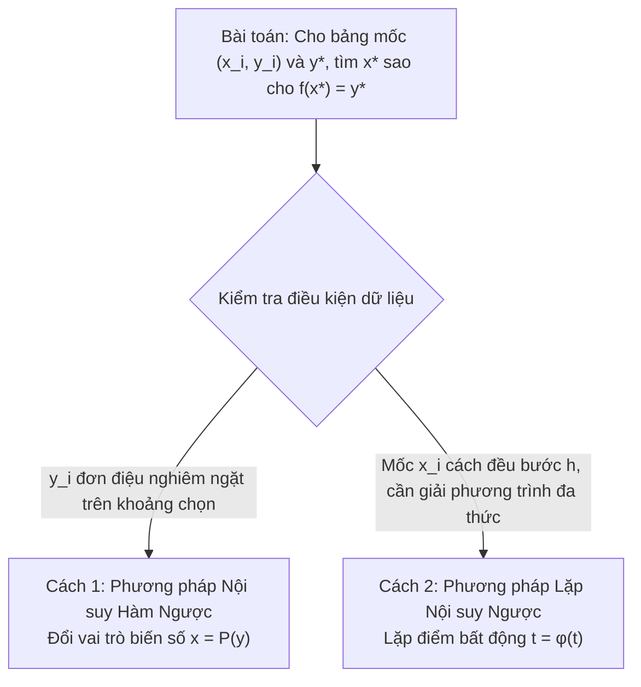

# TỔNG HỢP THUẬT TOÁN PHƯƠNG PHÁP SỐ CHUYÊN SÂU
### (Sổ tay thuật toán chuẩn hóa, tối ưu hóa từng bước lặp và hướng dẫn triển khai)

---

## MỤC LỤC TỔNG QUAN

1. [Sơ đồ Horner & Horner Lặp (Giá trị, Đạo hàm các cấp & Khai triển Taylor)](#1-sơ-đồ-horner--horner-lặp)
2. [Mốc nội suy tối ưu Chebyshev](#2-mốc-nội-suy-tối-ưu-chebyshev)
3. [Đa thức nội suy Lagrange (Mốc bất kỳ)](#3-đa-thức-nội-suy-lagrange-mốc-bất-kỳ)
4. [Đa thức nội suy Newton tỷ sai phân & Nhân lồng Horner](#4-đa-thức-nội-suy-newton-tỷ-sai-phân-mốc-bất-kỳ)
5. [Đa thức nội suy Newton sai phân hữu hạn (Mốc cách đều: Tiến & Lùi)](#5-đa-thức-nội-suy-newton-sai-phân-hữu-hạn-mốc-cách-đều)
6. [Đa thức nội suy trung tâm: Gauss I, Gauss II, Stirling và Bessel](#6-đa-thức-nội-suy-trung-tâm-gauss-stirling-bessel)
7. [Phương pháp Nội suy ngược (Hàm ngược & Phương pháp lặp $t = \varphi(t)$)](#7-phương-pháp-nội-suy-ngược)
8. [Hàm ghép trơn Spline & Thuật toán Thomas (TDMA giải hệ 3 đường chéo)](#8-hàm-ghép-trơn-spline--thuật-toán-thomas-tdma)
9. [Phương pháp Bình phương tối thiểu (Mô hình Tuyến tính & Phi tuyến)](#9-phương-pháp-bình-phương-tối-thiểu-least-squares)
10. [Thuật toán sơ lược theo từng phương pháp](#10-thuật-toán-sơ-lược-theo-từng-phương-pháp)
11. [Bảng tổng hợp so sánh các thuật toán](#11-bảng-tổng-hợp-so-sánh-các-thuật-toán)

---

## 1. Sơ đồ Horner & Horner Lặp

### 1.1. Bài toán và Tham số
- **Đầu vào (Input):**
  - Mảng hệ số của đa thức bậc $N$: $P(x) = a_N x^N + a_{N-1} x^{N-1} + \dots + a_1 x + a_0$.
  - Điểm đánh giá: $x = c$.
  - Cấp đạo hàm cần tính: $k$ ($0 \le k \le N$), nếu yêu cầu tính đạo hàm.
- **Đầu ra (Output):**
  - Giá trị đa thức $P(c)$.
  - Đa thức thương $Q(x)$ khi chia $P(x)$ cho $(x - c)$.
  - Giá trị đạo hàm cấp $k$: $P^{(k)}(c)$.

---

### 1.2. Thuật toán Horner tính giá trị $P(c)$

```text
Thuật toán Horner_Tinh_Gia_Tri(a, N, c):
Đầu vào:
   - a[0..N]: hệ số theo lũy thừa giảm dần,
     P(x) = a[0]*x^N + a[1]*x^(N-1) + ... + a[N]
   - Điểm cần tính c
Đầu ra:
   - Giá trị P(c)

1. p = a[0]
2. Với i từ 1 đến N:
      p = p * c + a[i]
3. Trả về p
```

### 1.3. Thuật toán Horner tìm đa thức thương khi chia cho $(x-c)$

```text
Thuật toán Horner_Tim_Thuong(a, N, c):
Đầu vào:
   - a[0..N]: hệ số theo lũy thừa giảm dần của đa thức P bậc N
   - Điểm chia c
Đầu ra:
   - Hệ số q[0..N-1] của thương Q(x), theo lũy thừa giảm dần
   - Số dư r = P(c)

1. Nếu N = 0:
      q = mảng rỗng
      r = a[0]
      Trả về q, r

2. Khởi tạo mảng q[0..N-1]:
      q[0] = a[0]

3. Với i từ 1 đến N - 1:
      q[i] = a[i] + c * q[i - 1]

4. Tính số dư:
      r = a[N] + c * q[N - 1]

5. Trả về q, r
   (P(x) = (x - c) * Q(x) + r)
```

### 1.4. Thuật toán Horner tính đạo hàm cấp $k$ tại $c$

```text
Thuật toán Horner_Tinh_Dao_Ham(a, N, c, k):
Đầu vào:
   - a[0..N]: hệ số theo lũy thừa giảm dần của đa thức P bậc N
   - Điểm đánh giá c
   - Cấp đạo hàm k, với 0 <= k <= N
Đầu ra:
   - Giá trị P^(k)(c)

1. Nếu k < 0 hoặc k > N thì báo lỗi cấp đạo hàm không hợp lệ.

2. Khởi tạo:
      D[0] = a[0]                 // Đang xây dựng đa thức bằng Horner
      Với j từ 1 đến k:
            D[j] = 0

3. Với i từ 1 đến N:
      Với j từ min(i, k) giảm dần về 1:
            D[j] = c * D[j] + j * D[j - 1]
      D[0] = c * D[0] + a[i]

4. Trả về D[k]
   (Sau mỗi bước, D[j] lưu đạo hàm cấp j của đa thức Horner hiện tại
    tại c; do đó không cần nhân thêm k!.)
```

### 1.5. Thuật toán Horner khai triển Taylor tại $c$

```text
Thuật toán Horner_Khai_Trien_Taylor(a, N, c):
Đầu vào:
   - a[0..N]: hệ số theo lũy thừa giảm dần của đa thức
     P(x) = a[0]*x^N + a[1]*x^(N-1) + ... + a[N]
   - Tâm khai triển c
Đầu ra:
   - Taylor_Coeff[0..N] = [b_0, b_1, ..., b_N], sao cho
     P(x) = b_0 + b_1*(x-c) + ... + b_N*(x-c)^N
   - Tương đương b_m = P^(m)(c) / m!

1. q = copy(a)
   Taylor_Coeff = mảng kích thước N + 1

2. Với m từ 0 đến N:
      degree = N - m

      // Chia đa thức hiện tại q cho (x - c) bằng Horner.
      // Các hệ số q đang được lưu theo lũy thừa giảm dần.
      Với i từ 1 đến degree:
            q[i] = q[i] + c * q[i - 1]

      rem = q[degree]
      Taylor_Coeff[m] = rem

      // Thương trở thành đa thức cần chia ở lượt kế tiếp.
      Nếu degree > 0:
            q = [q[0], q[1], ..., q[degree - 1]]

3. Trả về Taylor_Coeff
   (P^(m)(c) = m! * Taylor_Coeff[m], nếu cần các đạo hàm.)
```

### 1.6. Đánh giá kỹ thuật & Lưu ý thực hành

| Thuật toán | Độ phức tạp thời gian | Độ phức tạp không gian |
| :--- | :--- | :--- |
| **Tính $P(c)$** | $O(N)$ | $O(1)$ |
| **Tìm thương và số dư** | $O(N)$ | $O(N)$ để lưu các hệ số thương |
| **Tính đạo hàm cấp $k$** | $O(Nk)$ | $O(k)$ |
| **Khai triển Taylor đến bậc $N$** | $O(N^2)$ | $O(N)$ |

> [!WARNING]
> **Bẫy thứ tự hệ số đầu vào:**  
> Mảng $a$ bắt buộc phải được sắp xếp theo **lũy thừa giảm dần** từ bậc cao nhất $a_N$ về $a_0$. Nếu đa thức bị khuyết bất kỳ số hạng nào (ví dụ $P(x) = 2x^3 + 5x - 3$ khuyết $x^2$), bắt buộc phải chèn hệ số $0$ vào đúng vị trí tương ứng (`a = [2, 0, 5, -3]`), nếu không kết quả nhân cộng dồn sẽ sai lệch hoàn toàn.

---

## 2. Mốc nội suy tối ưu Chebyshev

### 2.1. Bài toán và Ý nghĩa
- **Hiện tượng Runge:** Khi số mốc nội suy cách đều $n$ tăng cao, đa thức nội suy $P_n(x)$ bị dao động dữ dội ở hai đầu mút khoảng $[a, b]$, khiến sai số cực đại $\max |f(x) - P_n(x)| \to \infty$.
- **Giải pháp mốc Chebyshev:** Chọn các mốc $x_k$ là nghiệm của đa thức Chebyshev loại I $T_{n+1}(x) = \cos((n+1)\arccos x)$ trên $[-1, 1]$, sau đó ánh xạ tuyến tính về $[a, b]$. Phân bố mốc sẽ dày đặc ở hai đầu mút và thưa ở giữa, giúp cực tiểu hóa sai số lớn nhất (Minimax Error).

---

### 2.2. Công thức xác định mốc

Với đa thức nội suy bậc $n$, dùng $n+1$ nghiệm Chebyshev trên đoạn chuẩn $[-1,1]$:
$$t_i = \cos\left(\frac{(2i+1)\pi}{2(n+1)}\right), \quad i=0,1,\dots,n.$$
Ánh xạ tuyến tính các nghiệm sang đoạn $[a,b]$:
$$x_i = x_{\text{mid}} + r t_i,\quad x_{\text{mid}}=\frac{a+b}{2},\quad r=\frac{b-a}{2}.$$

---

### 2.3. Cấu trúc Input & Output
- **Đầu vào:** Hai đầu mút $a < b$ và bậc đa thức $n \ge 0$.
- **Đầu ra:** Mảng $x[0..n]$ gồm $n+1$ mốc Chebyshev trong $[a,b]$, thường được sắp xếp tăng dần.

---

### 2.4. Thuật toán chi tiết từng bước

```text
Thuật toán Sinh_Moc_Chebyshev(a, b, n):
Đầu vào: Đoạn [a, b] với a < b; bậc đa thức n >= 0
Đầu ra: Mảng các mốc nội suy tối ưu x = [x_0, x_1, ..., x_n]

1. Nếu a >= b hoặc n < 0 thì báo lỗi đầu vào không hợp lệ.

2. Tính trung điểm và bán kính khoảng:
      x_mid = (a + b) / 2
      r = (b - a) / 2

3. Khởi tạo mảng x có kích thước (n + 1)

4. VÒNG LẶP i từ 0 đến n:
      // Tính nghiệm trên đoạn chuẩn [-1, 1]:
      t_i = cos(((2 * i + 1) * PI) / (2 * (n + 1)))
      
      // Ánh xạ tuyến tính sang đoạn [a, b]:
      x[i] = x_mid + r * t_i

5. Sắp xếp mảng x theo thứ tự tăng dần nếu cần dùng làm bảng mốc.
6. Trả về mảng x
```

- **Đánh giá sai số chặn trên:**
  $$\max_{x \in [a, b]} |f(x) - P_n(x)| \le \frac{M_{n+1}}{(n+1)! \cdot 2^n} \left(\frac{b - a}{2}\right)^{n+1} \quad \text{với } M_{n+1} = \max_{x \in [a, b]} |f^{(n+1)}(x)|$$

---

## 3. Đa thức nội suy Lagrange (Mốc bất kỳ)

### 3.1. Bài toán
Cho tập $(n+1)$ mốc đôi một khác nhau: $(x_0, y_0), (x_1, y_1), \dots, (x_n, y_n)$.  
Xây dựng đa thức $L_n(x) = \sum_{i=0}^n y_i l_i(x)$ bậc không quá $n$ thỏa mãn $L_n(x_i) = y_i$.

Trong đó, đa thức cơ bản Lagrange thứ $i$ có dạng:
$$l_i(x) = \frac{\prod_{j \ne i} (x - x_j)}{\prod_{j \ne i} (x_i - x_j)} = \frac{w_i(x)}{D_i}$$

---

### 3.2. Thuật toán chi tiết trong 1 cell (Tính giá trị trực tiếp & Xây dựng ĐTNS chính tắc qua Horner)

```text
Thuật toán Noi_Suy_Lagrange_Toan_Dien(X, Y, n, eval_x):
Đầu vào:
   - Mảng hoành độ X[0..n] (các mốc đôi một khác nhau)
   - Mảng tung độ Y[0..n]
   - Bậc đa thức n
   - Điểm đánh giá eval_x
Đầu ra:
   - Giá trị nội suy L_n(eval_x)
   - Vector hệ số đa thức chính tắc P[0..n] = [a_n, a_{n-1}, ..., a_0]
     sao cho L_n(x) = sum từ k=0 đến n của P[k] * x^(n-k)

PHẦN 1: TÍNH TRỰC TIẾP GIÁ TRỊ L_n(eval_x) THEO ĐA THỨC CƠ BẢN
      tong_L = 0.0
      VÒNG LẶP NGOÀI i từ 0 đến n:
            tu_so = 1.0
            mau_so = 1.0
            VÒNG LẶP TRONG j từ 0 đến n:
                  NẾU j != i THÌ:
                        tu_so = tu_so * (eval_x - X[j])
                        mau_so = mau_so * (X[i] - X[j])
            
            l_i = tu_so / mau_so
            tong_L = tong_L + Y[i] * l_i

PHẦN 2: XÂY DỰNG ĐA THỨC CHÍNH TẮC QUA ĐA THỨC TÍCH VÀ CHIA HORNER
      // Bước 2.1: Tính đa thức tích toàn phần omega(x) = prod(x - X_j) bậc n + 1
      omega = [1.0]                     // Khởi tạo đa thức bậc 0
      VÒNG LẶP j từ 0 đến n:
            omega = convolve(omega, [1.0, -X[j]])   // Nhân thêm (x - X_j)
      
      // Bước 2.2: Khởi tạo vector đa thức chính tắc tổng hợp P kích thước n + 1 toàn số 0
      P = mảng kích thước (n + 1) chứa 0.0
      
      // Bước 2.3: Hạ bậc bằng sơ đồ Horner chia omega(x) cho (x - X_i)
      VÒNG LẶP NGOÀI i từ 0 đến n:
            // Tính đa thức thương w_i(x) = omega(x) / (x - X_i) bậc n
            w_i = mảng kích thước (n + 1)
            w_i[0] = omega[0]           // Hệ số x^n
            VÒNG LẶP TRONG k từ 1 đến n:
                  w_i[k] = omega[k] + X[i] * w_i[k - 1]
            
            // Tính mẫu số D_i = prod_{j != i} (X_i - X_j)
            D_i = 1.0
            VÒNG LẶP TRONG j từ 0 đến n:
                  NẾU j != i THÌ:
                        D_i = D_i * (X[i] - X[j])
            
            // Hệ số trọng số của mốc i: weight_i = Y[i] / D_i
            weight_i = Y[i] / D_i
            
            // Cộng dồn vào vector đa thức chính tắc: P = P + weight_i * w_i
            VÒNG LẶP TRONG k từ 0 đến n:
                  P[k] = P[k] + weight_i * w_i[k]

PHẦN 3: TRẢ VỀ KẾT QUẢ
      Trả về: tong_L (giá trị tại eval_x) và P (vector hệ số [a_n, ..., a_0])
```

- **Độ phức tạp:**
  - Tính 1 điểm $L_n(x^*)$: $O(n^2)$ phép toán.
  - Xây dựng dạng biểu thức chính tắc $L_n(x) = \sum c_k x^k$: $O(n^2)$ phép toán qua đa thức $\omega(x)$ và phép chia Horner hạ bậc.

---

## 4. Đa thức nội suy Newton tỷ sai phân (Mốc bất kỳ)

### 4.1. Bài toán và Hai dạng công thức (Tiến & Lùi)
Cho $(n+1)$ mốc bất kỳ $(x_i, y_i)_{i=0}^n$ (các mốc $x_i$ đôi một khác nhau, không cần cách đều).

#### A. Định nghĩa tỷ sai phân (Divided Differences)
- Tỷ sai phân cấp 0: $f[x_i] = y_i$.
- Tỷ sai phân cấp $k$ tính đệ quy từ cấp $k-1$:
  $$f[x_i, x_{i+1}, \dots, x_{i+k}] = \frac{f[x_{i+1}, \dots, x_{i+k}] - f[x_i, \dots, x_{i+k-1}]}{x_{i+k} - x_i}$$

#### B. Đa thức Newton Tiến (Forward - Xuất phát từ $x_0$)
Lấy các hệ số theo **đường chéo trên** của bảng tỷ sai phân:
$$P_n(x) = f[x_0] + f[x_0, x_1](x - x_0) + f[x_0, x_1, x_2](x - x_0)(x - x_1) + \dots + f[x_0, \dots, x_n]\prod_{j=0}^{n-1}(x - x_j)$$
Vector hệ số nội suy tiến:
$$C_{\text{tiến}} = \big(f[x_0], \; f[x_0, x_1], \; f[x_0, x_1, x_2], \; \dots, \; f[x_0, \dots, x_n]\big)$$

#### C. Đa thức Newton Lùi (Backward - Xuất phát từ $x_n$)
Lấy các hệ số theo **đường chéo dưới** (phần tử cuối mỗi cột) của bảng tỷ sai phân:
$$P_n(x) = f[x_n] + f[x_{n-1}, x_n](x - x_n) + f[x_{n-2}, x_{n-1}, x_n](x - x_n)(x - x_{n-1}) + \dots + f[x_0, \dots, x_n]\prod_{j=1}^{n}(x - x_j)$$
Vector hệ số nội suy lùi:
$$C_{\text{lùi}} = \big(f[x_n], \; f[x_{n-1}, x_n], \; f[x_{n-2}, \dots, x_n], \; \dots, \; f[x_0, \dots, x_n]\big)$$

> **Định lý duy nhất:** Đa thức nội suy đi qua $(n+1)$ điểm là DUY NHẤT. Dạng Newton Tiến và Newton Lùi khi khai triển và thu gọn đều cho ra **cùng một đa thức chính tắc $P(x) = \sum a_k x^k$**.

---

### 4.2. Thuật toán Newton tiến và Newton lùi

#### A. Newton tiến trong 1 cell

```text
Thuật toán Noi_Suy_Newton_Tien(X, Y, n, eval_x):
Đầu vào:
   - X[0..n]: các mốc đôi một khác nhau
   - Y[0..n]: giá trị tại các mốc
   - Bậc đa thức n >= 0
   - Điểm cần nội suy eval_x
Đầu ra:
   - Bảng tỷ sai phân F
   - Vector hệ số Newton tiến C_tien[0..n]
   - Giá trị nội suy P_tien(eval_x)

1. Nếu độ dài X hoặc Y khác n + 1, hoặc có hai mốc X trùng nhau,
   báo lỗi đầu vào không hợp lệ.

2. Khởi tạo ma trận F kích thước (n + 1) x (n + 1).
   Với i từ 0 đến n:
      F[i, 0] = Y[i]

3. Lập bảng tỷ sai phân:
   Với j từ 1 đến n:
      Với i từ 0 đến n - j:
         F[i, j] = (F[i + 1, j - 1] - F[i, j - 1])
                   / (X[i + j] - X[i])

4. Trích hệ số Newton tiến từ hàng đầu tiên:
   Với j từ 0 đến n:
      C_tien[j] = F[0, j]

5. Tính giá trị bằng nhân lồng Horner:
   val = C_tien[n]
   Với k từ n - 1 giảm dần về 0:
      val = val * (eval_x - X[k]) + C_tien[k]

6. Trả về F, C_tien, val
```

#### B. Newton lùi trong 1 cell

```text
Thuật toán Noi_Suy_Newton_Lui(X, Y, n, eval_x):
Đầu vào:
   - X[0..n]: các mốc đôi một khác nhau
   - Y[0..n]: giá trị tại các mốc
   - Bậc đa thức n >= 0
   - Điểm cần nội suy eval_x
Đầu ra:
   - Bảng tỷ sai phân F
   - Vector hệ số Newton lùi C_lui[0..n]
   - Giá trị nội suy P_lui(eval_x)

1. Nếu độ dài X hoặc Y khác n + 1, hoặc có hai mốc X trùng nhau,
   báo lỗi đầu vào không hợp lệ.

2. Khởi tạo ma trận F kích thước (n + 1) x (n + 1).
   Với i từ 0 đến n:
      F[i, 0] = Y[i]

3. Lập bảng tỷ sai phân:
   Với j từ 1 đến n:
      Với i từ 0 đến n - j:
         F[i, j] = (F[i + 1, j - 1] - F[i, j - 1])
                   / (X[i + j] - X[i])

4. Trích hệ số Newton lùi từ đáy mỗi cột:
   Với j từ 0 đến n:
      C_lui[j] = F[n - j, j]

5. Tính giá trị bằng nhân lồng Horner:
   val = C_lui[n]
   Với k từ n - 1 giảm dần về 0:
      val = val * (eval_x - X[n - k]) + C_lui[k]

6. Trả về F, C_lui, val
```

---

### 4.3. Đánh giá kỹ thuật & Phân tích so sánh Tiến - Lùi

| Tiêu chí so sánh | Đa thức Newton Tiến (Forward) | Đa thức Newton Lùi (Backward) |
| :--- | :--- | :--- |
| **Hệ số tỷ sai phân** | Hàng đầu tiên: $C_{\text{tiến}}[j] = F[0, j]$ | Đáy mỗi cột: $C_{\text{lùi}}[j] = F[n-j, j]$ |
| **Đa thức cơ sở** | $B_i(x) = \prod_{k=0}^{i-1} (x - x_k)$ | $B_i(x) = \prod_{k=0}^{i-1} (x - x_{n-k})$ |
| **Ưu tiên sử dụng** | Khi $x^*$ nằm ở **nửa đầu** bảng dữ liệu | Khi $x^*$ nằm ở **nửa sau** bảng dữ liệu |
| **Tính duy nhất của ĐTNS** | Khi khai triển về chính tắc, Tiến và Lùi đều cho ra **cùng một đa thức duy nhất** $P(x) = \sum a_k x^k$ |
| **Bổ sung mốc mới** | Dễ dàng thêm mốc mới vào cuối mảng trong $O(n)$ phép tính mà không cần tính lại từ đầu |

> [!TIP]
> **Tối ưu hóa tính giá trị $P(x^*)$ trong $O(n)$:**  
> Không nên khai triển thành đa thức tường minh $P(x) = \sum a_k x^k$ rồi mới thay $x^*$ (dễ bị sai số làm tròn khi bậc cao). Thay vào đó, hãy luôn sử dụng **thuật toán nhân lồng Horner** trực tiếp trên vector hệ số $C$ để đạt độ chính xác tối đa và tốc độ $O(n)$.

---

## 5. Đa thức nội suy Newton sai phân hữu hạn (Mốc cách đều)

### 5.1. Định nghĩa và Bảng sai phân hữu hạn
Cho $x_i = x_0 + i \cdot h$ ($h = \text{const}$).
- **Sai phân tiến:** $\Delta y_i = y_{i+1} - y_i$, $\Delta^j y_i = \Delta^{j-1} y_{i+1} - \Delta^{j-1} y_i$.
- **Sai phân lùi:** $\nabla y_i = y_i - y_{i-1}$, $\nabla^j y_i = \nabla^{j-1} y_i - \nabla^{j-1} y_{i-1}$ (Quan hệ: $\nabla^j y_n = \Delta^j y_{n-j}$).

---

### 5.2. Thuật toán chi tiết trong 1 cell (Toàn bộ quy trình Sai phân hữu hạn, biến chuẩn hóa t và Newton Tiến / Lùi)

```text
Thuật toán Noi_Suy_Newton_Sai_Phan_Huu_Han_Toan_Dien(X, Y, n, eval_x, Huong):
Đầu vào:
   - Mảng hoành độ X[0..n] (cách đều nhau với bước h = X[1] - X[0])
   - Mảng tung độ Y[0..n]
   - Bậc đa thức n
   - Điểm đánh giá eval_x
   - Hướng nội suy Huong ("TIEN" hoặc "LUI" hoặc "TU_DONG")
Đầu ra:
   - Ma trận sai phân hữu hạn D[(n+1) x (n+1)]
   - Biến chuẩn hóa t (hoặc t_b)
   - Giá trị nội suy P(eval_x)
   - Vector hệ số đa thức theo biến chuẩn hóa t: Poly_t[0..n]

================================================================================
BƯỚC 1: KIỂM TRA BƯỚC CÁCH ĐỀU h VÀ LẬP BẢNG SAI PHÂN HỮU HẠN D
================================================================================
1. Kiểm tra n >= 1, độ dài X và Y đều bằng n + 1.
   Nếu không đúng, báo lỗi và dừng.
2. Tính bước cách đều: h = X[1] - X[0]
   Nếu h = 0, báo lỗi và dừng.
   tol_h = 1e-10 * max(1, |X[0]|, |X[n]|, |h|)
   Với i từ 1 đến n - 1:
         Nếu |(X[i + 1] - X[i]) - h| > tol_h:
               báo lỗi "Các mốc X không cách đều" và dừng.
3. Khởi tạo ma trận D kích thước (n + 1) x (n + 1) chứa số 0 (hoặc NaN)
4. Gán cột 0: D[i, 0] = Y[i] với mọi i = 0..n

5. VÒNG LẶP NGOÀI j từ 1 đến n:        // j là cấp sai phân (cột)
      VÒNG LẶP TRONG i từ 0 đến (n - j): // i là hàng
            D[i, j] = D[i + 1, j - 1] - D[i, j - 1]

================================================================================
BƯỚC 2: XÁC ĐỊNH HƯỚNG NỘI SUY VÀ TÍNH BIẾN CHUẨN HÓA t
================================================================================
6. NẾU Huong == "TU_DONG" THÌ:
      x_mid = (X[0] + X[n]) / 2.0
      Huong = (eval_x <= x_mid) ? "TIEN" : "LUI"

================================================================================
BƯỚC 3: TÍNH GIÁ TRỊ NỘI SUY THEO CÔNG THỨC TIẾN HOẶC LÙI
================================================================================
7. NẾU Huong == "TIEN" THÌ:
      // Điểm mốc gốc x_0 ở đầu bảng:
      t = (eval_x - X[0]) / h
      val = D[0, 0]                     // y_0
      t_prod = 1.0
      fact = 1.0
      
      VÒNG LẶP j từ 1 đến n:
            t_prod = t_prod * (t - (j - 1))
            fact = fact * j
            val = val + (D[0, j] / fact) * t_prod

8. NẾU Huong == "LUI" THÌ:
      // Điểm mốc gốc x_n ở cuối bảng:
      t_b = (eval_x - X[n]) / h          // t_b <= 0 khi eval_x nằm giữa X[0] và X[n]
      val = D[n, 0]                     // y_n
      t_prod = 1.0
      fact = 1.0
      
      VÒNG LẶP j từ 1 đến n:
            t_prod = t_prod * (t_b + (j - 1))
            fact = fact * j
            // Lưu ý: Sai phân lùi nabla^j y_n chính là phần tử D[n - j, j]
            val = val + (D[n - j, j] / fact) * t_prod

================================================================================
BƯỚC 4: LẬP BẢNG TÍCH THEO BIẾN t VÀ TỔNG HỢP HỆ SỐ ĐA THỨC THEO t
================================================================================
9. Khởi tạo danh sách đa thức cơ sở T_list gồm (n + 1) đa thức:
      T_list[0] = [1.0]
      VÒNG LẶP j từ 1 đến n:
            NẾU Huong == "TIEN":
                  T_list[j] = convolve(T_list[j - 1], [1.0, -(j - 1)])
            NGƯỢC LẠI:
                  T_list[j] = convolve(T_list[j - 1], [1.0, +(j - 1)])

10. Khởi tạo vector Poly_t kích thước (n + 1) chứa 0.0:
      fact = 1.0
      VÒNG LẶP j từ 0 đến n:
            NẾU j > 0: fact = fact * j
            coeff = (Huong == "TIEN") ? (D[0, j] / fact) : (D[n - j, j] / fact)
            
            len_p = độ dài T_list[j]
            offset = (n + 1) - len_p
            VÒNG LẶP k từ 0 đến len_p - 1:
                  Poly_t[offset + k] = Poly_t[offset + k] + coeff * T_list[j][k]

11. Trả về: Ma trận sai phân D, giá trị val (tại eval_x), biến t, vector Poly_t
```

---

## 6. Đa thức nội suy trung tâm (Gauss, Stirling, Bessel)

### 6.1. Nguyên lý và Trích xuất mốc đối xứng
Khi điểm nội suy $x^*$ nằm ở khoảng giữa bảng dữ liệu, các công thức nội suy trung tâm hội tụ nhanh nhất và cho sai số nhỏ nhất.

- **Chuyển đổi chỉ số mảng:**
  - Chọn $x_0$ gần $x^*$ nhất. Bước $h = x_1 - x_0$. Đặt $t = \frac{x^* - x_0}{h}$ ($|t| \le 0.5$).
  - Đối với $2N+1$ mốc (Gauss, Stirling): Lấy $\{x_{-N}, \dots, x_0, \dots, x_N\}$.
  - Trong bộ nhớ mảng Python/C (chỉ số $0 \dots 2N$), mốc $x_k$ tương ứng với phần tử có chỉ số mảng `idx = k + N`.

---

### 6.2. Sơ đồ bước lặp Ziczac của Gauss I và Gauss II

```text
       y_{-1} --------> Δy_{-1} -------> Δ²y_{-1} ------> Δ³y_{-2} ...
               \      /          \      /          \
                y_0 ------------> Δy_0 -----------> Δ²y_0 ...
```
- **Gauss I (Đường ziczac xuống trước):**
  $$y_0 \xrightarrow{\text{xuống}} \Delta y_0 \xrightarrow{\text{lên}} \Delta^2 y_{-1} \xrightarrow{\text{xuống}} \Delta^3 y_{-1} \xrightarrow{\text{lên}} \Delta^4 y_{-2} \dots$$
  $$P(t) = y_0 + t\Delta y_0 + \frac{t(t-1)}{2!} \Delta^2 y_{-1} + \frac{(t+1)t(t-1)}{3!} \Delta^3 y_{-1} + \frac{(t+1)t(t-1)(t-2)}{4!} \Delta^4 y_{-2} + \dots$$

- **Gauss II (Đường ziczac lên trước):**
  $$y_0 \xrightarrow{\text{lên}} \Delta y_{-1} \xrightarrow{\text{xuống}} \Delta^2 y_{-1} \xrightarrow{\text{lên}} \Delta^3 y_{-2} \xrightarrow{\text{xuống}} \Delta^4 y_{-2} \dots$$
  $$P(t) = y_0 + t\Delta y_{-1} + \frac{(t+1)t}{2!} \Delta^2 y_{-1} + \frac{(t+1)t(t-1)}{3!} \Delta^3 y_{-2} + \frac{(t+2)(t+1)t(t-1)}{4!} \Delta^4 y_{-2} + \dots$$

- **Stirling (Trung bình cộng Gauss I & II - Khi $|t| \le 0.25$):**
  $$P(t) = y_0 + t \left(\frac{\Delta y_{-1} + \Delta y_0}{2}\right) + \frac{t^2}{2!} \Delta^2 y_{-1} + \frac{t(t^2 - 1^2)}{3!} \left(\frac{\Delta^3 y_{-2} + \Delta^3 y_{-1}}{2}\right) + \frac{t^2(t^2 - 1^2)}{4!} \Delta^4 y_{-2} + \dots$$

- **Bessel (Số mốc chẵn $2N$, đặt $t = \frac{x - (x_0 + x_1)/2}{h}$, với $x_0, x_1$ là cặp mốc trung tâm; công thức thường phù hợp nhất khi $|t| \le 0.25$):**
  $$P(t) = \left(\frac{y_0 + y_1}{2}\right) + t \Delta y_0 + \frac{t^2 - \frac{1}{4}}{2!} \left(\frac{\Delta^2 y_{-1} + \Delta^2 y_0}{2}\right) + \frac{t(t^2 - \frac{1}{4})}{3!} \Delta^3 y_{-1} + \dots$$

---

### 6.3. Thuật toán Gauss I trong 1 cell (Đường ziczac xuống trước)

```text
Thuật toán Noi_Suy_Gauss_1(X, Y, M, eval_x):
Đầu vào:
   - Mảng hoành độ X[0..M-1] (cách đều bước h)
   - Mảng tung độ Y[0..M-1]
   - Điểm đánh giá eval_x (nằm ở lân cận giữa bảng)
Đầu ra:
   - Mốc trung tâm x_0, bước h, biến chuẩn hóa t
   - Giá trị nội suy P(eval_x) theo công thức Gauss I
   - Vector hệ số theo lũy thừa tăng dần của x:
     Coeff_x[0..2*N] = [a_0, a_1, ..., a_(2N)]
     sao cho P(x) = a_0 + a_1*x + ... + a_(2N)*x^(2N)

================================================================================
BƯỚC 1: XÁC ĐỊNH MỐC TRUNG TÂM VÀ BIẾN CHUẨN HÓA t
================================================================================
1. Tính bước cách đều: h = X[1] - X[0]
2. Tìm chỉ số mốc trung tâm mid_idx sao cho |X[mid_idx] - eval_x| nhỏ nhất.
   x_0 = X[mid_idx], y_0 = Y[mid_idx]
   t = (eval_x - x_0) / h
3. Bán kính mốc đối xứng tối đa: N = min(mid_idx, M - 1 - mid_idx)

================================================================================
BƯỚC 2: LẬP BẢNG SAI PHÂN HỮU HẠN D
================================================================================
4. Khởi tạo ma trận D kích thước M x M:
      D[i, 0] = Y[i] với i = 0..M-1
      VÒNG LẶP j từ 1 đến 2*N:
            VÒNG LẶP i từ 0 đến (M - 1 - j):
                  D[i, j] = D[i + 1, j - 1] - D[i, j - 1]

================================================================================
BƯỚC 3: TÍNH GIÁ TRỊ THEO CÔNG THỨC GAUSS I (ZICZAC XUỐNG TRƯỚC)
================================================================================
5. Khởi tạo:
      val = y_0
      prod = 1.0
      fact = 1.0
      Poly_t[0..2*N] = 0.0
      Poly_t[0] = y_0
      basis[0..2*N] = 0.0
      basis[0] = 1.0

6. VÒNG LẶP k từ 1 đến 2*N:           // k là cấp sai phân
      fact = fact * k
      NẾU k là số lẻ (k = 2*m - 1 với m = 1, 2, ...):
            // Nhân thêm nhân tử Gauss I: (t + (m - 1))
            shift = m - 1
            // Lấy sai phân: Delta^(2m-1) y_{-(m-1)} nằm tại hàng (mid_idx - (m - 1))
            d = D[mid_idx - (m - 1), k]
      NGƯỢC LẠI (k là số chẵn, k = 2*m với m = 1, 2, ...):
            // Nhân thêm nhân tử Gauss I: (t - m)
            shift = -m
            // Lấy sai phân: Delta^(2m) y_{-m} nằm tại hàng (mid_idx - m)
            d = D[mid_idx - m, k]
            
      prod = prod * (t + shift)
      val = val + (d / fact) * prod
      next_basis[0..2*N] = 0.0
      Với r từ 0 đến k - 1:
            next_basis[r] = next_basis[r] + shift * basis[r]
            next_basis[r + 1] = next_basis[r + 1] + basis[r]
      basis = next_basis
      Poly_t = Poly_t + (d / fact) * basis

7. Đổi Poly_t sang hệ số theo x, với t = (x - x_0) / h:
      Coeff_x[0..2*N] = 0.0
      Với r từ 0 đến 2*N:
            Với j từ 0 đến r:
                  Coeff_x[j] = Coeff_x[j]
                               + Poly_t[r] * Binomial(r, j)
                               * (-x_0)**(r - j) / h**r

8. Trả về: x_0, h, t, val, Coeff_x
```

---

### 6.4. Thuật toán Gauss II trong 1 cell (Đường ziczac lên trước)

```text
Thuật toán Noi_Suy_Gauss_2(X, Y, M, eval_x):
Đầu vào:
   - Mảng hoành độ X[0..M-1] (cách đều bước h)
   - Mảng tung độ Y[0..M-1]
   - Điểm đánh giá eval_x (thường chọn khi t < 0)
Đầu ra:
   - Mốc trung tâm x_0, bước h, biến chuẩn hóa t
   - Giá trị nội suy P(eval_x) theo công thức Gauss II
   - Vector hệ số theo lũy thừa tăng dần của x:
     Coeff_x[0..2*N] = [a_0, a_1, ..., a_(2N)]
     sao cho P(x) = a_0 + a_1*x + ... + a_(2N)*x^(2N)

================================================================================
BƯỚC 1: XÁC ĐỊNH MỐC TRUNG TÂM VÀ BIẾN CHUẨN HÓA t
================================================================================
1. Tính bước cách đều: h = X[1] - X[0]
2. Tìm chỉ số mốc trung tâm mid_idx sao cho |X[mid_idx] - eval_x| nhỏ nhất.
   x_0 = X[mid_idx], y_0 = Y[mid_idx]
   t = (eval_x - x_0) / h
3. Bán kính mốc đối xứng tối đa: N = min(mid_idx, M - 1 - mid_idx)

================================================================================
BƯỚC 2: LẬP BẢNG SAI PHÂN HỮU HẠN D
================================================================================
4. Khởi tạo ma trận D kích thước M x M:
      D[i, 0] = Y[i] với i = 0..M-1
      VÒNG LẶP j từ 1 đến 2*N:
            VÒNG LẶP i từ 0 đến (M - 1 - j):
                  D[i, j] = D[i + 1, j - 1] - D[i, j - 1]

================================================================================
BƯỚC 3: TÍNH GIÁ TRỊ THEO CÔNG THỨC GAUSS II (ZICZAC LÊN TRƯỚC)
================================================================================
5. Khởi tạo:
      val = y_0
      prod = 1.0
      fact = 1.0
      Poly_t[0..2*N] = 0.0
      Poly_t[0] = y_0
      basis[0..2*N] = 0.0
      basis[0] = 1.0

6. VÒNG LẶP k từ 1 đến 2*N:           // k là cấp sai phân
      fact = fact * k
      NẾU k là số lẻ (k = 2*m - 1 với m = 1, 2, ...):
            // Nhân thêm nhân tử Gauss II: (t - (m - 1))
            shift = -(m - 1)
            // Lấy sai phân: Delta^(2m-1) y_{-m} nằm tại hàng (mid_idx - m)
            d = D[mid_idx - m, k]
      NGƯỢC LẠI (k là số chẵn, k = 2*m với m = 1, 2, ...):
            // Nhân thêm nhân tử Gauss II: (t + m)
            shift = m
            // Lấy sai phân: Delta^(2m) y_{-m} nằm tại hàng (mid_idx - m)
            d = D[mid_idx - m, k]
            
      prod = prod * (t + shift)
      val = val + (d / fact) * prod
      next_basis[0..2*N] = 0.0
      Với r từ 0 đến k - 1:
            next_basis[r] = next_basis[r] + shift * basis[r]
            next_basis[r + 1] = next_basis[r + 1] + basis[r]
      basis = next_basis
      Poly_t = Poly_t + (d / fact) * basis

7. Đổi Poly_t sang hệ số theo x, với t = (x - x_0) / h:
      Coeff_x[0..2*N] = 0.0
      Với r từ 0 đến 2*N:
            Với j từ 0 đến r:
                  Coeff_x[j] = Coeff_x[j]
                               + Poly_t[r] * Binomial(r, j)
                               * (-x_0)**(r - j) / h**r

8. Trả về: x_0, h, t, val, Coeff_x
```

---

### 6.5. Thuật toán Stirling trong 1 cell (Trung bình cộng Gauss I & II cho $|t| \le 0.25$)

```text
Thuật toán Noi_Suy_Stirling(X, Y, M, x_bar):
Đầu vào:
   - Số mốc M >= 2
   - Mảng hoành độ X[0..M-1], cách đều với bước h != 0
   - Mảng tung độ Y[0..M-1], trong đó Y[i] ứng với X[i]
   - Điểm cần nội suy x_bar (ưu tiên chọn sao cho |t| <= 0.25)
Đầu ra:
   - x_0: hoành độ mốc gần x_bar nhất
   - h: khoảng cách giữa hai mốc liên tiếp
   - t = (x_bar - x_0) / h
   - val = P(t) = P(x_bar)
   - Coeff_x[0..2*N]: hệ số của P theo lũy thừa tăng dần của x

================================================================================
BƯỚC 1: XÁC ĐỊNH MỐC TRUNG TÂM VÀ BIẾN CHUẨN HÓA t
================================================================================
1. Tính bước cách đều: h = X[1] - X[0]
2. Tìm chỉ số mốc gần x_bar nhất:
      mid = 0
      min_dist = |X[0] - x_bar|
      VÒNG LẶP i từ 1 đến M - 1:
            dist = |X[i] - x_bar|
            NẾU dist < min_dist:
                  min_dist = dist
                  mid = i
   x_0 = X[mid]
   y_0 = Y[mid]
   t = (x_bar - x_0) / h
3. Tính số mốc đối xứng mỗi phía: N = min(mid, M - 1 - mid)

================================================================================
BƯỚC 2: LẬP BẢNG SAI PHÂN HỮU HẠN D
================================================================================
4. Khởi tạo ma trận D kích thước M x (2*N + 1):
      D[i, 0] = Y[i] với i = 0..M-1
      VÒNG LẶP j từ 1 đến 2*N:
            VÒNG LẶP i từ 0 đến M - 1 - j:
                  D[i, j] = D[i + 1, j - 1] - D[i, j - 1]

================================================================================
BƯỚC 3: DỰNG ĐA THỨC STIRLING THEO BIẾN t
================================================================================
5. Khởi tạo vector hệ số theo lũy thừa tăng dần:
      Coeff_t[0..2*N] = 0.0
      Coeff_t[0] = y_0
      B[0..2*N] = 0.0
      B[0] = 1.0
      // Trước lượt i, B(t) = product_{k=1}^{i-1}(t^2 - k^2)

6. VÒNG LẶP i từ 1 đến N:
      a = (D[mid - i, 2*i - 1] + D[mid - i + 1, 2*i - 1])
          / (2 * Factorial(2*i - 1))
      b = D[mid - i, 2*i] / Factorial(2*i)

      // Cộng (a*t + b*t^2) * B(t) vào đa thức P(t).
      Với r từ 0 đến 2*(i - 1):
            Coeff_t[r + 1] = Coeff_t[r + 1] + a * B[r]
            Coeff_t[r + 2] = Coeff_t[r + 2] + b * B[r]

      // Cập nhật B(t) = B(t) * (t^2 - i^2).
      B_next[0..2*N] = 0.0
      Với r từ 0 đến 2*(i - 1):
            B_next[r] = B_next[r] - i^2 * B[r]
            B_next[r + 2] = B_next[r + 2] + B[r]
      B = B_next

================================================================================
BƯỚC 4: ĐỔI BIẾN BẰNG HORNER ĐỂ TÍNH HỆ SỐ THEO x
================================================================================
7. Khởi tạo đa thức Q theo hệ số bậc cao nhất:
      Q[0] = Coeff_t[2*N]
      degree = 0

8. VÒNG LẶP r từ 2*N - 1 giảm dần đến 0:
      Q_next[0..degree + 1] = 0.0
      Với j từ 0 đến degree:
            Q_next[j] = Q_next[j] - (x_0 / h) * Q[j]
            Q_next[j + 1] = Q_next[j + 1] + Q[j] / h
      Q_next[0] = Q_next[0] + Coeff_t[r]
      Q = Q_next
      degree = degree + 1

9. Gán Coeff_x = Q

================================================================================
BƯỚC 5: TÍNH GIÁ TRỊ NỘI SUY BẰNG HORNER
================================================================================
10. Khởi tạo val = Coeff_t[2*N]
11. VÒNG LẶP r từ 2*N - 1 giảm dần đến 0:
       val = val * t + Coeff_t[r]

12. Trả về: x_0, h, t, val, Coeff_x
```

---

### 6.6. Thuật toán Bessel trong 1 cell (Biến chuẩn hóa đối xứng $t$ quanh trung điểm cặp mốc)

```text
Thuật toán Noi_Suy_Bessel(X, Y, M, x_bar):
Đầu vào:
   - Số mốc M >= 2
   - Mảng hoành độ X[0..M-1], cách đều với bước h != 0
   - Mảng tung độ Y[0..M-1], trong đó Y[i] ứng với X[i]
   - Điểm cần tính x_bar
Đầu ra:
   - x_0, x_1: hai mốc trung tâm được chọn
   - h: khoảng cách giữa hai mốc liên tiếp
   - t = (x_bar - (x_0 + x_1)/2) / h: biến chuẩn hóa đối xứng
   - N: bán kính nội suy thực tế sau khi giới hạn theo số mốc khả dụng
   - val = P(x_bar)
   - Coeff_x[0..2*N+1]: hệ số của P theo lũy thừa tăng dần của x

================================================================================
BƯỚC 1: CHỌN CẶP MỐC TRUNG TÂM VÀ TÍNH BIẾN CHUẨN HÓA t
================================================================================
1. Kiểm tra đầu vào:
      NẾU M < 2: báo lỗi và dừng
      h = X[1] - X[0]
      NẾU h = 0: báo lỗi và dừng
      tol = 10^(-10) * max(1, |h|)
      VÒNG LẶP i từ 1 đến M - 2:
            NẾU |(X[i + 1] - X[i]) - h| > tol:
                  báo lỗi "Các mốc X không cách đều"
                  và dừng
2. Tìm cặp mốc có trung điểm gần x_bar nhất:
      mid_idx = 0
      pair_mid = (X[0] + X[1]) / 2
      min_dist = |pair_mid - x_bar|
      VÒNG LẶP i từ 1 đến M - 2:
            pair_mid = (X[i] + X[i + 1]) / 2
            dist = |pair_mid - x_bar|
            NẾU dist < min_dist:
                  min_dist = dist
                  mid_idx = i
      x_0 = X[mid_idx]
      x_1 = X[mid_idx + 1]
      // Khi hòa khoảng cách, giữ cặp có chỉ số nhỏ hơn.
      NẾU x_bar < min(X[0], X[M - 1]) HOẶC x_bar > max(X[0], X[M - 1]):
            cảnh báo "Đang ngoại suy; độ chính xác có thể giảm"
      x_mid = (x_0 + x_1) / 2
   t = (x_bar - x_mid) / h
   // Nếu x_bar nằm giữa x_0 và x_1 thì -0.5 <= t <= 0.5.
   // Công thức Bessel thường phù hợp nhất khi |t| <= 0.25.

3. Tính bán kính mốc đối xứng tối đa:
      N = min(mid_idx, M - 2 - mid_idx)

================================================================================
BƯỚC 2: LẬP BẢNG SAI PHÂN HỮU HẠN D
================================================================================
4. Khởi tạo ma trận D kích thước M x (2*N + 2):
      Với i từ 0 đến M - 1:
            D[i, 0] = Y[i]
      VÒNG LẶP j từ 1 đến 2*N + 1:
            VÒNG LẶP i từ 0 đến M - 1 - j:
                  D[i, j] = D[i + 1, j - 1] - D[i, j - 1]

================================================================================
BƯỚC 3: DỰNG ĐA THỨC BESSEL THEO BIẾN t
================================================================================
5. Khởi tạo vector hệ số theo lũy thừa tăng dần của t:
      Coeff_t[0..2*N+1] = 0.0
      Coeff_t[0] = (D[mid_idx, 0] + D[mid_idx + 1, 0]) / 2
      Coeff_t[1] = D[mid_idx, 1]
      B[0..2*N+1] = 0.0
      B[0] = -0.25
      NẾU N >= 1:
            B[2] = 1.0
            // B(t) = t^2 - 1/4 cho số hạng ứng với i = 1.

6. VÒNG LẶP i từ 1 đến N:
      a = (D[mid_idx - i, 2*i] + D[mid_idx - i + 1, 2*i])
          / (2 * Factorial(2*i))
      b = D[mid_idx - i, 2*i + 1] / Factorial(2*i + 1)

      // Cộng (a + b*t) * B(t) vào đa thức P(t).
      Với r từ 0 đến 2*i:
            Coeff_t[r] = Coeff_t[r] + a * B[r]
            Coeff_t[r + 1] = Coeff_t[r + 1] + b * B[r]

      // Chuẩn bị B(t) = B(t) * (t^2 - (i + 1/2)^2) cho lượt sau.
      NẾU i < N:
            B_next[0..2*N+1] = 0.0
            Với r từ 0 đến 2*i:
                  B_next[r] = B_next[r] - (i + 0.5)^2 * B[r]
                  B_next[r + 2] = B_next[r + 2] + B[r]
            B = B_next

================================================================================
BƯỚC 4: ĐỔI BIẾN BẰNG HORNER ĐỂ TÍNH HỆ SỐ THEO x
================================================================================
7. Với t = (x - x_mid) / h:
      Q[0] = Coeff_t[2*N + 1]
      degree = 0

8. VÒNG LẶP r từ 2*N giảm dần đến 0:
      Q_next[0..degree + 1] = 0.0
      Với j từ 0 đến degree:
            Q_next[j] = Q_next[j] - (x_mid / h) * Q[j]
            Q_next[j + 1] = Q_next[j + 1] + Q[j] / h
      Q_next[0] = Q_next[0] + Coeff_t[r]
      Q = Q_next
      degree = degree + 1

9. Gán Coeff_x = Q
   // Coeff_x là dạng hệ số để xuất đa thức; phép đổi biến có thể
   // khuếch đại sai số làm tròn nếu |x_mid / h| lớn.

================================================================================
BƯỚC 5: TÍNH GIÁ TRỊ NỘI SUY BẰNG HORNER
================================================================================
10. Khởi tạo val = Coeff_t[2*N + 1]
11. VÒNG LẶP r từ 2*N giảm dần đến 0:
       val = val * t + Coeff_t[r]
   // Tính val trực tiếp theo biến chuẩn hóa t, không dùng Coeff_x.

12. Trả về: x_0, x_1, h, N, t, val, Coeff_x
```

---

### 6.7. Thuật toán sơ lược Stirling và Bessel

Hai thuật toán dưới đây tóm tắt các bước nội suy chính. Cách khai triển đa thức sang `Coeff_x` được thực hiện như ở thuật toán chi tiết tương ứng phía trên.

#### A. Stirling

```text
Thuật toán So_Luoc_Stirling(X, Y, M, x_bar):
Đầu vào: Các mốc X cách đều, bảng giá trị Y và điểm cần nội suy x_bar
Đầu ra: val = P(x_bar), Coeff_x

1. Tính h = X[1] - X[0].
2. Chọn mid sao cho X[mid] gần x_bar nhất; đặt:
      x_0 = X[mid]
      t = (x_bar - x_0) / h
      N = min(mid, M - 1 - mid)
3. Lập bảng sai phân D đến cấp 2*N.
4. Khởi tạo P(t) = Y[mid], B(t) = 1.
5. Với i từ 1 đến N:
      a = (D[mid-i, 2*i-1] + D[mid-i+1, 2*i-1])
          / (2 * (2*i-1)!)
      b = D[mid-i, 2*i] / (2*i)!
      P(t) = P(t) + (a*t + b*t^2) * B(t)
      B(t) = B(t) * (t^2 - i^2)
6. Tính val = P(t) bằng Horner.
7. Đổi P((x - x_0)/h) sang hệ số theo lũy thừa của x để thu Coeff_x.
8. Trả về val, Coeff_x.
```

#### B. Bessel

```text
Thuật toán So_Luoc_Bessel(X, Y, M, x_bar):
Đầu vào: Các mốc X cách đều, bảng giá trị Y và điểm cần nội suy x_bar
Đầu ra: val = P(x_bar), Coeff_x

1. Tính h = X[1] - X[0].
2. Chọn cặp X[mid], X[mid+1] có trung điểm gần x_bar nhất; đặt:
      x_mid = (X[mid] + X[mid+1]) / 2
      t = (x_bar - x_mid) / h
      N = min(mid, M - 2 - mid)
3. Lập bảng sai phân D đến cấp 2*N + 1.
4. Khởi tạo:
      P(t) = (D[mid, 0] + D[mid+1, 0]) / 2 + t*D[mid, 1]
      B(t) = t^2 - 1/4
5. Với i từ 1 đến N:
      a = (D[mid-i, 2*i] + D[mid-i+1, 2*i])
          / (2 * (2*i)!)
      b = D[mid-i, 2*i+1] / (2*i+1)!
      P(t) = P(t) + (a + b*t) * B(t)
      B(t) = B(t) * (t^2 - (i + 1/2)^2)
6. Tính val = P(t) bằng Horner.
7. Đổi P((x - x_mid)/h) sang hệ số theo lũy thừa của x để thu Coeff_x.
8. Trả về val, Coeff_x.
```

---

## 7. Phương pháp Nội suy ngược (Inverse Interpolation)

### 7.1. Phân loại hai hướng giải bài toán tìm $x^*$ sao cho $f(x^*) = \bar{y}$

Cho bảng giá trị thực nghiệm $(x_i, y_i)_{i=0}^n$ và giá trị mục tiêu $\bar{y}$. Cần tìm hoành độ $x^*$ thỏa mãn $f(x^*) = \bar{y}$.



- **Cách 1 (Nội suy hàm ngược):** Hoán đổi vai trò biến $y$ làm biến độc lập và $x$ làm giá trị hàm: $(Y_i, X_i) = (y_i, x_i)$. Xây dựng trực tiếp đa thức nội suy $x = P_n(y)$ (qua Newton tỷ sai phân hoặc Lagrange) và tính thẳng nghiệm $x^* = P_n(\bar{y})$.
- **Cách 2 (Phương pháp lặp nội suy ngược - Chuẩn thi cử giáo trình):** Sử dụng đa thức Newton theo $t$ với mốc $x$ cách đều bước $h$, rút ẩn $t$ từ số hạng bậc nhất để đưa về phương trình lặp điểm bất động $t = \varphi(t)$.

---

### 7.2. Phương pháp Nội suy Hàm Ngược (Inverse Function Interpolation)

#### 7.2.1. Cơ sở toán học & Điều kiện đơn điệu
- **Điều kiện tồn tại hàm ngược:** Hàm số $y = f(x)$ phải **đơn điệu nghiêm ngặt** (strictly monotonic: hoặc tăng ngặt $y_0 < y_1 < \dots < y_n$, hoặc giảm ngặt $y_0 > y_1 > \dots > y_n$) trên khoảng chứa $\bar{y}$. Khi đó, tồn tại duy nhất hàm ngược $x = f^{-1}(y)$.
- **Bản chất mốc dữ liệu sau khi hoán đổi:** 
  - Ban đầu, mốc $x_i$ có thể cách đều bước $h$. Nhưng khi hoán đổi vai trò biến số: $y$ trở thành **biến độc lập** và $x$ trở thành **giá trị hàm**, thì các mốc $y_i$ **nói chung không cách đều nhau**.
  - Do đó, **không được áp dụng công thức sai phân hữu hạn thông thường theo biến $y$**, mà bắt buộc phải sử dụng công thức nội suy cho **mốc bất kỳ**:
    1. Đa thức nội suy **Newton tỷ sai phân** theo biến $y$:
       $$x = P_n(y) = x_0 + f[y_0, y_1](y - y_0) + f[y_0, y_1, y_2](y - y_0)(y - y_1) + \dots$$
    2. Hoặc đa thức nội suy **Lagrange** theo biến $y$:
       $$x = L_n(y) = \sum_{i=0}^n x_i \prod_{j \ne i} \frac{y - y_j}{y_i - y_j}$$

---

#### 7.2.2. Cấu trúc Input & Output
- **Đầu vào:**
  - Tập mốc thực nghiệm `Points = [(x_0, y_0), ..., (x_{M-1}, y_{M-1})]`.
  - Giá trị mục tiêu $\bar{y}$ nằm trong miền giá trị của cửa sổ đơn điệu được chọn.
  - Bậc nội suy ngược $n \ge 1$, cần chọn $n+1$ mốc.
- **Đầu ra:**
  - Nghiệm $\bar{x}=P_n(\bar{y})$ xấp xỉ nghiệm của $f(x)=\bar{y}$.
  - Đạo hàm $f'(\bar{x})$ ước lượng từ đa thức nội suy ngược.
  - Sai số phần dư và các dữ liệu trung gian của bảng tỷ sai phân.

---

#### 7.2.3. Thuật toán chi tiết trong 1 cell (Quét đơn điệu, Hoán đổi biến, Tỷ sai phân Y và Horner)

```text
Thuật toán Noi_Suy_Ham_Nguoc_Toan_Dien(points, eval_y, n):
Đầu vào:
   - Tập mốc thực nghiệm points = [(x_0, y_0), (x_1, y_1), ..., (x_{M-1}, y_{M-1})]
   - Giá trị mục tiêu eval_y
   - Bậc đa thức nội suy ngược mong muốn n (cần n + 1 mốc, thường n = 3 hoặc 4)
Đầu ra:
   - Nghiệm x_star sao cho f(x_star) xấp xỉ eval_y
   - Đạo hàm f'(x_star)
   - Sai số phần dư residual

================================================================================
BƯỚC 1: QUÉT TÍNH ĐƠN ĐIỆU VÀ CẮT CỬA SỔ MỐC LÂN CẬN eval_y
================================================================================
1. Quét kiểm tra chiều biến thiên cục bộ:
      M = len(points)
      Nếu n < 1 hoặc M < n + 1 thì báo lỗi: không đủ mốc để nội suy.
      k_target = -1
      VÒNG LẶP i từ 0 đến M - 2:
            min_y = min(points[i].y, points[i + 1].y)
            max_y = max(points[i].y, points[i + 1].y)
            NẾU min_y <= eval_y <= max_y THÌ:
                  k_target = i
                  THOÁT VÒNG LẶP
      NẾU k_target == -1: Báo lỗi "eval_y nằm ngoài miền giá trị của bảng dữ liệu!"

2. Trích xuất cửa sổ (n + 1) mốc lân cận k_target:
      start = max(0, min(k_target - n // 2, M - (n + 1)))
      sub_points = points[start : start + n + 1]
      Kiểm tra các tung độ trong sub_points đơn điệu nghiêm ngặt
      (tăng hoặc giảm); nếu không, báo lỗi cửa sổ mốc không đơn điệu.

================================================================================
BƯỚC 2: HOÁN ĐỔI VAI TRÒ BIẾN SỐ VÀ TIỀN XỬ LÝ SẮP XẾP
================================================================================
3. Hoán đổi: Y là biến độc lập, X là giá trị hàm:
      Y_arr = [p.y for p in sub_points]
      X_arr = [p.x for p in sub_points]

4. Sắp xếp mảng (Y_arr, X_arr) theo thứ tự Y tăng dần để đảm bảo ổn định số học:
      Sort pairs (Y_arr[i], X_arr[i]) theo key Y_arr tăng dần

================================================================================
BƯỚC 3: LẬP BẢNG TỶ SAI PHÂN THEO BIẾN Y
================================================================================
5. Khởi tạo ma trận F kích thước (n + 1) x (n + 1) chứa NaN
6. Gán cột 0: F[i, 0] = X_arr[i] với i = 0..n

7. VÒNG LẶP NGOÀI j từ 1 đến n:        // j: cấp tỷ sai phân
      VÒNG LẶP TRONG i từ 0 đến n - j: // i: hàng
            denom = Y_arr[i + j] - Y_arr[i]
            NẾU |denom| < 1e-14 THÌ:
                  Báo lỗi: "Hai mốc y trùng nhau, vi phạm tính đơn điệu ngặt!"
            F[i, j] = (F[i + 1, j - 1] - F[i, j - 1]) / denom

8. Trích xuất vector hệ số Newton tiến theo y:
      d = [F[0, j] for j = 0..n]

================================================================================
BƯỚC 4: NHÂN LỒNG HORNER TÍNH NGHIỆM x_star VÀ ĐẠO HÀM P'(eval_y)
================================================================================
9. Tính đồng thời x_star = P_n(eval_y) và dx_dy = P_n'(eval_y) bằng Horner:
      p_value = d[n]
      p_derivative = 0.0
      VÒNG LẶP k từ (n - 1) GIẢM DẦN VỀ 0:
            factor = eval_y - Y_arr[k]
            p_derivative = p_derivative * factor + p_value
            p_value = p_value * factor + d[k]
      x_star = p_value
      dx_dy = p_derivative
      Nếu |dx_dy| < 1e-14, báo lỗi: đạo hàm của đa thức nội suy ngược bằng 0.
      f_prime_x = 1.0 / dx_dy

================================================================================
BƯỚC 5: ĐÁNH GIÁ SAI SỐ PHẦN DƯ (RESIDUAL)
================================================================================
10. Lập đa thức nội suy thuận trên cùng cửa sổ mốc:
      D_forward[i, 0] = Y_arr[i] với i = 0..n
      VÒNG LẶP j từ 1 đến n:
            VÒNG LẶP i từ 0 đến n - j:
                  D_forward[i, j] = (D_forward[i + 1, j - 1] - D_forward[i, j - 1])
                                    / (X_arr[i + j] - X_arr[i])
      coeff_forward[j] = D_forward[0, j] với j = 0..n
   Đánh giá đa thức Newton thuận y = f_interpolated(x) tại x_star bằng Horner:
      y_check = coeff_forward[n]
      VÒNG LẶP j từ (n - 1) GIẢM DẦN VỀ 0:
            y_check = y_check * (x_star - X_arr[j]) + coeff_forward[j]
11. residual = |y_check - eval_y|
12. Trả về: x_star, f_prime_x, residual, ma trận F, vector d
```

---

#### 7.2.4. Đánh giá kỹ thuật & Điều kiện áp dụng

| Tiêu chí | Phân tích kỹ thuật |
| :--- | :--- |
| **Độ phức tạp** | $O(n^2)$ lập bảng tỷ sai phân theo $y$, $O(n)$ nhân lồng Horner tính nghiệm $x^* = P_n(\bar{y})$ |
| **Đạo hàm hàm ngược** | Liên hệ đạo hàm: $f'(x^*) = \frac{1}{P'(\bar{y})} = \frac{1}{\left.\frac{dx}{dy}\right|_{y = \bar{y}}}$ |
| **Ưu điểm vượt trội** | Giải trực tiếp (Direct Closed-form) thu được ngay nghiệm $x^*$, không cần lặp điểm bất động nhiều vòng |

> [!IMPORTANT]
> **Điều kiện tiên quyết:**  
> Dãy tung độ mốc $y_i$ bắt buộc phải **đơn điệu nghiêm ngặt** (strictly monotonic) trên khoảng chọn. Nếu xuất hiện điểm cực trị làm hàm đảo chiều biến thiên, bắt buộc phải dùng thuật toán phân đoạn đơn điệu để cắt riêng từng khoảng trước khi nội suy.

---

### 7.3. Phương pháp Lặp Nội suy Ngược (Inverse Interpolation Loop - Điểm bất động $t = \varphi(t)$)

#### 7.3.1. Thuật toán chi tiết từng bước lặp

```text
Thuật toán Lap_Noi_Suy_Nguoc(Data, eval_y, tol, max_iter):
Đầu vào:
   - Data = [(x_i, y_i)] với hoành độ có thể chưa sắp xếp
   - Giá trị mục tiêu eval_y
   - Sai số tol > 0 áp dụng cho diff_t; số lần lặp tối đa max_iter > 0
Đầu ra:
   - Danh sách nghiệm phân biệt tìm được x_star[0..n_roots-1] và số nghiệm n_roots
   - Lịch sử, residual và trạng thái tương ứng từng nghiệm
   // n_roots đếm nghiệm tại nút và nghiệm hội tụ từ khoảng đổi dấu;
   // nghiệm tiếp xúc không nằm tại nút có thể không được phát hiện.

BƯỚC 0: KIỂM TRA VÀ CHUẨN HÓA DỮ LIỆU
      NẾU số điểm < 2, tol <= 0 hoặc max_iter < 1:
            báo lỗi đầu vào và dừng.
      Sắp xếp Data theo x tăng dần.
      Gộp các điểm có cùng x:
            NẾU các y tương ứng bằng nhau thì chỉ giữ một điểm.
            NẾU các y khác nhau thì báo lỗi
                  "Một hoành độ có nhiều tung độ mâu thuẫn" và dừng.
      Gán X[0..n], Y[0..n] từ dữ liệu đã gộp.
      NẾU n < 1: báo lỗi không đủ hoành độ phân biệt và dừng.
      h = X[1] - X[0]
      NẾU h <= 0:
            báo lỗi "Các hoành độ phải tăng nghiêm ngặt" và dừng.
      tol_h = 1e-10 * max(1, |X[0]|, |X[n]|, |h|)
      Với i từ 1 đến n - 1:
            NẾU |(X[i + 1] - X[i]) - h| > tol_h:
                  báo lỗi "Các mốc X không cách đều; sai phân hữu hạn không áp dụng"
                  và dừng.

BƯỚC 1: TÌM TẤT CẢ KHOẢNG CÁCH LY NGHIỆM
      RootNodes = danh sách rỗng
      Brackets = danh sách rỗng
      MonotoneRuns = danh sách rỗng
      // Tách bảng thành các đoạn đơn điệu nghiêm ngặt tối đại.
      // Gom liên tiếp các hiệu khác 0 có cùng dấu, từ các hiệu
      // Y[p+1]-Y[p] đến Y[q+1]-Y[q], thành đoạn mốc [p, q+1].
      // Hiệu bằng 0 kết thúc đoạn hiện tại và không thuộc đoạn nghiêm ngặt.
      Với i từ 0 đến n - 1:
            s[i] = dấu(Y[i + 1] - Y[i])
      i = 0
      TRONG KHI i < n:
            NẾU s[i] = 0:
                  i = i + 1
            NGƯỢC LẠI:
                  L = i
                  sign_run = s[i]
                  TRONG KHI i + 1 < n VÀ s[i + 1] = sign_run:
                        i = i + 1
                  R = i + 1
                  thêm [L, R] vào MonotoneRuns
                  i = i + 1
      Với i từ 0 đến n:
            NẾU Y[i] = eval_y:
                  thêm X[i] vào RootNodes
      Với mỗi đoạn đơn điệu [L, R] trong MonotoneRuns:
            VÒNG LẶP i từ L đến R - 1:
                  NẾU (Y[i] - eval_y) * (Y[i + 1] - eval_y) < 0:
                        thêm (i, L, R) vào Brackets
      // Dấu < 0 không đưa nghiệm tại nút vào hai khoảng lân cận để tránh đếm trùng.
      NẾU Brackets rỗng:
            n_roots = số phần tử RootNodes
            Trả về RootNodes, n_roots và trạng thái tương ứng.
            Nếu n_roots = 0, trạng thái là "Không tìm thấy khoảng cách ly nghiệm".
            Dừng thuật toán.

      VÒNG LẶP với mỗi (k_sep, L, R) trong Brackets:
            Thực hiện các Bước 2–5 riêng cho khoảng [X[k_sep], X[k_sep + 1]].
            Dùng toàn bộ các mốc X[L..R], Y[L..R] của đoạn đơn điệu chứa khoảng đó.
            Nếu phép lặp thất bại, ghi trạng thái cho khoảng đó rồi tiếp tục.

BƯỚC 2: TRÍCH XUẤT CỤM MỐC VÀ LẬP BẢNG SAI PHÂN
      dy_sep = Y[k_sep + 1] - Y[k_sep]
      NẾU dy_sep = 0:
            báo lỗi "Hai tung độ tại khoảng phân ly bằng nhau" và dừng.
      // Chọn mốc xuất phát gần giá trị mục tiêu hơn trong toàn đoạn [L, R].
      m = R - L + 1
      t_forward_0 = (eval_y - Y[L]) / (Y[L + 1] - Y[L])
      t_backward_0 = (eval_y - Y[R]) / (Y[R] - Y[R - 1])

      NẾU |t_forward_0| <= |t_backward_0|:
            mode = "Newton tiến"
            Trích xuất toàn bộ m mốc Xf[i] = X[L + i], Yf[i] = Y[L + i]
            Y_local = Yf
            x_anchor = X[L]
            y_anchor = Y[L]
            Df[i, 0] = Yf[i] với i = 0..m-1
            Df[i, r] = Df[i + 1, r - 1] - Df[i, r - 1]
                  với r = 1..m-1 và i = 0..m-r-1
            c1 = Df[0, 1]
      NGƯỢC LẠI:
            mode = "Newton lùi"
            Trích xuất toàn bộ m mốc Xb[i] = X[L + i], Yb[i] = Y[L + i]
            Y_local = Yb
            x_anchor = X[R]
            y_anchor = Y[R]
            Lập bảng sai phân lùi Nb trên cụm đến cấp m - 1:
                  Nb[i, 0] = Yb[i]
                  Nb[i, r] = Nb[i, r - 1] - Nb[i - 1, r - 1]
                  với r = 1..m-1 và i = r..m-1
            c1 = Nb[m - 1, 1]

      // Đã dùng toàn bộ mốc của đoạn đơn điệu tối đại [L, R].
      Nếu |c1| <= 1e-12 * max_i |Y_local[i]|:
            ghi trạng thái "Sai phân bậc nhất quá nhỏ",
            bỏ qua khoảng hiện tại và chuyển sang khoảng kế tiếp.

BƯỚC 3: THIẾT LẬP CÔNG THỨC HÀM LẶP phi(t)
      NẾU mode = "Newton tiến":
            t^(0) = (eval_y - y_anchor) / c1
            phi(t) = t^(0)
                     - SUM từ r = 2 đến m - 1:
                       [Df[0, r] / (r! * c1)] * product_{j=0}^{r-1}(t - j)
      NGƯỢC LẠI (Newton lùi):
            t^(0) = (eval_y - y_anchor) / c1
            psi(t) = t^(0)
                     - SUM từ r = 2 đến m - 1:
                       [Nb[m - 1, r] / (r! * c1)] * product_{j=0}^{r-1}(t + j)
      Điều kiện co cục bộ:
            |phi'(t)| < 1 với Newton tiến
            |psi'(t)| < 1 với Newton lùi
         tương đương
            0 < P'(t) / c1 < 2
      (P' là đạo hàm theo biến t tương ứng).
      Điều kiện này cần được thỏa trong lân cận nghiệm để đảm bảo hội tụ.

BƯỚC 4: VÒNG LẶP ĐIỂM BẤT ĐỘNG (FIXED-POINT ITERATION)
      Khởi tạo t_curr = t^(0)
      Khởi tạo bảng lịch sử History rỗng
      diff_x = NaN
      Ghi nhận bước 0: (k=0, t^(0), x^(0) = x_anchor + t^(0)*h,
                        diff_t = NaN, diff_x = NaN)
      prev_diff_t = +infinity
      increase_count = 0
      converged = False
      stopped_early = False
      
      VÒNG LẶP k từ 1 đến max_iter:
            t_prev = t_curr
            
            // Tính số hạng hiệu chỉnh (correction):
            corr = 0.0
            VÒNG LẶP r từ 2 đến m - 1:
                  prod = 1.0
                  NẾU mode = "Newton tiến":
                        VÒNG LẶP j từ 0 đến r - 1:
                              prod = prod * (t_prev - j)
                        delta_r = Df[0, r]
                  NGƯỢC LẠI:
                        VÒNG LẶP j từ 0 đến r - 1:
                              prod = prod * (t_prev + j)
                        delta_r = Nb[m - 1, r]
                  corr = corr + (delta_r / (Factorial(r) * c1)) * prod

            t_curr = t^(0) - corr
            diff_t = |t_curr - t_prev|
            x_curr = x_anchor + t_curr * h
            diff_x = diff_t * h
            
            Ghi nhận bước k: (k, t_curr, x_curr, diff_t, diff_x)
            
            // KIỂM TRA ĐIỀU KIỆN DỪNG:
            NẾU diff_t < tol THÌ:
                  converged = True
                  THOÁT VÒNG LẶP
            NẾU diff_t > prev_diff_t:
                  increase_count = increase_count + 1
            NGƯỢC LẠI:
                  increase_count = 0
            NẾU increase_count >= 3:
                  Cảnh báo "Sai số tăng liên tiếp; dừng vì có dấu hiệu không hội tụ"
                  stopped_early = True
                  THOÁT VÒNG LẶP
            prev_diff_t = diff_t

BƯỚC 5: TÍNH NGHIỆM CUỐI CÙNG VÀ THỬ LẠI
      x_star = x_anchor + t_curr * h
      // Đánh giá đa thức Newton của đúng cụm/chiều đã dùng tại t_curr.
      y_check = y_anchor + c1 * t_curr
      VÒNG LẶP r từ 2 đến m - 1:
            prod = 1.0
            NẾU mode = "Newton tiến":
                  VÒNG LẶP j từ 0 đến r - 1:
                        prod = prod * (t_curr - j)
                  delta_r = Df[0, r]
            NGƯỢC LẠI:
                  VÒNG LẶP j từ 0 đến r - 1:
                        prod = prod * (t_curr + j)
                  delta_r = Nb[m - 1, r]
            y_check = y_check + (delta_r / Factorial(r)) * prod
      residual = |y_check - eval_y|
      k_local = k_sep - L
      NẾU (
            (mode = "Newton tiến" và t_curr không thuộc [k_local, k_local + 1]) hoặc
            (mode = "Newton lùi" và t_curr không thuộc
                  [k_sep - R, k_sep + 1 - R])
      ):
            cảnh báo "Nghiệm lặp nằm ngoài khoảng phân ly đã chọn"
      NẾU converged = False VÀ stopped_early = False:
            trạng thái = "Không hội tụ trong max_iter"
      NGƯỢC LẠI NẾU stopped_early = True:
            trạng thái = "Dừng sớm do sai số tăng"
      NGƯỢC LẠI:
            trạng thái = "Hội tụ"
      Nếu trạng thái = "Hội tụ":
            thêm x_star vào RootNodes nếu chưa trùng nghiệm đã có
      Lưu History, residual và trạng thái cho khoảng k_sep.

      n_roots = số nghiệm phân biệt trong RootNodes
      Trả về RootNodes, n_roots, các lịch sử, residual và trạng thái.
```

#### 7.3.2. Thuật toán sơ lược

```text
Thuật toán So_Luoc_Lap_Noi_Suy_Nguoc(Data, eval_y, tol, max_iter):
Đầu vào: Các cặp dữ liệu (x_i, y_i), giá trị eval_y, tol, max_iter
Đầu ra: Nghiệm phân biệt tìm được x_star và số nghiệm n_roots

1. Sắp xếp dữ liệu theo x; gộp các điểm trùng x nếu y giống nhau.
   Nếu cùng x nhưng y mâu thuẫn, báo lỗi.
2. Kiểm tra các x sau chuẩn hóa cách đều; nếu không, báo lỗi.
3. Chia bảng thành các đoạn đơn điệu nghiêm ngặt tối đại.
   Thêm mọi x_i có y_i = eval_y vào danh sách nghiệm.
   Tìm TẤT CẢ khoảng [x_k, x_(k+1)] đổi dấu trong các đoạn đó.
   (Nghiệm tiếp xúc không nằm tại nút có thể không được phát hiện.)
4. Với mỗi khoảng tìm được:
      Dùng toàn bộ mốc của đoạn đơn điệu chứa khoảng đó
      (nếu vùng ứng viên không đơn điệu, thu hẹp về đoạn đơn điệu).
      Chọn Newton tiến hoặc lùi; lập bảng sai phân đến cấp m-1,
      với m là số mốc trong đoạn.
      Lặp công thức điểm bất động tương ứng đến khi
      |t^(j+1) - t^(j)| < tol hoặc đạt max_iter.
      Nếu hội tụ, đổi t* về x* theo mốc xuất phát và thêm vào danh sách.
      Nếu không hội tụ, ghi trạng thái thất bại cho khoảng đó.
5. Đặt n_roots = số nghiệm phân biệt tìm được; trả về n_roots và danh sách nghiệm.
```

#### 7.3.3. Đánh giá kỹ thuật & Điều kiện hội tụ của hàm lặp $\varphi(t)$

| Tiêu chí | Đánh giá kỹ thuật |
| :--- | :--- |
| **Bản chất thuật toán** | Lặp điểm bất động $t^{(k+1)} = \varphi(t^{(k)})$ xuất phát từ nghiệm tuyến tính $t^{(0)} = \frac{\bar{y} - y_0}{\Delta y_0}$ |
| **Độ phức tạp mỗi bước** | $O(m^2)$ phép tính hiệu chỉnh nếu tính lại từng tích rơi; $m$ là số mốc trong đoạn đơn điệu |
| **Tiêu chuẩn dừng** | Hội tụ khi $|t^{(k+1)} - t^{(k)}| < tol$; báo không hội tụ nếu hết $max\_iter$ hoặc dừng sớm vì sai số tăng liên tiếp |

> [!NOTE]
> **Điều kiện hội tụ (Định lý ánh xạ co Banach):**  
> Cần kiểm tra $Y$ đơn điệu nghiêm ngặt trên cụm mốc đã chọn. Lặp điểm bất động chỉ được đảm bảo hội tụ khi tồn tại $q < 1$ sao cho $|\varphi'(t)| \le q$ trong lân cận nghiệm; tương đương $0 < P'(t)/\Delta y_0 < 2$. Tính đơn điệu là điều kiện cần cho bài toán nghịch đảo trên cụm nhưng tự nó không đảm bảo tính co.

---

### 7.4. Bảng so sánh chuyên sâu: Nội suy Hàm Ngược vs Lặp Nội suy Ngược

| Tiêu chí | Nội suy Hàm Ngược ($x = P(y)$) | Lặp Nội suy Ngược ($t = \varphi(t)$) |
| :--- | :--- | :--- |
| **Bản chất thuật toán** | Giải trực tiếp (Direct / Closed-form) | Thuật toán lặp điểm bất động (Iterative / Fixed-point) |
| **Điều kiện hàm số** | Bắt buộc đơn điệu nghiêm ngặt trên khoảng chọn | Chọn toàn bộ mốc trong đoạn đơn điệu; hội tụ còn cần điều kiện co cục bộ $|\varphi'(t)|<1$ |
| **Dạng mốc sau đổi biến** | Mốc $y_i$ **không cách đều** | Vẫn giữ nguyên biến chuẩn hóa $t$ cách đều $h$ |
| **Công thức nội suy** | Newton tỷ sai phân hoặc Lagrange theo $y$ | Newton sai phân hữu hạn theo $t$ |
| **Số bước tính toán** | Tính 1 lần bảng tỷ sai phân + nhân lồng Horner | Phải lặp nhiều bước $k = 0, 1, 2 \dots$ đến khi hội tụ |
| **Sai số / Độ ổn định** | Dễ bị ảnh hưởng nếu các mốc $y_i$ quá sát nhau | Hội tụ khi thỏa điều kiện co $|\varphi'(t)| < 1$; đa thức bậc cao có thể nhạy với sai số |
| **Ứng dụng phòng thi** | Nhanh, trực quan khi đề cho sẵn các mốc đơn điệu | Chuẩn mẫu giáo trình khi đề yêu cầu bảng các bước lặp |

---

## 8. Hàm ghép trơn Spline & Thuật toán Thomas (TDMA)

### 8.1. Khái niệm chung
Cho $n+1$ mốc $x_0 < x_1 < \dots < x_n$. Hàm ghép trơn $S(x)$ gồm $n$ đa thức con $S_i(x)$ trên từng đoạn $[x_i, x_{i+1}]$ ($i = 0, \dots, n-1$).
- Đặt bước nhảy: $h_i = x_{i+1} - x_i > 0$.

---

### 8.2. Spline tuyến tính (Linear Spline - Bậc 1)
Trên mỗi đoạn $[x_i, x_{i+1}]$, $S_i(x) = a_1 x + a_0$:
- Vòng lặp $i = 0 \dots n-1$:
  $$a_{1, i} = \frac{y_{i+1} - y_i}{h_i}, \quad a_{0, i} = y_i - a_{1, i} \cdot x_i$$

#### Thuật toán chi tiết trong 1 cell

```text
Thuật toán Linear_Spline(X, Y, n, eval_x):
Đầu vào:
   - X[0..n]: các mốc tăng nghiêm ngặt; n >= 1
   - Y[0..n]: giá trị tại các mốc
   - eval_x: điểm cần nội suy, thuộc [X[0], X[n]]
Đầu ra:
   - Coeffs[0..n-1], với S_i(x) = A_i + B_i*(x - X[i])
   - Giá trị S(eval_x)

1. Kiểm tra n >= 1, độ dài X và Y bằng n + 1, X tăng nghiêm ngặt
   và X[0] <= eval_x <= X[n]; nếu sai, báo lỗi.

2. Với mỗi đoạn i từ 0 đến n - 1:
      h[i] = X[i + 1] - X[i]
      A[i] = Y[i]
      B[i] = (Y[i + 1] - Y[i]) / h[i]
      Coeffs[i] = [A[i], B[i]]

3. Chỉ số đoạn k chạy từ 0 đến n - 1 (có n đoạn).
   Tìm k như sau:
      Nếu eval_x == X[n]:
            k = n - 1
      Ngược lại:
            Với i từ 0 đến n - 1:
                  Nếu X[i] <= eval_x < X[i + 1]:
                        k = i
                        thoát vòng lặp

4. dx = eval_x - X[k]
   val_S = A[k] + B[k] * dx

5. Trả về Coeffs, val_S
```

---

### 8.3. Spline cấp 2 (Quadratic Spline - Bậc 2)
Đặt $z_i = S'(x_i)$ là hệ số góc tại các nút ($i = 0 \dots n$).
1. **Khởi tạo:** Cho trước điều kiện biên $z_0 = S'(x_0)$ (ví dụ $z_0 = 0$).
2. **Vòng lặp tiến tìm toàn bộ vector $z$:**
   - Cho $i$ chạy từ $0$ đến $n-1$:
     $$z_{i+1} = \frac{2(y_{i+1} - y_i)}{h_i} - z_i$$
3. **Xác định hệ số từng đoạn $S_i(x) = a_{2,i} x^2 + a_{1,i} x + a_{0,i}$:**
   $$a_{2,i} = \frac{z_{i+1} - z_i}{2h_i}, \quad a_{1,i} = z_i - 2 a_{2,i} x_i, \quad a_{0,i} = y_i - a_{2,i} x_i^2 - a_{1,i} x_i$$

#### Thuật toán chi tiết trong 1 cell

```text
Thuật toán Quadratic_Spline(X, Y, n, z0, eval_x):
Đầu vào:
   - X[0..n]: các mốc tăng nghiêm ngặt; n >= 1
   - Y[0..n]: giá trị tại các mốc
   - z0: điều kiện biên S'(X[0])
   - eval_x: điểm cần nội suy, thuộc [X[0], X[n]]
Đầu ra:
   - Các đạo hàm nút z[0..n]
   - Coeffs[0..n-1], với S_i(x) = A_i + B_i*(x - X[i]) + C_i*(x - X[i])^2
   - Giá trị S(eval_x)

1. Kiểm tra n >= 1, độ dài X và Y bằng n + 1, X tăng nghiêm ngặt
   và X[0] <= eval_x <= X[n]; nếu sai, báo lỗi.

2. Khởi tạo z[0] = z0.
   Với mỗi đoạn i từ 0 đến n - 1:
      h[i] = X[i + 1] - X[i]
      secant = (Y[i + 1] - Y[i]) / h[i]
      z[i + 1] = 2 * secant - z[i]
      A[i] = Y[i]
      B[i] = z[i]
      C[i] = (Y[i + 1] - Y[i] - z[i] * h[i]) / (h[i] * h[i])
      Coeffs[i] = [A[i], B[i], C[i]]

3. Chỉ số đoạn k chạy từ 0 đến n - 1 (có n đoạn).
   Tìm k như sau:
      Nếu eval_x == X[n]:
            k = n - 1
      Ngược lại:
            Với i từ 0 đến n - 1:
                  Nếu X[i] <= eval_x < X[i + 1]:
                        k = i
                        thoát vòng lặp

4. dx = eval_x - X[k]
   val_S = A[k] + B[k] * dx + C[k] * dx * dx

5. Trả về z, Coeffs, val_S
```

---

### 8.4. Spline cấp 3 (Natural Cubic Spline) & Thuật toán Thomas (TDMA)

#### A. Thiết lập hệ phương trình 3 đường chéo
Đặt $M_i = S''(x_i)$ là Moment uốn tại nút $x_i$ ($i = 0 \dots n$).  
Với Spline tự nhiên (Natural Spline): $M_0 = 0$ và $M_n = 0$.  
Tại các nút trong $i = 1, 2, \dots, n-1$, điều kiện liên tục của đạo hàm cấp 1 ($S'_{i-1}(x_i) = S'_i(x_i)$) dẫn đến hệ phương trình:
$$h_{i-1} M_{i-1} + 2(h_{i-1} + h_i) M_i + h_i M_{i+1} = 6 \left(\frac{y_{i+1} - y_i}{h_i} - \frac{y_i - y_{i-1}}{h_{i-1}}\right)$$

Đây là hệ phương trình tuyến tính 3 đường chéo (Tridiagonal System) dạng:
$$a_i M_{i-1} + b_i M_i + c_i M_{i+1} = d_i \quad (i = 1, \dots, n-1)$$
Trong đó:
- $a_i = h_{i-1}$ (đường chéo dưới)
- $b_i = 2(h_{i-1} + h_i)$ (đường chéo chính, luôn trội đường chéo vì $2(h_{i-1} + h_i) > h_{i-1} + h_i$)
- $c_i = h_i$ (đường chéo trên)
- $d_i = 6 \left( \frac{y_{i+1} - y_i}{h_i} - \frac{y_i - y_{i-1}}{h_{i-1}} \right)$

---

#### B. Thuật toán chi tiết trong 1 cell

```text
Thuật toán Natural_Cubic_Spline_TDMA(X, Y, n, eval_x):
Đầu vào:
   - Mảng hoành độ mốc tăng dần: X[0..n] (n đoạn, n + 1 mốc)
   - Mảng tung độ: Y[0..n]
   - Điểm đánh giá eval_x (nằm trong khoảng [X[0], X[n]])
Đầu ra:
   - Vector Moment uốn M[0..n] (với M[0] = M[n] = 0)
   - Bảng hệ số n đoạn theo biến cục bộ dx = x - X[i]:
     Coefficients[i] = [A_i, B_i, C_i, D_i]
     sao cho S_i(x) = A_i + B_i*dx + C_i*dx^2 + D_i*dx^3
   - Giá trị nội suy S(eval_x), đạo hàm cấp 1 S'(eval_x), đạo hàm cấp 2 S''(eval_x)

================================================================================
BƯỚC 1: KIỂM TRA ĐẦU VÀO VÀ TÍNH CÁC BƯỚC NHẢY h
================================================================================
1. Kiểm tra n >= 1, độ dài X và Y bằng n + 1, X tăng nghiêm ngặt
   và X[0] <= eval_x <= X[n]; nếu sai, báo lỗi.

2. Khởi tạo mảng h kích thước n:
      VÒNG LẶP i từ 0 đến n - 1:
            h[i] = X[i + 1] - X[i]

================================================================================
BƯỚC 2: LẬP HỆ CHO CÁC MOMENT TẠI NÚT TRONG
================================================================================
3. Đặt m = n - 1, số nút trong.
   Khởi tạo lower[0..m-1], diag[0..m-1], upper[0..m-1],
   rhs[0..m-1] khi m > 0.
   Với mỗi hàng r từ 0 đến m - 1, tương ứng nút i = r + 1:
      diag[r] = 2 * (h[i - 1] + h[i])
      rhs[r] = 6 * ((Y[i + 1] - Y[i]) / h[i]
                    - (Y[i] - Y[i - 1]) / h[i - 1])
      lower[r] = h[i - 1] nếu r > 0, ngược lại lower[r] = 0
      upper[r] = h[i] nếu r < m - 1, ngược lại upper[r] = 0
   Các phần tử biên bị bỏ đi vì điều kiện tự nhiên M[0] = M[n] = 0.

================================================================================
BƯỚC 3: GIẢI HỆ 3 ĐƯỜNG CHÉO BẰNG THUẬT TOÁN THOMAS
================================================================================
4. Khởi tạo M[0..n] = 0.0, đảm bảo điều kiện tự nhiên.
   Nếu m > 0:
      Khởi tạo c_prime[0..m-1], d_prime[0..m-1].
      denom = diag[0]
      Nếu denom == 0, báo lỗi không thể giải hệ.
      c_prime[0] = upper[0] / denom
      d_prime[0] = rhs[0] / denom

      Với r từ 1 đến m - 1:
            denom = diag[r] - lower[r] * c_prime[r - 1]
            Nếu denom == 0, báo lỗi không thể giải hệ.
            c_prime[r] = upper[r] / denom
            d_prime[r] = (rhs[r] - lower[r] * d_prime[r - 1]) / denom

      M[n - 1] = d_prime[m - 1]
      Với r từ m - 2 giảm dần về 0:
            M[r + 1] = d_prime[r] - c_prime[r] * M[r + 2]
   (Khi n = 1 thì m = 0, không có hệ cần giải và M vẫn bằng 0.)

================================================================================
BƯỚC 4: XÂY DỰNG HỆ SỐ ĐA THỨC BẬC 3 TỪNG ĐOẠN
================================================================================
5. Khởi tạo mảng Coeffs[0..n-1]:
      VÒNG LẶP i từ 0 đến n - 1:
            A_i = Y[i]
            B_i = (Y[i + 1] - Y[i]) / h[i] - (h[i] / 6.0) * (2.0 * M[i] + M[i + 1])
            C_i = M[i] / 2.0
            D_i = (M[i + 1] - M[i]) / (6.0 * h[i])
            Coeffs[i] = [A_i, B_i, C_i, D_i]

================================================================================
BƯỚC 5: ĐÁNH GIÁ GIÁ TRỊ VÀ ĐẠO HÀM TẠI eval_x
================================================================================
6. Chỉ số đoạn k chạy từ 0 đến n - 1 (có n đoạn). Tìm k chứa eval_x:
      NẾU eval_x == X[n] THÌ:
            k = n - 1
      NGƯỢC LẠI:
            VÒNG LẶP i từ 0 đến n - 1:
                  NẾU X[i] <= eval_x < X[i + 1] THÌ:
                        k = i
                        THOÁT VÒNG LẶP

7. Tính độ lệch cục bộ dx = eval_x - X[k]:
      A_k, B_k, C_k, D_k = Coeffs[k]
      
      val_S   = A_k + B_k * dx + C_k * (dx**2) + D_k * (dx**3)
      val_d1  = B_k + 2.0 * C_k * dx + 3.0 * D_k * (dx**2)
      val_d2  = 2.0 * C_k + 6.0 * D_k * dx

8. Trả về: M, Coeffs, val_S, val_d1, val_d2
```

---

## 9. Phương pháp Bình phương tối thiểu (Least Squares)

### 9.1. Mô hình Tuyến tính theo tham số: $g(x) = \sum_{j=1}^m c_j \varphi_j(x)$
Cho tập thực nghiệm $(x_i, y_i)_{i=1}^N$ với $N \ge m$. Tìm $c = [c_1, \dots, c_m]^T$ cực tiểu hóa $S = \sum_{i=1}^N (y_i - g(x_i))^2$.

#### Thuật toán chi tiết trong 1 cell (Thiết lập ma trận Gram, giải hệ chuẩn Gauss và đánh giá sai số):

```text
Thuật toán Binh_Phuong_Toi_Thieu_Tuyen_Tinh(X, Y, N, phi_funcs, m):
Đầu vào:
   - Dữ liệu thực nghiệm: X[1..N], Y[1..N] (N điểm)
   - Danh sách m hàm cơ sở: phi_funcs = [phi_1, phi_2, ..., phi_m]
Đầu ra:
   - Vector tham số tối ưu c[1..m] sao cho g(x) = sum(c_j * phi_j(x))
   - Các chỉ số đánh giá sai số: SSE, RMSE, MAE, Max_Error, R_squared

================================================================================
BƯỚC 1: XÂY DỰNG MA TRẬN THIẾT KẾ PHI KÍCH THƯỚC (N x m)
================================================================================
1. Kiểm tra N >= m >= 1; nếu không, báo lỗi và dừng.
2. Khởi tạo ma trận Phi kích thước N x m:
      VÒNG LẶP i từ 1 đến N:
            VÒNG LẶP j từ 1 đến m:
                  Phi[i, j] = phi_funcs[j](X[i])
   Nếu rank(Phi) < m (kiểm tra theo sai số số học phù hợp):
         báo lỗi "Các hàm cơ sở không độc lập trên dữ liệu; không xác định duy nhất"
         và dừng.

================================================================================
BƯỚC 2: THIẾT LẬP HỆ PHƯƠNG TRÌNH CHUẨN GAUSS (M * c = B)
================================================================================
3. Khởi tạo ma trận Gram đối xứng M (kích thước m x m) và vector vế phải B (kích thước m):
      // M = Phi^T * Phi, B = Phi^T * Y
      VÒNG LẶP j từ 1 đến m:
            VÒNG LẶP k từ j đến m:     // Tận dụng tính đối xứng M[j, k] = M[k, j]
                  sum_jk = 0.0
                  VÒNG LẶP i từ 1 đến N:
                        sum_jk = sum_jk + Phi[i, j] * Phi[i, k]
                  M[j, k] = sum_jk
                  M[k, j] = sum_jk
            
            sum_b = 0.0
            VÒNG LẶP i từ 1 đến N:
                  sum_b = sum_b + Phi[i, j] * Y[i]
            B[j] = sum_b

================================================================================
BƯỚC 3: GIẢI HỆ PHƯƠNG TRÌNH ĐỐI XỨNG XÁC ĐỊNH DƯƠNG TÌM c
================================================================================
4. Giải hệ M * c = B bằng phép phân tích Cholesky (M = L * L^T) hoặc khử Gauss:
      c = Giai_He_Phuong_Trinh_Tuyen_Tinh(M, B)

================================================================================
BƯỚC 4: TÍNH TOÁN DỰ BÁO VÀ CÁC CHỈ SỐ SAI SỐ THỐNG KÊ
================================================================================
5. y_mean = (1.0 / N) * sum(Y[1..N])
   SSE = 0.0
   SST = 0.0
   sum_abs_e = 0.0
   max_e = 0.0
   
   VÒNG LẶP i từ 1 đến N:
         // Giá trị dự báo từ mô hình:
         y_hat_i = 0.0
         VÒNG LẶP j từ 1 đến m:
               y_hat_i = y_hat_i + c[j] * Phi[i, j]
         
         e_i = Y[i] - y_hat_i
         SSE = SSE + e_i**2
         SST = SST + (Y[i] - y_mean)**2
         sum_abs_e = sum_abs_e + |e_i|
         NẾU |e_i| > max_e THÌ max_e = |e_i|

6. Tính các chỉ số đánh giá:
      RMSE = sqrt(SSE / N)
      MAE = sum_abs_e / N
      NẾU SST = 0:
            R_squared = "Không xác định (SST = 0)"
      NGƯỢC LẠI:
            R_squared = 1.0 - (SSE / SST)

7. Trả về: c, SSE, RMSE, MAE, max_e, R_squared
```

---

### 9.2. Mô hình Phi tuyến đưa về dạng tuyến tính (Có kiểm tra dấu dữ liệu)
Xét mô hình hàm số mũ tổng quát thường gặp trong bài thi:
$$y = a \cdot e^{b \varphi_1(x) + c \varphi_2(x)} + C_0$$

```text
Thuật toán Tuyen_Tinh_Hoa_Phi_Tuyen(X, Y, N, C0):
1. Chuyển vế hằng số đã biết: y_tilde[i] = Y[i] - C0 với mọi i = 1..N

2. KIỂM TRA DẤU DỮ LIỆU:
      NẾU mọi y_tilde[i] > 0 THÌ:
            sign_mode = +1
            Y_lin[i] = ln(y_tilde[i])
      NGƯỢC LẠI NẾU mọi y_tilde[i] < 0 THÌ:
            sign_mode = -1
            Y_lin[i] = ln(-y_tilde[i])
      NGƯỢC LẠI:
            Báo lỗi: "y_tilde chứa giá trị 0 hoặc không cùng dấu;
                     không thể tuyến tính hóa bằng logarit."

3. THIẾT LẬP MÔ HÌNH HỒI QUY TUYẾN TÍNH:
      Y_lin = A_0 + b * phi_1(x) + c * phi_2(x)
      (với A_0 = ln(a) nếu sign_mode = +1, hoặc A_0 = ln(-a) nếu sign_mode = -1)

4. LẬP VÀ GIẢI HỆ PHƯƠNG TRÌNH CHUẨN GAUSS 3x3 tìm [A_0, b, c]^T.

5. KHÔI PHỤC THAM SỐ GỐC:
      NẾU sign_mode == +1 THÌ a = exp(A_0)
      NẾU sign_mode == -1 THÌ a = -exp(A_0)

6. ĐÁNH GIÁ CÁC CHỈ SỐ SAI SỐ TRÊN DỮ LIỆU GỐC:
      VÒNG LẶP i từ 1 đến N:
            y_hat[i] = a * exp(b * phi_1(X[i]) + c * phi_2(X[i])) + C0
            e[i] = Y[i] - y_hat[i]
            
      SSE = sum(e[i]^2)
      MAE = (1 / N) * sum(|e[i]|)
      RMSE = sqrt(SSE / N)
      Max_Error = max(|e[i]|)
      SST = sum((Y[i] - mean(Y))^2)
      NẾU SST = 0:
            R_squared = "Không xác định (SST = 0)"
      NGƯỢC LẠI:
            R_squared = 1 - (SSE / SST)
      
7. Trả về các tham số a, b, c và bảng chỉ số sai số (SSE, RMSE, R^2).
```

---

## 10. Thuật toán sơ lược theo từng phương pháp

Các cell dưới đây là bản tóm tắt độc lập cho những phương pháp chưa có cell sơ lược ở các mục trước. Stirling, Bessel và lặp nội suy ngược đã có cell riêng tại mục 6.7 và 7.3.2.

#### A. Horner tính giá trị

```text
Thuật toán So_Luoc_Horner_Gia_Tri(a[0..N], c):
1. p = a[0]
2. Với i từ 1 đến N: p = p*c + a[i]
3. Trả về p = P(c)
```

#### B. Horner tìm thương và số dư

```text
Thuật toán So_Luoc_Horner_Chia(a[0..N], c):
1. Nếu N = 0: trả về thương rỗng, số dư a[0].
2. q[0] = a[0]
3. Với i từ 1 đến N-1: q[i] = a[i] + c*q[i-1]
4. r = a[N] + c*q[N-1]
5. Trả về q, r; P(x) = (x-c)Q(x) + r.
```

#### C. Horner tính đạo hàm cấp k

```text
Thuật toán So_Luoc_Horner_Dao_Ham(a[0..N], c, k):
1. Kiểm tra 0 <= k <= N.
2. D[0] = a[0]; D[1..k] = 0.
3. Với i từ 1 đến N:
      Với j từ min(i,k) giảm đến 1: D[j] = c*D[j] + j*D[j-1]
      D[0] = c*D[0] + a[i]
4. Trả về D[k] = P^(k)(c).
```

#### D. Horner khai triển Taylor

```text
Thuật toán So_Luoc_Horner_Taylor(a[0..N], c):
1. q = copy(a).
2. Với m từ 0 đến N:
      Chia q cho (x-c) bằng Horner; lấy số dư làm Taylor_Coeff[m].
      Nếu m < N, thay q bằng thương vừa tìm.
3. Trả về Taylor_Coeff; mỗi phần tử thỏa
   Taylor_Coeff[m] = P^(m)(c)/m!.
```

#### E. Sinh mốc Chebyshev

```text
Thuật toán So_Luoc_Chebyshev(a, b, n):
1. Kiểm tra a < b, n >= 0.
2. x_mid = (a+b)/2; radius = (b-a)/2.
3. Với i từ 0 đến n:
      x[i] = x_mid + radius*cos((2*i+1)*PI/(2*(n+1)))
4. Sắp xếp x tăng dần; trả về n+1 mốc.
```

#### F. Nội suy Lagrange

```text
Thuật toán So_Luoc_Lagrange(X[0..n], Y[0..n], x_eval):
1. Kiểm tra các X đôi một khác nhau.
2. val = 0; P[0..n] = 0.
3. Với i từ 0 đến n:
      L_i(x) = product_{j != i}(x-X[j]) / product_{j != i}(X[i]-X[j])
      val = val + Y[i]*L_i(x_eval)
      Cộng Y[i]*L_i(x) vào vector hệ số chính tắc P.
4. Trả về val, P.
```

#### G. Newton tỷ sai phân tiến

```text
Thuật toán So_Luoc_Newton_Ty_Sai_Phan_Tien(X, Y, n, x_eval):
1. Lập bảng F tỷ sai phân:
      F[i,0] = Y[i]
      F[i,j] = (F[i+1,j-1]-F[i,j-1])/(X[i+j]-X[i])
2. C[j] = F[0,j], j=0..n.
3. Horner lồng: val = C[n];
   với j giảm từ n-1 đến 0: val = val*(x_eval-X[j]) + C[j].
4. Trả về val, C.
```

#### H. Newton tỷ sai phân lùi

```text
Thuật toán So_Luoc_Newton_Ty_Sai_Phan_Lui(X, Y, n, x_eval):
1. Lập bảng F tỷ sai phân như Newton tiến.
2. C[j] = F[n-j,j], j=0..n.
3. Horner lồng: val = C[n];
   với j giảm từ n-1 đến 0: val = val*(x_eval-X[n-j]) + C[j].
4. Trả về val, C.
```

#### I. Newton sai phân hữu hạn tiến

```text
Thuật toán So_Luoc_Newton_Huu_Han_Tien(X, Y, n, x_eval):
1. Kiểm tra X cách đều; h = X[1]-X[0] != 0.
2. Lập bảng sai phân tiến D; t = (x_eval-X[0])/h.
3. P(t) = D[0,0] + SUM(j=1..n) D[0,j]/j! * product(r=0..j-1)(t-r).
4. Tính val bằng Horner lồng theo các nhân tử (t-r).
5. Trả về val, t và các sai phân dùng trong đa thức.
```

#### J. Newton sai phân hữu hạn lùi

```text
Thuật toán So_Luoc_Newton_Huu_Han_Lui(X, Y, n, x_eval):
1. Kiểm tra X cách đều; h = X[1]-X[0] != 0.
2. Lập bảng sai phân lùi; t_b = (x_eval-X[n])/h.
3. P(t_b) = Y[n] + SUM(j=1..n) nabla^j(Y[n])/j!
             * product(r=0..j-1)(t_b+r).
4. Tính val bằng Horner lồng theo các nhân tử (t_b+r).
5. Trả về val, t_b và các sai phân dùng trong đa thức.
```

#### K. Gauss I

```text
Thuật toán So_Luoc_Gauss_I(X, Y, eval_x):
1. Chọn mốc trung tâm x_0 gần eval_x; h = X[1]-X[0], t=(eval_x-x_0)/h.
2. Lập bảng sai phân hữu hạn và chọn số mốc đối xứng khả dụng.
3. Dựng đa thức theo ziczac Gauss I:
      số hạng lẻ dùng các nhân tử t+(m-1);
      số hạng chẵn dùng các nhân tử t-m;
      hệ số lấy từ các sai phân tương ứng chia k!.
4. Tính val tại t và đổi đa thức sang hệ số theo x.
5. Trả về val, Coeff_x.
```

#### L. Gauss II

```text
Thuật toán So_Luoc_Gauss_II(X, Y, eval_x):
1. Chọn mốc trung tâm x_0 gần eval_x; h = X[1]-X[0], t=(eval_x-x_0)/h.
2. Lập bảng sai phân hữu hạn và chọn số mốc đối xứng khả dụng.
3. Dựng đa thức theo ziczac Gauss II:
      số hạng lẻ dùng các nhân tử t-(m-1);
      số hạng chẵn dùng các nhân tử t+m;
      hệ số lấy từ các sai phân tương ứng chia k!.
4. Tính val tại t và đổi đa thức sang hệ số theo x.
5. Trả về val, Coeff_x.
```

#### M. Nội suy hàm ngược

```text
Thuật toán So_Luoc_Noi_Suy_Ham_Nguoc(Points, y_bar, n):
1. Chọn n+1 mốc lân cận y_bar trong một đoạn đơn điệu nghiêm ngặt.
2. Đổi vai trò biến: Y_i = y_i, X_i = x_i.
3. Lập bảng tỷ sai phân của X theo biến độc lập Y.
4. Dùng các hệ số Newton và Horner tại y_bar để tính x_bar = P(y_bar).
5. Trả về x_bar.
```

#### N. Spline tuyến tính

```text
Thuật toán So_Luoc_Linear_Spline(X, Y, eval_x):
1. Kiểm tra X tăng nghiêm ngặt và eval_x thuộc [X[0], X[n]].
2. Với mỗi đoạn i: h_i=X[i+1]-X[i],
   A_i=Y[i], B_i=(Y[i+1]-Y[i])/h_i.
3. Tìm đoạn k chứa eval_x; nếu eval_x=X[n], đặt k=n-1.
4. val=A_k+B_k*(eval_x-X[k]).
5. Trả về các hệ số [A_i,B_i] và val.
```

#### O. Spline bậc 2

```text
Thuật toán So_Luoc_Quadratic_Spline(X, Y, z0, eval_x):
1. Khởi tạo z[0]=z0.
2. Với i=0..n-1:
      h_i=X[i+1]-X[i]; secant=(Y[i+1]-Y[i])/h_i
      z[i+1]=2*secant-z[i]
      A_i=Y[i]; B_i=z[i]
      C_i=(Y[i+1]-Y[i]-z[i]*h_i)/h_i^2
3. Tìm đoạn k chứa eval_x.
4. val=A_k+B_k*dx+C_k*dx^2, dx=eval_x-X[k].
5. Trả về hệ số đoạn và val.
```

#### P. Natural cubic spline

```text
Thuật toán So_Luoc_Natural_Cubic_Spline(X, Y, eval_x):
1. Kiểm tra X tăng nghiêm ngặt; tính h_i=X[i+1]-X[i].
2. Đặt M[0]=M[n]=0; lập hệ tam-diagonal cho M[1..n-1].
3. Giải hệ bằng Thomas.
4. Với mỗi đoạn i, tính:
      A_i=Y[i]
      B_i=(Y[i+1]-Y[i])/h_i - h_i*(2*M[i]+M[i+1])/6
      C_i=M[i]/2; D_i=(M[i+1]-M[i])/(6*h_i)
5. Tìm đoạn k; dùng đa thức cục bộ tại eval_x để tính S, S', S''.
6. Trả về M, hệ số đoạn và các giá trị.
```

#### Q. Bình phương tối thiểu tuyến tính theo tham số

```text
Thuật toán So_Luoc_Least_Squares(X, Y, phi_funcs, m):
1. Kiểm tra N >= m và ma trận thiết kế Phi có hạng m.
2. Lập Phi[i,j]=phi_j(X[i]).
3. Tìm c cực tiểu ||Phi*c-Y||_2 bằng QR hoặc SVD.
4. Tính y_hat, SSE, RMSE, MAE, Max_Error và SST.
5. Nếu SST=0, R_squared không xác định; ngược lại R_squared=1-SSE/SST.
6. Trả về c và các chỉ số sai số.
```

#### R. Tuyến tính hóa mô hình phi tuyến

```text
Thuật toán So_Luoc_Tuyen_Tinh_Hoa(X, Y, C0):
1. y_tilde[i]=Y[i]-C0; kiểm tra mọi giá trị khác 0 và cùng dấu.
2. sign_mode=sign(y_tilde); Y_lin[i]=ln(abs(y_tilde[i])).
3. Hồi quy Y_lin=A0+b*phi1(x)+c*phi2(x) bằng least squares.
4. Khôi phục a=sign_mode*exp(A0); giữ b,c.
5. Đánh giá mô hình gốc và tính SSE, RMSE, MAE, Max_Error, R_squared.
6. Trả về a,b,c và các chỉ số.
```

---

## 11. BẢNG TỔNG HỢP SO SÁNH CÁC THUẬT TOÁN

| Thuật toán | Loại mốc dữ liệu | Mục đích chính | Độ phức tạp thời gian | Cấu trúc vòng lặp trọng tâm |
| :--- | :--- | :--- | :---: | :--- |
| **Sơ đồ Horner** | Mọi đa thức | Tính $P(c)$ và đạo hàm các cấp $P^{(k)}(c)$ | $O(K \cdot N)$ | Lặp chia tổng hợp 2 vòng lồng nhau |
| **Mốc Chebyshev** | Khoảng $[a, b]$ | Triệt tiêu hiện tượng Runge | $O(N)$ | Vòng lặp đơn tính nghiệm lượng giác $\cos$ |
| **Lagrange** | Mốc bất kỳ | Tìm đa thức nội suy tổng quát | $O(N^2)$ | 2 vòng lặp tính tích cơ sở $l_i(x)$ |
| **Newton Tỷ sai phân** | Mốc bất kỳ | Xây dựng bảng chia sai phân, dễ thêm mốc | $O(N^2)$ | Lập bảng 2D / 1D in-place + Nhân lồng Horner $O(N)$ |
| **Newton Sai phân hữu hạn** | Mốc cách đều ($h = \text{const}$) | Tính nhanh ở đầu bảng (tiến) / cuối bảng (lùi) | $O(N^2)$ | Vòng lặp sai phân $\Delta$ + Tích lũy biến $t$ |
| **Gauss / Stirling / Bessel** | Mốc cách đều | Nội suy chính xác nhất ở giữa bảng dữ liệu | $O(N^2)$ | Sơ đồ đi ziczac + Tách cụm chẵn lẻ |
| **Nội suy hàm ngược** | Mốc $y_i$ đơn điệu ngặt | Tìm nghiệm trực tiếp $x^* = P_n(\bar{y})$ không cần lặp | $O(N^2)$ | Lập bảng tỷ sai phân theo $y$ + Nhân lồng Horner $O(N)$ |
| **Lặp nội suy ngược** | Mốc cách đều | Tìm nghiệm $x^*$ thỏa mãn $f(x^*) = \bar{y}$ | $O(K \cdot N)$ | Vòng lặp điểm bất động $t^{(k+1)} = \varphi(t^{(k)})$ |
| **Ghép trơn Cubic Spline** | Dữ liệu đo đạc nhiều điểm | Tạo đường cong trơn liên tục đến đạo hàm cấp 2 | $O(N)$ | **Thuật toán Thomas (TDMA)**: quét xuôi và thế ngược |
| **Bình phương tối thiểu** | Thực nghiệm có sai số đo | Tìm hàm quy luật xấp xỉ tối ưu | $O(N \cdot m^2 + m^3)$ | Tích lũy tổng ma trận Gram $\Phi^T \Phi$ + Khử Gauss |