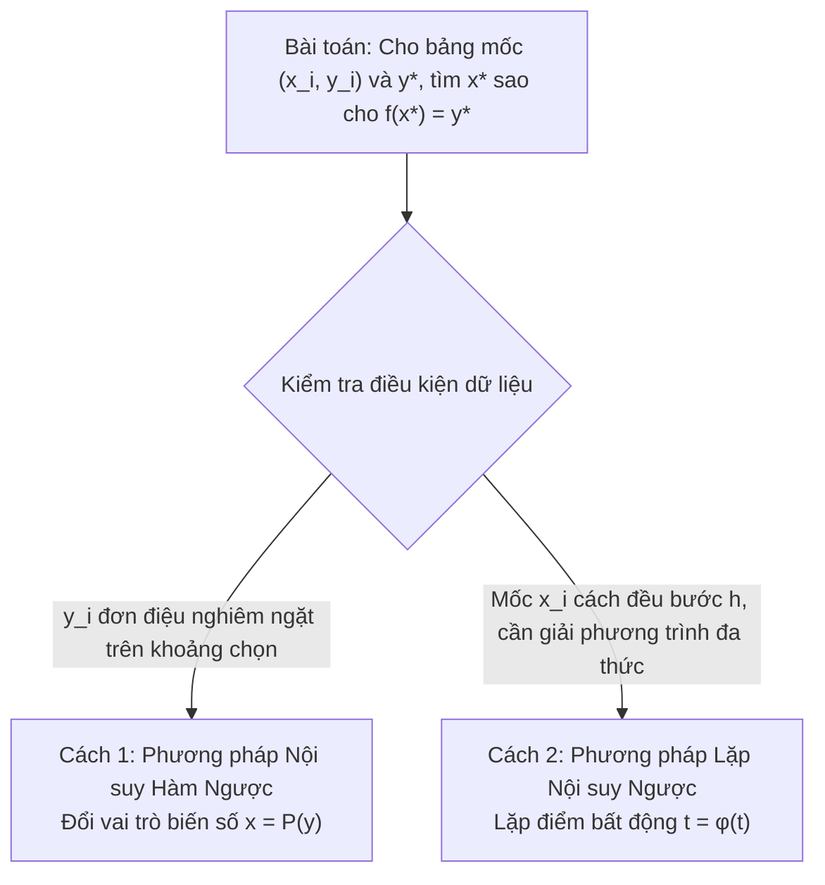

# TỔNG HỢP THUẬT TOÁN PHƯƠNG PHÁP SỐ CHUYÊN SÂU
### (Sổ tay thuật toán chuẩn hóa, tối ưu hóa từng bước lặp và hướng dẫn triển khai)

---

## MỤC LỤC TỔNG QUAN

1. [Sơ đồ Horner & Horner Lặp (Giá trị, Đạo hàm các cấp & Khai triển Taylor)](#1-sơ-đồ-horner--horner-lặp)
2. [Mốc nội suy tối ưu Chebyshev](#2-mốc-nội-suy-tối-ưu-chebyshev)
3. [Đa thức nội suy Lagrange (Mốc bất kỳ)](#3-đa-thức-nội-suy-lagrange-mốc-bất-kỳ)
4. [Đa thức nội suy Newton tỷ sai phân & Nhân lồng Horner](#4-đa-thức-nội-suy-newton-tỷ-sai-phân-mốc-bất-kỳ)
5. [Đa thức nội suy Newton sai phân hữu hạn (Mốc cách đều: Tiến & Lùi)](#5-đa-thức-nội-suy-newton-sai-phân-hữu-hạn-mốc-cách-đều)
6. [Đa thức nội suy trung tâm: Gauss I, Gauss II, Stirling và Bessel](#6-đa-thức-nội-suy-trung-tâm-gauss-stirling-bessel)
7. [Phương pháp Nội suy ngược (Hàm ngược & Phương pháp lặp $t = \varphi(t)$)](#7-phương-pháp-nội-suy-ngược)
8. [Hàm ghép trơn Spline & Thuật toán Thomas (TDMA giải hệ 3 đường chéo)](#8-hàm-ghép-trơn-spline--thuật-toán-thomas-tdma)
9. [Phương pháp Bình phương tối thiểu (Mô hình Tuyến tính & Phi tuyến)](#9-phương-pháp-bình-phương-tối-thiểu-least-squares)

---

## 1. Sơ đồ Horner & Horner Lặp

### 1.1. Bài toán và Tham số
- **Đầu vào (Input):**
  - Mảng hệ số của đa thức bậc $N$: $P(x) = a_N x^N + a_{N-1} x^{N-1} + \dots + a_1 x + a_0$.
  - Điểm đánh giá: $x = c$.
  - Cấp đạo hàm cao nhất cần tính: $K$ ($0 \le K \le N$).
- **Đầu ra (Output):**
  - Giá trị đa thức $P(c)$.
  - Đa thức thương $Q(x)$ khi chia $P(x)$ cho $(x - c)$.
  - Các cấp đạo hàm: $P'(c), P''(c), \dots, P^{(K)}(c)$.
  - Khai triển Taylor của $P(x)$ tại lân cận điểm $c$: $P(x) = \sum_{m=0}^N \frac{P^{(m)}(c)}{m!} (x - c)^m$.

---

### 1.2. Thuật toán chi tiết trong 1 cell (Horner 1 lần & Horner lặp đạo hàm, Taylor)

```text
Thuật toán Horner_Tong_Hop_Va_Taylor(a, N, c, K):
Đầu vào: 
   - Mảng hệ số đa thức a[0..N] theo lũy thừa giảm dần: P(x) = a[0]*x^N + a[1]*x^(N-1) + ... + a[N]
   - Điểm đánh giá c
   - Cấp đạo hàm cao nhất cần tính K (0 <= K <= N)
Đầu ra: 
   - Giá trị P(c)
   - Đa thức thương Q(x) khi chia P(x) cho (x - c)
   - Mảng đạo hàm D[0..K] = [P(c), P'(c), P''(c), ..., P^(K)(c)]
   - Mảng hệ số khai triển Taylor Taylor_Coeff[0..K] = [b_0, b_1, ..., b_K] sao cho P(x) = sum(b_m * (x - c)^m)

BƯỚC 1: KHỞI TẠO BỘ NHỚ LÀM VIỆC
      b = copy(a)               // Mảng lưu hệ số thương và số dư in-place (kích thước N + 1)
      D = mảng kích thước (K + 1) chứa số 0
      Taylor_Coeff = mảng kích thước (K + 1) chứa số 0
      fact = 1.0                // Biến lưu giai thừa m!

BƯỚC 2: VÒNG LẶP HORNER LẶP (QUÉT TÍNH TỪ CẤP m = 0 ĐẾN K)
      VÒNG LẶP NGOÀI m từ 0 đến K:
            // Cập nhật mảng b bằng quy tắc nhân cộng liên tiếp:
            VÒNG LẶP TRONG i từ 1 đến (N - m):
                  b[i] = b[i] + c * b[i - 1]
            
            // Số dư sau lần chia thứ m nằm tại vị trí b[N - m]:
            rem = b[N - m]
            
            // Tính giai thừa m! phục vụ công thức đạo hàm Taylor:
            NẾU m > 0 THÌ:
                  fact = fact * m
            
            // Lưu hệ số Taylor và giá trị đạo hàm cấp m:
            Taylor_Coeff[m] = rem           // b_m = P^(m)(c) / m!
            D[m] = rem * fact               // P^(m)(c) = rem * m!
            
            // Riêng tại lượt đầu tiên m = 0: Lưu đa thức thương Q(x)
            NẾU m == 0 THÌ:
                  Q = [b[0], b[1], ..., b[N - 1]]

BƯỚC 3: TRẢ VỀ KẾT QUẢ TOÀN DIỆN
      P_c = D[0]                            // Giá trị P(c) chính là đạo hàm cấp 0
      Trả về: P_c, Q, D, Taylor_Coeff
```

---

### 1.3. Đánh giá kỹ thuật & Lưu ý thực hành

| Tiêu chí | Đánh giá / Đặc tính kỹ thuật |
| :--- | :--- |
| **Độ phức tạp thời gian** | $O(K \cdot N)$ phép nhân - cộng (với $K = N$ là $O(N^2)$; nếu chỉ tính giá trị $P(c)$ thì $K = 0 \implies O(N)$) |
| **Độ phức tạp không gian** | $O(N)$ lưu trữ in-place trên mảng $b$, không tốn thêm bộ nhớ ma trận |
| **Quan hệ số dư & Đạo hàm Taylor** | Số dư lượt chia thứ $m$ thỏa mãn: $\text{rem}_m = \frac{P^{(m)}(c)}{m!} \implies P^{(m)}(c) = m! \cdot \text{rem}_m$ |
| **Khai triển Taylor tại lân cận $c$** | $P(x) = \sum_{m=0}^K \text{rem}_m (x - c)^m$ |

> [!WARNING]
> **Bẫy thứ tự hệ số đầu vào:**  
> Mảng $a$ bắt buộc phải được sắp xếp theo **lũy thừa giảm dần** từ bậc cao nhất $a_N$ về $a_0$. Nếu đa thức bị khuyết bất kỳ số hạng nào (ví dụ $P(x) = 2x^3 + 5x - 3$ khuyết $x^2$), bắt buộc phải chèn hệ số $0$ vào đúng vị trí tương ứng (`a = [2, 0, 5, -3]`), nếu không kết quả nhân cộng dồn sẽ sai lệch hoàn toàn.

---

## 2. Mốc nội suy tối ưu Chebyshev

### 2.1. Bài toán và Ý nghĩa
- **Hiện tượng Runge:** Khi số mốc nội suy cách đều $n$ tăng cao, đa thức nội suy $P_n(x)$ bị dao động dữ dội ở hai đầu mút khoảng $[a, b]$, khiến sai số cực đại $\max |f(x) - P_n(x)| \to \infty$.
- **Giải pháp mốc Chebyshev:** Chọn các mốc $x_k$ là nghiệm của đa thức Chebyshev loại I $T_{n+1}(x) = \cos((n+1)\arccos x)$ trên $[-1, 1]$, sau đó ánh xạ tuyến tính về $[a, b]$. Phân bố mốc sẽ dày đặc ở hai đầu mút và thưa ở giữa, giúp cực tiểu hóa sai số lớn nhất (Minimax Error).

---

### 2.2. Công thức xác định mốc

Với đa thức nội suy bậc $n$, dùng $n+1$ nghiệm Chebyshev trên đoạn chuẩn $[-1,1]$:
$$t_i = \cos\left(\frac{(2i+1)\pi}{2(n+1)}\right), \quad i=0,1,\dots,n.$$
Ánh xạ tuyến tính các nghiệm sang đoạn $[a,b]$:
$$x_i = x_{\text{mid}} + r t_i,\quad x_{\text{mid}}=\frac{a+b}{2},\quad r=\frac{b-a}{2}.$$

---

### 2.3. Cấu trúc Input & Output
- **Đầu vào:** Hai đầu mút $a < b$ và bậc đa thức $n \ge 0$.
- **Đầu ra:** Mảng $x[0..n]$ gồm $n+1$ mốc Chebyshev trong $[a,b]$, thường được sắp xếp tăng dần.

---

### 2.4. Thuật toán chi tiết từng bước

```text
Thuật toán Sinh_Moc_Chebyshev(a, b, n):
Đầu vào: Đoạn [a, b] với a < b; bậc đa thức n >= 0
Đầu ra: Mảng các mốc nội suy tối ưu x = [x_0, x_1, ..., x_n]

1. Nếu a >= b hoặc n < 0 thì báo lỗi đầu vào không hợp lệ.

2. Tính trung điểm và bán kính khoảng:
      x_mid = (a + b) / 2
      r = (b - a) / 2

3. Khởi tạo mảng x có kích thước (n + 1)

4. VÒNG LẶP i từ 0 đến n:
      // Tính nghiệm trên đoạn chuẩn [-1, 1]:
      t_i = cos(((2 * i + 1) * PI) / (2 * (n + 1)))
      
      // Ánh xạ tuyến tính sang đoạn [a, b]:
      x[i] = x_mid + r * t_i

5. Sắp xếp mảng x theo thứ tự tăng dần nếu cần dùng làm bảng mốc.
6. Trả về mảng x
```

- **Đánh giá sai số chặn trên:**
  $$\max_{x \in [a, b]} |f(x) - P_n(x)| \le \frac{M_{n+1}}{(n+1)! \cdot 2^n} \left(\frac{b - a}{2}\right)^{n+1} \quad \text{với } M_{n+1} = \max_{x \in [a, b]} |f^{(n+1)}(x)|$$

---

## 3. Đa thức nội suy Lagrange (Mốc bất kỳ)

### 3.1. Bài toán
Cho tập $(n+1)$ mốc đôi một khác nhau: $(x_0, y_0), (x_1, y_1), \dots, (x_n, y_n)$.  
Xây dựng đa thức $L_n(x) = \sum_{i=0}^n y_i l_i(x)$ bậc không quá $n$ thỏa mãn $L_n(x_i) = y_i$.

Trong đó, đa thức cơ bản Lagrange thứ $i$ có dạng:
$$l_i(x) = \frac{\prod_{j \ne i} (x - x_j)}{\prod_{j \ne i} (x_i - x_j)} = \frac{w_i(x)}{D_i}$$

---

### 3.2. Thuật toán chi tiết trong 1 cell (Tính giá trị trực tiếp & Xây dựng ĐTNS chính tắc qua Horner)

```text
Thuật toán Noi_Suy_Lagrange_Toan_Dien(X, Y, n, eval_x):
Đầu vào:
   - Mảng hoành độ X[0..n] (các mốc đôi một khác nhau)
   - Mảng tung độ Y[0..n]
   - Bậc đa thức n
   - Điểm đánh giá eval_x
Đầu ra:
   - Giá trị nội suy L_n(eval_x)
   - Vector hệ số đa thức chính tắc P[0..n] = [a_n, a_{n-1}, ..., a_0] sao cho L_n(x) = sum(a_k * x^k)

PHẦN 1: TÍNH TRỰC TIẾP GIÁ TRỊ L_n(eval_x) THEO ĐA THỨC CƠ BẢN
      tong_L = 0.0
      VÒNG LẶP NGOÀI i từ 0 đến n:
            tu_so = 1.0
            mau_so = 1.0
            VÒNG LẶP TRONG j từ 0 đến n:
                  NẾU j != i THÌ:
                        tu_so = tu_so * (eval_x - X[j])
                        mau_so = mau_so * (X[i] - X[j])
            
            l_i = tu_so / mau_so
            tong_L = tong_L + Y[i] * l_i

PHẦN 2: XÂY DỰNG ĐA THỨC CHÍNH TẮC QUA ĐA THỨC TÍCH VÀ CHIA HORNER
      // Bước 2.1: Tính đa thức tích toàn phần omega(x) = prod(x - X_j) bậc n + 1
      omega = [1.0]                     // Khởi tạo đa thức bậc 0
      VÒNG LẶP j từ 0 đến n:
            omega = convolve(omega, [1.0, -X[j]])   // Nhân thêm (x - X_j)
      
      // Bước 2.2: Khởi tạo vector đa thức chính tắc tổng hợp P kích thước n + 1 toàn số 0
      P = mảng kích thước (n + 1) chứa 0.0
      
      // Bước 2.3: Hạ bậc bằng sơ đồ Horner chia omega(x) cho (x - X_i)
      VÒNG LẶP NGOÀI i từ 0 đến n:
            // Tính đa thức thương w_i(x) = omega(x) / (x - X_i) bậc n
            w_i = mảng kích thước (n + 1)
            w_i[0] = omega[0]           // Hệ số x^n
            VÒNG LẶP TRONG k từ 1 đến n:
                  w_i[k] = omega[k] + X[i] * w_i[k - 1]
            
            // Tính mẫu số D_i = prod_{j != i} (X_i - X_j)
            D_i = 1.0
            VÒNG LẶP TRONG j từ 0 đến n:
                  NẾU j != i THÌ:
                        D_i = D_i * (X[i] - X[j])
            
            // Hệ số trọng số của mốc i: weight_i = Y[i] / D_i
            weight_i = Y[i] / D_i
            
            // Cộng dồn vào vector đa thức chính tắc: P = P + weight_i * w_i
            VÒNG LẶP TRONG k từ 0 đến n:
                  P[k] = P[k] + weight_i * w_i[k]

PHẦN 3: TRẢ VỀ KẾT QUẢ
      Trả về: tong_L (giá trị tại eval_x) và P (vector hệ số [a_n, ..., a_0])
```

- **Độ phức tạp:**
  - Tính 1 điểm $L_n(x^*)$: $O(n^2)$ phép toán.
  - Xây dựng dạng biểu thức chính tắc $L_n(x) = \sum c_k x^k$: $O(n^2)$ phép toán qua đa thức $\omega(x)$ và phép chia Horner hạ bậc.

---

## 4. Đa thức nội suy Newton tỷ sai phân (Mốc bất kỳ)

### 4.1. Bài toán và Hai dạng công thức (Tiến & Lùi)
Cho $(n+1)$ mốc bất kỳ $(x_i, y_i)_{i=0}^n$ (các mốc $x_i$ đôi một khác nhau, không cần cách đều).

#### A. Định nghĩa tỷ sai phân (Divided Differences)
- Tỷ sai phân cấp 0: $f[x_i] = y_i$.
- Tỷ sai phân cấp $k$ tính đệ quy từ cấp $k-1$:
  $$f[x_i, x_{i+1}, \dots, x_{i+k}] = \frac{f[x_{i+1}, \dots, x_{i+k}] - f[x_i, \dots, x_{i+k-1}]}{x_{i+k} - x_i}$$

#### B. Đa thức Newton Tiến (Forward - Xuất phát từ $x_0$)
Lấy các hệ số theo **đường chéo trên** của bảng tỷ sai phân:
$$P_n(x) = f[x_0] + f[x_0, x_1](x - x_0) + f[x_0, x_1, x_2](x - x_0)(x - x_1) + \dots + f[x_0, \dots, x_n]\prod_{j=0}^{n-1}(x - x_j)$$
Vector hệ số nội suy tiến:
$$C_{\text{tiến}} = \big(f[x_0], \; f[x_0, x_1], \; f[x_0, x_1, x_2], \; \dots, \; f[x_0, \dots, x_n]\big)$$

#### C. Đa thức Newton Lùi (Backward - Xuất phát từ $x_n$)
Lấy các hệ số theo **đường chéo dưới** (phần tử cuối mỗi cột) của bảng tỷ sai phân:
$$P_n(x) = f[x_n] + f[x_{n-1}, x_n](x - x_n) + f[x_{n-2}, x_{n-1}, x_n](x - x_n)(x - x_{n-1}) + \dots + f[x_0, \dots, x_n]\prod_{j=1}^{n}(x - x_j)$$
Vector hệ số nội suy lùi:
$$C_{\text{lùi}} = \big(f[x_n], \; f[x_{n-1}, x_n], \; f[x_{n-2}, \dots, x_n], \; \dots, \; f[x_0, \dots, x_n]\big)$$

> **Định lý duy nhất:** Đa thức nội suy đi qua $(n+1)$ điểm là DUY NHẤT. Dạng Newton Tiến và Newton Lùi khi khai triển và thu gọn đều cho ra **cùng một đa thức chính tắc $P(x) = \sum a_k x^k$**.

---

### 4.2. Thuật toán Newton tiến và Newton lùi

#### A. Newton tiến trong 1 cell

```text
Thuật toán Noi_Suy_Newton_Tien(X, Y, n, eval_x):
Đầu vào:
   - X[0..n]: các mốc đôi một khác nhau
   - Y[0..n]: giá trị tại các mốc
   - Bậc đa thức n >= 0
   - Điểm cần nội suy eval_x
Đầu ra:
   - Bảng tỷ sai phân F
   - Vector hệ số Newton tiến C_tien[0..n]
   - Giá trị nội suy P_tien(eval_x)

1. Nếu độ dài X hoặc Y khác n + 1, hoặc có hai mốc X trùng nhau,
   báo lỗi đầu vào không hợp lệ.

2. Khởi tạo ma trận F kích thước (n + 1) x (n + 1).
   Với i từ 0 đến n:
      F[i, 0] = Y[i]

3. Lập bảng tỷ sai phân:
   Với j từ 1 đến n:
      Với i từ 0 đến n - j:
         F[i, j] = (F[i + 1, j - 1] - F[i, j - 1])
                   / (X[i + j] - X[i])

4. Trích hệ số Newton tiến từ hàng đầu tiên:
   Với j từ 0 đến n:
      C_tien[j] = F[0, j]

5. Tính giá trị bằng nhân lồng Horner:
   val = C_tien[n]
   Với k từ n - 1 giảm dần về 0:
      val = val * (eval_x - X[k]) + C_tien[k]

6. Trả về F, C_tien, val
```

#### B. Newton lùi trong 1 cell

```text
Thuật toán Noi_Suy_Newton_Lui(X, Y, n, eval_x):
Đầu vào:
   - X[0..n]: các mốc đôi một khác nhau
   - Y[0..n]: giá trị tại các mốc
   - Bậc đa thức n >= 0
   - Điểm cần nội suy eval_x
Đầu ra:
   - Bảng tỷ sai phân F
   - Vector hệ số Newton lùi C_lui[0..n]
   - Giá trị nội suy P_lui(eval_x)

1. Nếu độ dài X hoặc Y khác n + 1, hoặc có hai mốc X trùng nhau,
   báo lỗi đầu vào không hợp lệ.

2. Khởi tạo ma trận F kích thước (n + 1) x (n + 1).
   Với i từ 0 đến n:
      F[i, 0] = Y[i]

3. Lập bảng tỷ sai phân:
   Với j từ 1 đến n:
      Với i từ 0 đến n - j:
         F[i, j] = (F[i + 1, j - 1] - F[i, j - 1])
                   / (X[i + j] - X[i])

4. Trích hệ số Newton lùi từ đáy mỗi cột:
   Với j từ 0 đến n:
      C_lui[j] = F[n - j, j]

5. Tính giá trị bằng nhân lồng Horner:
   val = C_lui[n]
   Với k từ n - 1 giảm dần về 0:
      val = val * (eval_x - X[n - k]) + C_lui[k]

6. Trả về F, C_lui, val
```

---

### 4.3. Đánh giá kỹ thuật & Phân tích so sánh Tiến - Lùi

| Tiêu chí so sánh | Đa thức Newton Tiến (Forward) | Đa thức Newton Lùi (Backward) |
| :--- | :--- | :--- |
| **Hệ số tỷ sai phân** | Hàng đầu tiên: $C_{\text{tiến}}[j] = F[0, j]$ | Đáy mỗi cột: $C_{\text{lùi}}[j] = F[n-j, j]$ |
| **Đa thức cơ sở** | $B_i(x) = \prod_{k=0}^{i-1} (x - x_k)$ | $B_i(x) = \prod_{k=0}^{i-1} (x - x_{n-k})$ |
| **Ưu tiên sử dụng** | Khi $x^*$ nằm ở **nửa đầu** bảng dữ liệu | Khi $x^*$ nằm ở **nửa sau** bảng dữ liệu |
| **Tính duy nhất của ĐTNS** | Khi khai triển về chính tắc, Tiến và Lùi đều cho ra **cùng một đa thức duy nhất** $P(x) = \sum a_k x^k$ |
| **Bổ sung mốc mới** | Dễ dàng thêm mốc mới vào cuối mảng trong $O(n)$ phép tính mà không cần tính lại từ đầu |

> [!TIP]
> **Tối ưu hóa tính giá trị $P(x^*)$ trong $O(n)$:**  
> Không nên khai triển thành đa thức tường minh $P(x) = \sum a_k x^k$ rồi mới thay $x^*$ (dễ bị sai số làm tròn khi bậc cao). Thay vào đó, hãy luôn sử dụng **thuật toán nhân lồng Horner** trực tiếp trên vector hệ số $C$ để đạt độ chính xác tối đa và tốc độ $O(n)$.

---

## 5. Đa thức nội suy Newton sai phân hữu hạn (Mốc cách đều)

### 5.1. Định nghĩa và Bảng sai phân hữu hạn
Cho $x_i = x_0 + i \cdot h$ ($h = \text{const}$).
- **Sai phân tiến:** $\Delta y_i = y_{i+1} - y_i$, $\Delta^j y_i = \Delta^{j-1} y_{i+1} - \Delta^{j-1} y_i$.
- **Sai phân lùi:** $\nabla y_i = y_i - y_{i-1}$, $\nabla^j y_i = \nabla^{j-1} y_i - \nabla^{j-1} y_{i-1}$ (Quan hệ: $\nabla^j y_n = \Delta^j y_{n-j}$).

---

### 5.2. Thuật toán chi tiết trong 1 cell (Toàn bộ quy trình Sai phân hữu hạn, biến chuẩn hóa t và Newton Tiến / Lùi)

```text
Thuật toán Noi_Suy_Newton_Sai_Phan_Huu_Han_Toan_Dien(X, Y, n, eval_x, Huong):
Đầu vào:
   - Mảng hoành độ X[0..n] (cách đều nhau với bước h = X[1] - X[0])
   - Mảng tung độ Y[0..n]
   - Bậc đa thức n
   - Điểm đánh giá eval_x
   - Hướng nội suy Huong ("TIEN" hoặc "LUI" hoặc "TU_DONG")
Đầu ra:
   - Ma trận sai phân hữu hạn D[(n+1) x (n+1)]
   - Biến chuẩn hóa t (hoặc t_b)
   - Giá trị nội suy P(eval_x)
   - Vector hệ số đa thức theo biến chuẩn hóa t: Poly_t[0..n]

================================================================================
BƯỚC 1: KIỂM TRA BƯỚC CÁCH ĐỀU h VÀ LẬP BẢNG SAI PHÂN HỮU HẠN D
================================================================================
1. Tính bước cách đều: h = X[1] - X[0]
2. Khởi tạo ma trận D kích thước (n + 1) x (n + 1) chứa số 0 (hoặc NaN)
3. Gán cột 0: D[i, 0] = Y[i] với mọi i = 0..n

4. VÒNG LẶP NGOÀI j từ 1 đến n:        // j là cấp sai phân (cột)
      VÒNG LẶP TRONG i từ 0 đến (n - j): // i là hàng
            D[i, j] = D[i + 1, j - 1] - D[i, j - 1]

================================================================================
BƯỚC 2: XÁC ĐỊNH HƯỚNG NỘI SUY VÀ TÍNH BIẾN CHUẨN HÓA t
================================================================================
5. NẾU Huong == "TU_DONG" THÌ:
      x_mid = (X[0] + X[n]) / 2.0
      Huong = (eval_x <= x_mid) ? "TIEN" : "LUI"

================================================================================
BƯỚC 3: TÍNH GIÁ TRỊ NỘI SUY THEO CÔNG THỨC TIẾN HOẶC LÙI
================================================================================
6. NẾU Huong == "TIEN" THÌ:
      // Điểm mốc gốc x_0 ở đầu bảng:
      t = (eval_x - X[0]) / h
      val = D[0, 0]                     // y_0
      t_prod = 1.0
      fact = 1.0
      
      VÒNG LẶP j từ 1 đến n:
            t_prod = t_prod * (t - (j - 1))
            fact = fact * j
            val = val + (D[0, j] / fact) * t_prod

7. NẾU Huong == "LUI" THÌ:
      // Điểm mốc gốc x_n ở cuối bảng:
      t_b = (eval_x - X[n]) / h          // t_b <= 0
      val = D[n, 0]                     // y_n
      t_prod = 1.0
      fact = 1.0
      
      VÒNG LẶP j từ 1 đến n:
            t_prod = t_prod * (t_b + (j - 1))
            fact = fact * j
            // Lưu ý: Sai phân lùi nabla^j y_n chính là phần tử D[n - j, j]
            val = val + (D[n - j, j] / fact) * t_prod

================================================================================
BƯỚC 4: LẬP BẢNG TÍCH THEO BIẾN t VÀ TỔNG HỢP HỆ SỐ ĐA THỨC THEO t
================================================================================
8. Khởi tạo danh sách đa thức cơ sở T_list gồm (n + 1) đa thức:
      T_list[0] = [1.0]
      VÒNG LẶP j từ 1 đến n:
            NẾU Huong == "TIEN":
                  T_list[j] = convolve(T_list[j - 1], [1.0, -(j - 1)])
            NGƯỢC LẠI:
                  T_list[j] = convolve(T_list[j - 1], [1.0, +(j - 1)])

9. Khởi tạo vector Poly_t kích thước (n + 1) chứa 0.0:
      fact = 1.0
      VÒNG LẶP j từ 0 đến n:
            NẾU j > 0: fact = fact * j
            coeff = (Huong == "TIEN") ? (D[0, j] / fact) : (D[n - j, j] / fact)
            
            len_p = độ dài T_list[j]
            offset = (n + 1) - len_p
            VÒNG LẶP k từ 0 đến len_p - 1:
                  Poly_t[offset + k] = Poly_t[offset + k] + coeff * T_list[j][k]

10. Trả về: Ma trận sai phân D, giá trị val (tại eval_x), biến t, vector Poly_t
```

---

## 6. Đa thức nội suy trung tâm (Gauss, Stirling, Bessel)

### 6.1. Nguyên lý và Trích xuất mốc đối xứng
Khi điểm nội suy $x^*$ nằm ở khoảng giữa bảng dữ liệu, các công thức nội suy trung tâm hội tụ nhanh nhất và cho sai số nhỏ nhất.

- **Chuyển đổi chỉ số mảng:**
  - Chọn $x_0$ gần $x^*$ nhất. Bước $h = x_1 - x_0$. Đặt $t = \frac{x^* - x_0}{h}$ ($|t| \le 0.5$).
  - Đối với $2N+1$ mốc (Gauss, Stirling): Lấy $\{x_{-N}, \dots, x_0, \dots, x_N\}$.
  - Trong bộ nhớ mảng Python/C (chỉ số $0 \dots 2N$), mốc $x_k$ tương ứng với phần tử có chỉ số mảng `idx = k + N`.

---

### 6.2. Sơ đồ bước lặp Ziczac của Gauss I và Gauss II

```text
       y_{-1} --------> Δy_{-1} -------> Δ²y_{-1} ------> Δ³y_{-2} ...
               \      /          \      /          \
                y_0 ------------> Δy_0 -----------> Δ²y_0 ...
```
- **Gauss I (Đường ziczac xuống trước):**
  $$y_0 \xrightarrow{\text{xuống}} \Delta y_0 \xrightarrow{\text{lên}} \Delta^2 y_{-1} \xrightarrow{\text{xuống}} \Delta^3 y_{-1} \xrightarrow{\text{lên}} \Delta^4 y_{-2} \dots$$
  $$P(t) = y_0 + t\Delta y_0 + \frac{t(t-1)}{2!} \Delta^2 y_{-1} + \frac{(t+1)t(t-1)}{3!} \Delta^3 y_{-1} + \frac{(t+1)t(t-1)(t-2)}{4!} \Delta^4 y_{-2} + \dots$$

- **Gauss II (Đường ziczac lên trước):**
  $$y_0 \xrightarrow{\text{lên}} \Delta y_{-1} \xrightarrow{\text{xuống}} \Delta^2 y_{-1} \xrightarrow{\text{lên}} \Delta^3 y_{-2} \xrightarrow{\text{xuống}} \Delta^4 y_{-2} \dots$$
  $$P(t) = y_0 + t\Delta y_{-1} + \frac{(t+1)t}{2!} \Delta^2 y_{-1} + \frac{(t+1)t(t-1)}{3!} \Delta^3 y_{-2} + \frac{(t+2)(t+1)t(t-1)}{4!} \Delta^4 y_{-2} + \dots$$

- **Stirling (Trung bình cộng Gauss I & II - Khi $|t| \le 0.25$):**
  $$P(t) = y_0 + t \left(\frac{\Delta y_{-1} + \Delta y_0}{2}\right) + \frac{t^2}{2!} \Delta^2 y_{-1} + \frac{t(t^2 - 1^2)}{3!} \left(\frac{\Delta^3 y_{-2} + \Delta^3 y_{-1}}{2}\right) + \frac{t^2(t^2 - 1^2)}{4!} \Delta^4 y_{-2} + \dots$$

- **Bessel (Số mốc chẵn $2N$, đặt $u = t - 1/2 \implies u \in [-0.25, 0.25]$):**
  $$P(u) = \left(\frac{y_0 + y_1}{2}\right) + u \Delta y_0 + \frac{u^2 - \frac{1}{4}}{2!} \left(\frac{\Delta^2 y_{-1} + \Delta^2 y_0}{2}\right) + \frac{u(u^2 - \frac{1}{4})}{3!} \Delta^3 y_{-1} + \dots$$

---

### 6.3. Thuật toán Gauss I trong 1 cell (Đường ziczac xuống trước)

```text
Thuật toán Noi_Suy_Gauss_1(X, Y, M, eval_x):
Đầu vào:
   - Mảng hoành độ X[0..M-1] (cách đều bước h)
   - Mảng tung độ Y[0..M-1]
   - Điểm đánh giá eval_x (nằm ở lân cận giữa bảng)
Đầu ra:
   - Mốc trung tâm x_0, bước h, biến chuẩn hóa t
   - Giá trị nội suy P(eval_x) theo công thức Gauss I

================================================================================
BƯỚC 1: XÁC ĐỊNH MỐC TRUNG TÂM VÀ BIẾN CHUẨN HÓA t
================================================================================
1. Tính bước cách đều: h = X[1] - X[0]
2. Tìm chỉ số mốc trung tâm mid_idx sao cho |X[mid_idx] - eval_x| nhỏ nhất.
   x_0 = X[mid_idx], y_0 = Y[mid_idx]
   t = (eval_x - x_0) / h
3. Bán kính mốc đối xứng tối đa: N = min(mid_idx, M - 1 - mid_idx)

================================================================================
BƯỚC 2: LẬP BẢNG SAI PHÂN HỮU HẠN D
================================================================================
4. Khởi tạo ma trận D kích thước M x M:
      D[i, 0] = Y[i] với i = 0..M-1
      VÒNG LẶP j từ 1 đến 2*N:
            VÒNG LẶP i từ 0 đến (M - 1 - j):
                  D[i, j] = D[i + 1, j - 1] - D[i, j - 1]

================================================================================
BƯỚC 3: TÍNH GIÁ TRỊ THEO CÔNG THỨC GAUSS I (ZICZAC XUỐNG TRƯỚC)
================================================================================
5. Khởi tạo:
      val = y_0
      prod = 1.0
      fact = 1.0

6. VÒNG LẶP k từ 1 đến 2*N:           // k là cấp sai phân
      fact = fact * k
      NẾU k là số lẻ (k = 2*m - 1 với m = 1, 2, ...):
            // Nhân thêm nhân tử Gauss I: (t + (m - 1))
            prod = prod * (t + (m - 1))
            // Lấy sai phân: Delta^(2m-1) y_{-(m-1)} nằm tại hàng (mid_idx - (m - 1))
            d = D[mid_idx - (m - 1), k]
      NGƯỢC LẠI (k là số chẵn, k = 2*m với m = 1, 2, ...):
            // Nhân thêm nhân tử Gauss I: (t - m)
            prod = prod * (t - m)
            // Lấy sai phân: Delta^(2m) y_{-m} nằm tại hàng (mid_idx - m)
            d = D[mid_idx - m, k]
            
      val = val + (d / fact) * prod

7. Trả về: x_0, t, val
```

---

### 6.4. Thuật toán Gauss II trong 1 cell (Đường ziczac lên trước)

```text
Thuật toán Noi_Suy_Gauss_2(X, Y, M, eval_x):
Đầu vào:
   - Mảng hoành độ X[0..M-1] (cách đều bước h)
   - Mảng tung độ Y[0..M-1]
   - Điểm đánh giá eval_x (thường chọn khi t < 0)
Đầu ra:
   - Mốc trung tâm x_0, bước h, biến chuẩn hóa t
   - Giá trị nội suy P(eval_x) theo công thức Gauss II

================================================================================
BƯỚC 1: XÁC ĐỊNH MỐC TRUNG TÂM VÀ BIẾN CHUẨN HÓA t
================================================================================
1. Tính bước cách đều: h = X[1] - X[0]
2. Tìm chỉ số mốc trung tâm mid_idx sao cho |X[mid_idx] - eval_x| nhỏ nhất.
   x_0 = X[mid_idx], y_0 = Y[mid_idx]
   t = (eval_x - x_0) / h
3. Bán kính mốc đối xứng tối đa: N = min(mid_idx, M - 1 - mid_idx)

================================================================================
BƯỚC 2: LẬP BẢNG SAI PHÂN HỮU HẠN D
================================================================================
4. Khởi tạo ma trận D kích thước M x M:
      D[i, 0] = Y[i] với i = 0..M-1
      VÒNG LẶP j từ 1 đến 2*N:
            VÒNG LẶP i từ 0 đến (M - 1 - j):
                  D[i, j] = D[i + 1, j - 1] - D[i, j - 1]

================================================================================
BƯỚC 3: TÍNH GIÁ TRỊ THEO CÔNG THỨC GAUSS II (ZICZAC LÊN TRƯỚC)
================================================================================
5. Khởi tạo:
      val = y_0
      prod = 1.0
      fact = 1.0

6. VÒNG LẶP k từ 1 đến 2*N:           // k là cấp sai phân
      fact = fact * k
      NẾU k là số lẻ (k = 2*m - 1 với m = 1, 2, ...):
            // Nhân thêm nhân tử Gauss II: (t - (m - 1))
            prod = prod * (t - (m - 1))
            // Lấy sai phân: Delta^(2m-1) y_{-m} nằm tại hàng (mid_idx - m)
            d = D[mid_idx - m, k]
      NGƯỢC LẠI (k là số chẵn, k = 2*m với m = 1, 2, ...):
            // Nhân thêm nhân tử Gauss II: (t + m)
            prod = prod * (t + m)
            // Lấy sai phân: Delta^(2m) y_{-m} nằm tại hàng (mid_idx - m)
            d = D[mid_idx - m, k]
            
      val = val + (d / fact) * prod

7. Trả về: x_0, t, val
```

---

### 6.5. Thuật toán Stirling trong 1 cell (Trung bình cộng Gauss I & II cho $|t| \le 0.25$)

```text
Thuật toán Noi_Suy_Stirling(X, Y, M, eval_x):
Đầu vào:
   - Mảng hoành độ X[0..M-1] (cách đều bước h)
   - Mảng tung độ Y[0..M-1]
   - Điểm đánh giá eval_x (thỏa mãn |t| <= 0.25 để đạt tốc độ hội tụ nhanh nhất)
Đầu ra:
   - Mốc trung tâm x_0, bước h, biến chuẩn hóa t
   - Giá trị nội suy P(eval_x) theo công thức Stirling

================================================================================
BƯỚC 1: XÁC ĐỊNH MỐC TRUNG TÂM VÀ BIẾN CHUẨN HÓA t
================================================================================
1. Tính bước cách đều: h = X[1] - X[0]
2. Tìm chỉ số mốc trung tâm mid_idx sao cho |X[mid_idx] - eval_x| nhỏ nhất.
   x_0 = X[mid_idx], y_0 = Y[mid_idx]
   t = (eval_x - x_0) / h
3. Bán kính mốc đối xứng: N = min(mid_idx, M - 1 - mid_idx)

================================================================================
BƯỚC 2: LẬP BẢNG SAI PHÂN HỮU HẠN D
================================================================================
4. Khởi tạo ma trận D kích thước M x M:
      D[i, 0] = Y[i] với i = 0..M-1
      VÒNG LẶP j từ 1 đến 2*N:
            VÒNG LẶP i từ 0 đến (M - 1 - j):
                  D[i, j] = D[i + 1, j - 1] - D[i, j - 1]

================================================================================
BƯỚC 3: TÍNH TOÁN THEO CÔNG THỨC STIRLING (TÁCH SỐ HẠNG CHẴN VÀ LẺ)
================================================================================
5. Khởi tạo:
      val = y_0
      t_sq = t * t
      p = 1.0

6. VÒNG LẶP i từ 1 đến N:
      fact_odd = Factorial(2*i - 1)
      fact_even = Factorial(2*i)
      
      // Số hạng lẻ: Lấy trung bình cộng Delta^(2i-1) y_{-i} và Delta^(2i-1) y_{-i+1}
      d_odd = (D[mid_idx - i, 2*i - 1] + D[mid_idx - i + 1, 2*i - 1]) / 2.0
      term_odd = (d_odd / fact_odd) * t * p
      
      // Số hạng chẵn: dùng cùng p trước khi cập nhật, lấy Delta^(2i) y_{-i}
      d_even = D[mid_idx - i, 2*i]
      term_even = (d_even / fact_even) * t_sq * p
      
      val = val + term_odd + term_even
      p = p * (t_sq - i**2)

7. Trả về: x_0, t, val
```

---

### 6.6. Thuật toán Bessel trong 1 cell (Biến đối xứng $u = t - 0.5$ cho $0.25 \le t \le 0.75$)

```text
Thuật toán Noi_Suy_Bessel(X, Y, M, eval_x):
Đầu vào:
   - Mảng hoành độ X[0..M-1] (cách đều bước h)
   - Mảng tung độ Y[0..M-1]
   - Điểm đánh giá eval_x (thỏa mãn 0.25 <= t <= 0.75)
Đầu ra:
   - Mốc trung tâm x_0, x_1, bước h, biến chuẩn hóa t, u = t - 0.5
   - Giá trị nội suy P(eval_x) theo công thức Bessel

================================================================================
BƯỚC 1: XÁC ĐỊNH CẶP MỐC KẸP VÀ ẨN PHỤ ĐỐI XỨNG u
================================================================================
1. Tính bước cách đều: h = X[1] - X[0]
2. Tìm chỉ số mid_idx sao cho X[mid_idx] <= eval_x <= X[mid_idx + 1].
   x_0 = X[mid_idx]
   t = (eval_x - x_0) / h         // 0.0 <= t <= 1.0
   u = t - 0.5                   // -0.5 <= u <= 0.5 (Tối ưu khi |u| <= 0.25)
3. Bán kính mốc đối xứng: N = min(mid_idx, M - 2 - mid_idx)

================================================================================
BƯỚC 2: LẬP BẢNG SAI PHÂN HỮU HẠN D
================================================================================
4. Khởi tạo ma trận D kích thước M x M:
      D[i, 0] = Y[i] với i = 0..M-1
      VÒNG LẶP j từ 1 đến 2*N + 1:
            VÒNG LẶP i từ 0 đến (M - 1 - j):
                  D[i, j] = D[i + 1, j - 1] - D[i, j - 1]

================================================================================
BƯỚC 3: TÍNH TOÁN THEO CÔNG THỨC BESSEL
================================================================================
5. Khởi tạo với 2 số hạng đầu tiên:
      val = (D[mid_idx, 0] + D[mid_idx + 1, 0]) / 2.0 + u * D[mid_idx, 1]
      prod_base = (u**2) - 0.25

6. VÒNG LẶP i từ 1 đến N:
      fact_even = Factorial(2*i)
      fact_odd  = Factorial(2*i + 1)
      
      // Số hạng chẵn: Trung bình cộng hai sai phân cấp chẵn Delta^(2i) y_{-i} và Delta^(2i) y_{-i+1}
      d_even = (D[mid_idx - i, 2*i] + D[mid_idx - i + 1, 2*i]) / 2.0
      term_even = (d_even / fact_even) * prod_base
      
      // Số hạng lẻ: Sai phân cấp lẻ Delta^(2i+1) y_{-i}
      d_odd = D[mid_idx - i, 2*i + 1]
      term_odd = (d_odd / fact_odd) * u * prod_base
      
      val = val + term_even + term_odd
      
      // Cập nhật tích lũy đa thức tích cho lượt sau:
      prod_base = prod_base * ((u**2) - (i + 0.5)**2)

7. Trả về: x_0, t, u, val
```

---

## 7. Phương pháp Nội suy ngược (Inverse Interpolation)

### 7.1. Phân loại hai hướng giải bài toán tìm $x^*$ sao cho $f(x^*) = \bar{y}$

Cho bảng giá trị thực nghiệm $(x_i, y_i)_{i=0}^n$ và giá trị mục tiêu $\bar{y}$. Cần tìm hoành độ $x^*$ thỏa mãn $f(x^*) = \bar{y}$.



- **Cách 1 (Nội suy hàm ngược):** Hoán đổi vai trò biến $y$ làm biến độc lập và $x$ làm giá trị hàm: $(Y_i, X_i) = (y_i, x_i)$. Xây dựng trực tiếp đa thức nội suy $x = P_n(y)$ (qua Newton tỷ sai phân hoặc Lagrange) và tính thẳng nghiệm $x^* = P_n(\bar{y})$.
- **Cách 2 (Phương pháp lặp nội suy ngược - Chuẩn thi cử giáo trình):** Sử dụng đa thức Newton theo $t$ với mốc $x$ cách đều bước $h$, rút ẩn $t$ từ số hạng bậc nhất để đưa về phương trình lặp điểm bất động $t = \varphi(t)$.

---

### 7.2. Phương pháp Nội suy Hàm Ngược (Inverse Function Interpolation)

#### 7.2.1. Cơ sở toán học & Điều kiện đơn điệu
- **Điều kiện tồn tại hàm ngược:** Hàm số $y = f(x)$ phải **đơn điệu nghiêm ngặt** (strictly monotonic: hoặc tăng ngặt $y_0 < y_1 < \dots < y_n$, hoặc giảm ngặt $y_0 > y_1 > \dots > y_n$) trên khoảng chứa $\bar{y}$. Khi đó, tồn tại duy nhất hàm ngược $x = f^{-1}(y)$.
- **Bản chất mốc dữ liệu sau khi hoán đổi:** 
  - Ban đầu, mốc $x_i$ có thể cách đều bước $h$. Nhưng khi hoán đổi vai trò biến số: $y$ trở thành **biến độc lập** và $x$ trở thành **giá trị hàm**, thì các mốc $y_i$ **nói chung không cách đều nhau**.
  - Do đó, **không được áp dụng công thức sai phân hữu hạn thông thường theo biến $y$**, mà bắt buộc phải sử dụng công thức nội suy cho **mốc bất kỳ**:
    1. Đa thức nội suy **Newton tỷ sai phân** theo biến $y$:
       $$x = P_n(y) = x_0 + f[y_0, y_1](y - y_0) + f[y_0, y_1, y_2](y - y_0)(y - y_1) + \dots$$
    2. Hoặc đa thức nội suy **Lagrange** theo biến $y$:
       $$x = L_n(y) = \sum_{i=0}^n x_i \prod_{j \ne i} \frac{y - y_j}{y_i - y_j}$$

---

#### 7.2.2. Cấu trúc Input & Output
- **Đầu vào:**
  - Tập mốc thực nghiệm `Points = [(x_0, y_0), ..., (x_{M-1}, y_{M-1})]`.
  - Giá trị mục tiêu $\bar{y}$ nằm trong miền giá trị của cửa sổ đơn điệu được chọn.
  - Bậc nội suy ngược $n \ge 1$, cần chọn $n+1$ mốc.
- **Đầu ra:**
  - Nghiệm $\bar{x}=P_n(\bar{y})$ xấp xỉ nghiệm của $f(x)=\bar{y}$.
  - Đạo hàm $f'(\bar{x})$ ước lượng từ đa thức nội suy ngược.
  - Sai số phần dư và các dữ liệu trung gian của bảng tỷ sai phân.

---

#### 7.2.3. Thuật toán chi tiết trong 1 cell (Quét đơn điệu, Hoán đổi biến, Tỷ sai phân Y và Horner)

```text
Thuật toán Noi_Suy_Ham_Nguoc_Toan_Dien(points, eval_y, n):
Đầu vào:
   - Tập mốc thực nghiệm points = [(x_0, y_0), (x_1, y_1), ..., (x_{M-1}, y_{M-1})]
   - Giá trị mục tiêu eval_y
   - Bậc đa thức nội suy ngược mong muốn n (cần n + 1 mốc, thường n = 3 hoặc 4)
Đầu ra:
   - Nghiệm x_star sao cho f(x_star) xấp xỉ eval_y
   - Đạo hàm f'(x_star)
   - Sai số phần dư residual

================================================================================
BƯỚC 1: QUÉT TÍNH ĐƠN ĐIỆU VÀ CẮT CỬA SỔ MỐC LÂN CẬN eval_y
================================================================================
1. Quét kiểm tra chiều biến thiên cục bộ:
      M = len(points)
      Nếu n < 1 hoặc M < n + 1 thì báo lỗi: không đủ mốc để nội suy.
      k_target = -1
      VÒNG LẶP i từ 0 đến M - 2:
            min_y = min(points[i].y, points[i + 1].y)
            max_y = max(points[i].y, points[i + 1].y)
            NẾU min_y <= eval_y <= max_y THÌ:
                  k_target = i
                  THOÁT VÒNG LẶP
      NẾU k_target == -1: Báo lỗi "eval_y nằm ngoài miền giá trị của bảng dữ liệu!"

2. Trích xuất cửa sổ (n + 1) mốc lân cận k_target:
      start = max(0, min(k_target - n // 2, M - (n + 1)))
      sub_points = points[start : start + n + 1]
      Kiểm tra các tung độ trong sub_points đơn điệu nghiêm ngặt
      (tăng hoặc giảm); nếu không, báo lỗi cửa sổ mốc không đơn điệu.

================================================================================
BƯỚC 2: HOÁN ĐỔI VAI TRÒ BIẾN SỐ VÀ TIỀN XỬ LÝ SẮP XẾP
================================================================================
3. Hoán đổi: Y là biến độc lập, X là giá trị hàm:
      Y_arr = [p.y for p in sub_points]
      X_arr = [p.x for p in sub_points]

4. Sắp xếp mảng (Y_arr, X_arr) theo thứ tự Y tăng dần để đảm bảo ổn định số học:
      Sort pairs (Y_arr[i], X_arr[i]) theo key Y_arr tăng dần

================================================================================
BƯỚC 3: LẬP BẢNG TỶ SAI PHÂN THEO BIẾN Y
================================================================================
5. Khởi tạo ma trận F kích thước (n + 1) x (n + 1) chứa NaN
6. Gán cột 0: F[i, 0] = X_arr[i] với i = 0..n

7. VÒNG LẶP NGOÀI j từ 1 đến n:        // j: cấp tỷ sai phân
      VÒNG LẶP TRONG i từ 0 đến n - j: // i: hàng
            denom = Y_arr[i + j] - Y_arr[i]
            NẾU |denom| < 1e-14 THÌ:
                  Báo lỗi: "Hai mốc y trùng nhau, vi phạm tính đơn điệu ngặt!"
            F[i, j] = (F[i + 1, j - 1] - F[i, j - 1]) / denom

8. Trích xuất vector hệ số Newton tiến theo y:
      d = [F[0, j] for j = 0..n]

================================================================================
BƯỚC 4: NHÂN LỒNG HORNER TÍNH NGHIỆM x_star VÀ ĐẠO HÀM P'(eval_y)
================================================================================
9. Tính đồng thời x_star = P_n(eval_y) và dx_dy = P_n'(eval_y) bằng Horner:
      p_value = d[n]
      p_derivative = 0.0
      VÒNG LẶP k từ (n - 1) GIẢM DẦN VỀ 0:
            factor = eval_y - Y_arr[k]
            p_derivative = p_derivative * factor + p_value
            p_value = p_value * factor + d[k]
      x_star = p_value
      dx_dy = p_derivative
      Nếu |dx_dy| < 1e-14, báo lỗi: đạo hàm của đa thức nội suy ngược bằng 0.
      f_prime_x = 1.0 / dx_dy

================================================================================
BƯỚC 5: ĐÁNH GIÁ SAI SỐ PHẦN DƯ (RESIDUAL)
================================================================================
10. Lập đa thức nội suy thuận trên cùng cửa sổ mốc:
      D_forward[i, 0] = Y_arr[i] với i = 0..n
      VÒNG LẶP j từ 1 đến n:
            VÒNG LẶP i từ 0 đến n - j:
                  D_forward[i, j] = (D_forward[i + 1, j - 1] - D_forward[i, j - 1])
                                    / (X_arr[i + j] - X_arr[i])
      coeff_forward[j] = D_forward[0, j] với j = 0..n
   Đánh giá đa thức Newton thuận y = f_interpolated(x) tại x_star bằng Horner:
      y_check = coeff_forward[n]
      VÒNG LẶP j từ (n - 1) GIẢM DẦN VỀ 0:
            y_check = y_check * (x_star - X_arr[j]) + coeff_forward[j]
11. residual = |y_check - eval_y|
12. Trả về: x_star, f_prime_x, residual, ma trận F, vector d
```

---

#### 7.2.4. Đánh giá kỹ thuật & Điều kiện áp dụng

| Tiêu chí | Phân tích kỹ thuật |
| :--- | :--- |
| **Độ phức tạp** | $O(n^2)$ lập bảng tỷ sai phân theo $y$, $O(n)$ nhân lồng Horner tính nghiệm $x^* = P_n(\bar{y})$ |
| **Đạo hàm hàm ngược** | Liên hệ đạo hàm: $f'(x^*) = \frac{1}{P'(\bar{y})} = \frac{1}{\left.\frac{dx}{dy}\right|_{y = \bar{y}}}$ |
| **Ưu điểm vượt trội** | Giải trực tiếp (Direct Closed-form) thu được ngay nghiệm $x^*$, không cần lặp điểm bất động nhiều vòng |

> [!IMPORTANT]
> **Điều kiện tiên quyết:**  
> Dãy tung độ mốc $y_i$ bắt buộc phải **đơn điệu nghiêm ngặt** (strictly monotonic) trên khoảng chọn. Nếu xuất hiện điểm cực trị làm hàm đảo chiều biến thiên, bắt buộc phải dùng thuật toán phân đoạn đơn điệu để cắt riêng từng khoảng trước khi nội suy.

---

### 7.3. Phương pháp Lặp Nội suy Ngược (Inverse Interpolation Loop - Điểm bất động $t = \varphi(t)$)

#### 7.3.1. Thuật toán chi tiết từng bước lặp

```text
Thuật toán Lap_Noi_Suy_Nguoc(X, Y, n, eval_y, tol, max_iter):
Đầu vào: Mảng X, Y (cách đều bước h), giá trị mục tiêu eval_y, sai số tol, số lần lặp tối đa max_iter.
Đầu ra: Nghiệm x*, bảng lịch sử các bước lặp.

BƯỚC 1: TÌM KHOẢNG PHÂN LY NGHIỆM
      Khởi tạo found = False, k_sep = -1
      VÒNG LẶP i từ 0 đến n - 1:
            NẾU (Y[i] - eval_y) * (Y[i+1] - eval_y) <= 0 THÌ:
                  k_sep = i
                  found = True
                  THOÁT VÒNG LẶP
      Nếu không tìm thấy, chọn khoảng gần nhất.

BƯỚC 2: TRÍCH XUẤT CỤM MỐC VÀ LẬP BẢNG SAI PHÂN
      Trích xuất cụm 4 hoặc 5 mốc quanh k_sep: (x_0, y_0), (x_1, y_1), ...
      Tính bảng sai phân hữu hạn Δ.
      Lấy c1 = Δy_0. Nếu |c1| < 1e-14 thì báo lỗi (đạo hàm xấp xỉ bằng 0).
      
BƯỚC 3: THIẾT LẬP CÔNG THỨC HÀM LẶP phi(t)
      Điểm xuất phát: t^(0) = (eval_y - y_0) / Δy_0
      Hàm lặp phi(t):
            phi(t) = t^(0) - [ (Δ²y_0 / (2! * Δy_0)) * t(t - 1)
                             + (Δ³y_0 / (3! * Δy_0)) * t(t - 1)(t - 2) + ... ]

BƯỚC 4: VÒNG LẶP ĐIỂM BẤT ĐỘNG (FIXED-POINT ITERATION)
      Khởi tạo t_curr = t^(0)
      Khởi tạo bảng lịch sử History rỗng
      Ghi nhận bước 0: (k=0, t^(0), x^(0) = x_0 + t^(0)*h, diff_t = NaN)
      
      VÒNG LẶP k từ 1 đến max_iter:
            t_prev = t_curr
            
            // Tính số hạng hiệu chỉnh (correction):
            corr = 0.0
            VÒNG LẶP r từ 2 đến n:
                  prod = 1.0
                  VÒNG LẶP j từ 0 đến r - 1:
                        prod = prod * (t_prev - j)
                  corr = corr + (Δ^r y_0 / (Factorial(r) * c1)) * prod
                  
            t_curr = t^(0) - corr
            diff_t = |t_curr - t_prev|
            x_curr = x_0 + t_curr * h
            diff_x = diff_t * h
            
            Ghi nhận bước k: (k, t_curr, x_curr, diff_t, diff_x)
            
            // KIỂM TRA ĐIỀU KIỆN DỪNG:
            NẾU diff_t < tol THÌ:
                  Hội tụ thành công!
                  THOÁT VÒNG LẶP

BƯỚC 5: TÍNH NGHIỆM CUỐI CÙNG VÀ THỬ LẠI
      x_star = x_0 + t_curr * h
      y_check = P(x_star)
      residual = |y_check - eval_y|
      Trả về x_star, History, residual
```

#### 7.3.2. Đánh giá kỹ thuật & Điều kiện hội tụ của hàm lặp $\varphi(t)$

| Tiêu chí | Đánh giá kỹ thuật |
| :--- | :--- |
| **Bản chất thuật toán** | Lặp điểm bất động $t^{(k+1)} = \varphi(t^{(k)})$ xuất phát từ nghiệm tuyến tính $t^{(0)} = \frac{\bar{y} - y_0}{\Delta y_0}$ |
| **Độ phức tạp mỗi bước** | $O(m)$ phép tính hiệu chỉnh correction ở mỗi vòng lặp với đa thức bậc $m$ |
| **Tiêu chuẩn dừng** | Dừng khi $|t^{(k+1)} - t^{(k)}| < \varepsilon$ hoặc số bước lặp vượt quá $max\_iter$ |

> [!NOTE]
> **Điều kiện hội tụ (Định lý ánh xạ co Banach):**  
> Quá trình lặp hội tụ nếu tồn tại số $q < 1$ sao cho $|\varphi'(t)| \le q < 1$ trong lân cận nghiệm. Khi bước $h$ đủ nhỏ và hàm số biến thiên êm dịu, số hạng bậc 2 trở đi rất nhỏ so với số hạng bậc nhất, đảm bảo tính chất co và nghiệm hội tụ rất nhanh.

---

### 7.4. Bảng so sánh chuyên sâu: Nội suy Hàm Ngược vs Lặp Nội suy Ngược

| Tiêu chí | Nội suy Hàm Ngược ($x = P(y)$) | Lặp Nội suy Ngược ($t = \varphi(t)$) |
| :--- | :--- | :--- |
| **Bản chất thuật toán** | Giải trực tiếp (Direct / Closed-form) | Thuật toán lặp điểm bất động (Iterative / Fixed-point) |
| **Điều kiện hàm số** | Bắt buộc đơn điệu nghiêm ngặt trên khoảng chọn | Không bắt buộc đơn điệu toàn cục, chỉ cần $\Delta y_k \ne 0$ |
| **Dạng mốc sau đổi biến** | Mốc $y_i$ **không cách đều** | Vẫn giữ nguyên biến chuẩn hóa $t$ cách đều $h$ |
| **Công thức nội suy** | Newton tỷ sai phân hoặc Lagrange theo $y$ | Newton sai phân hữu hạn theo $t$ |
| **Số bước tính toán** | Tính 1 lần bảng tỷ sai phân + nhân lồng Horner | Phải lặp nhiều bước $k = 0, 1, 2 \dots$ đến khi hội tụ |
| **Sai số / Độ ổn định** | Dễ bị ảnh hưởng nếu các mốc $y_i$ quá sát nhau | Rất ổn định nếu thỏa điều kiện co $|\varphi'(t)| < 1$ |
| **Ứng dụng phòng thi** | Nhanh, trực quan khi đề cho sẵn các mốc đơn điệu | Chuẩn mẫu giáo trình khi đề yêu cầu bảng các bước lặp |

---

## 8. Hàm ghép trơn Spline & Thuật toán Thomas (TDMA)

### 8.1. Khái niệm chung
Cho $n+1$ mốc $x_0 < x_1 < \dots < x_n$. Hàm ghép trơn $S(x)$ gồm $n$ đa thức con $S_i(x)$ trên từng đoạn $[x_i, x_{i+1}]$ ($i = 0, \dots, n-1$).
- Đặt bước nhảy: $h_i = x_{i+1} - x_i > 0$.

---

### 8.2. Spline tuyến tính (Linear Spline - Bậc 1)
Trên mỗi đoạn $[x_i, x_{i+1}]$, $S_i(x) = a_1 x + a_0$:
- Vòng lặp $i = 0 \dots n-1$:
  $$a_{1, i} = \frac{y_{i+1} - y_i}{h_i}, \quad a_{0, i} = y_i - a_{1, i} \cdot x_i$$

#### Thuật toán chi tiết trong 1 cell

```text
Thuật toán Linear_Spline(X, Y, n, eval_x):
Đầu vào:
   - X[0..n]: các mốc tăng nghiêm ngặt; n >= 1
   - Y[0..n]: giá trị tại các mốc
   - eval_x: điểm cần nội suy, thuộc [X[0], X[n]]
Đầu ra:
   - Coeffs[0..n-1], với S_i(x) = A_i + B_i*(x - X[i])
   - Giá trị S(eval_x)

1. Kiểm tra n >= 1, độ dài X và Y bằng n + 1, X tăng nghiêm ngặt
   và X[0] <= eval_x <= X[n]; nếu sai, báo lỗi.

2. Với mỗi đoạn i từ 0 đến n - 1:
      h[i] = X[i + 1] - X[i]
      A[i] = Y[i]
      B[i] = (Y[i + 1] - Y[i]) / h[i]
      Coeffs[i] = [A[i], B[i]]

3. Chỉ số đoạn k chạy từ 0 đến n - 1 (có n đoạn).
   Tìm k như sau:
      Nếu eval_x == X[n]:
            k = n - 1
      Ngược lại:
            Với i từ 0 đến n - 1:
                  Nếu X[i] <= eval_x < X[i + 1]:
                        k = i
                        thoát vòng lặp

4. dx = eval_x - X[k]
   val_S = A[k] + B[k] * dx

5. Trả về Coeffs, val_S
```

---

### 8.3. Spline cấp 2 (Quadratic Spline - Bậc 2)
Đặt $z_i = S'(x_i)$ là hệ số góc tại các nút ($i = 0 \dots n$).
1. **Khởi tạo:** Cho trước điều kiện biên $z_0 = S'(x_0)$ (ví dụ $z_0 = 0$).
2. **Vòng lặp tiến tìm toàn bộ vector $z$:**
   - Cho $i$ chạy từ $0$ đến $n-1$:
     $$z_{i+1} = \frac{2(y_{i+1} - y_i)}{h_i} - z_i$$
3. **Xác định hệ số từng đoạn $S_i(x) = a_{2,i} x^2 + a_{1,i} x + a_{0,i}$:**
   $$a_{2,i} = \frac{z_{i+1} - z_i}{2h_i}, \quad a_{1,i} = z_i - 2 a_{2,i} x_i, \quad a_{0,i} = y_i - a_{2,i} x_i^2 - a_{1,i} x_i$$

#### Thuật toán chi tiết trong 1 cell

```text
Thuật toán Quadratic_Spline(X, Y, n, z0, eval_x):
Đầu vào:
   - X[0..n]: các mốc tăng nghiêm ngặt; n >= 1
   - Y[0..n]: giá trị tại các mốc
   - z0: điều kiện biên S'(X[0])
   - eval_x: điểm cần nội suy, thuộc [X[0], X[n]]
Đầu ra:
   - Các đạo hàm nút z[0..n]
   - Coeffs[0..n-1], với S_i(x) = A_i + B_i*(x - X[i]) + C_i*(x - X[i])^2
   - Giá trị S(eval_x)

1. Kiểm tra n >= 1, độ dài X và Y bằng n + 1, X tăng nghiêm ngặt
   và X[0] <= eval_x <= X[n]; nếu sai, báo lỗi.

2. Khởi tạo z[0] = z0.
   Với mỗi đoạn i từ 0 đến n - 1:
      h[i] = X[i + 1] - X[i]
      secant = (Y[i + 1] - Y[i]) / h[i]
      z[i + 1] = 2 * secant - z[i]
      A[i] = Y[i]
      B[i] = z[i]
      C[i] = (Y[i + 1] - Y[i] - z[i] * h[i]) / (h[i] * h[i])
      Coeffs[i] = [A[i], B[i], C[i]]

3. Chỉ số đoạn k chạy từ 0 đến n - 1 (có n đoạn).
   Tìm k như sau:
      Nếu eval_x == X[n]:
            k = n - 1
      Ngược lại:
            Với i từ 0 đến n - 1:
                  Nếu X[i] <= eval_x < X[i + 1]:
                        k = i
                        thoát vòng lặp

4. dx = eval_x - X[k]
   val_S = A[k] + B[k] * dx + C[k] * dx * dx

5. Trả về z, Coeffs, val_S
```

---

### 8.4. Spline cấp 3 (Natural Cubic Spline) & Thuật toán Thomas (TDMA)

#### A. Thiết lập hệ phương trình 3 đường chéo
Đặt $M_i = S''(x_i)$ là Moment uốn tại nút $x_i$ ($i = 0 \dots n$).  
Với Spline tự nhiên (Natural Spline): $M_0 = 0$ và $M_n = 0$.  
Tại các nút trong $i = 1, 2, \dots, n-1$, điều kiện liên tục của đạo hàm cấp 1 ($S'_{i-1}(x_i) = S'_i(x_i)$) dẫn đến hệ phương trình:
$$h_{i-1} M_{i-1} + 2(h_{i-1} + h_i) M_i + h_i M_{i+1} = 6 \left(\frac{y_{i+1} - y_i}{h_i} - \frac{y_i - y_{i-1}}{h_{i-1}}\right)$$

Đây là hệ phương trình tuyến tính 3 đường chéo (Tridiagonal System) dạng:
$$a_i M_{i-1} + b_i M_i + c_i M_{i+1} = d_i \quad (i = 1, \dots, n-1)$$
Trong đó:
- $a_i = h_{i-1}$ (đường chéo dưới)
- $b_i = 2(h_{i-1} + h_i)$ (đường chéo chính, luôn trội đường chéo vì $2(h_{i-1} + h_i) > h_{i-1} + h_i$)
- $c_i = h_i$ (đường chéo trên)
- $d_i = 6 \left( \frac{y_{i+1} - y_i}{h_i} - \frac{y_i - y_{i-1}}{h_{i-1}} \right)$

---

#### B. Thuật toán chi tiết trong 1 cell

```text
Thuật toán Natural_Cubic_Spline_TDMA(X, Y, n, eval_x):
Đầu vào:
   - Mảng hoành độ mốc tăng dần: X[0..n] (n đoạn, n + 1 mốc)
   - Mảng tung độ: Y[0..n]
   - Điểm đánh giá eval_x (nằm trong khoảng [X[0], X[n]])
Đầu ra:
   - Vector Moment uốn M[0..n] (với M[0] = M[n] = 0)
   - Bảng hệ số n đoạn theo biến cục bộ dx = x - X[i]:
     Coefficients[i] = [A_i, B_i, C_i, D_i]
     sao cho S_i(x) = A_i + B_i*dx + C_i*dx^2 + D_i*dx^3
   - Giá trị nội suy S(eval_x), đạo hàm cấp 1 S'(eval_x), đạo hàm cấp 2 S''(eval_x)

================================================================================
BƯỚC 1: KIỂM TRA ĐẦU VÀO VÀ TÍNH CÁC BƯỚC NHẢY h
================================================================================
1. Kiểm tra n >= 1, độ dài X và Y bằng n + 1, X tăng nghiêm ngặt
   và X[0] <= eval_x <= X[n]; nếu sai, báo lỗi.

2. Khởi tạo mảng h kích thước n:
      VÒNG LẶP i từ 0 đến n - 1:
            h[i] = X[i + 1] - X[i]

================================================================================
BƯỚC 2: LẬP HỆ CHO CÁC MOMENT TẠI NÚT TRONG
================================================================================
3. Đặt m = n - 1, số nút trong.
   Khởi tạo lower[0..m-1], diag[0..m-1], upper[0..m-1],
   rhs[0..m-1] khi m > 0.
   Với mỗi hàng r từ 0 đến m - 1, tương ứng nút i = r + 1:
      diag[r] = 2 * (h[i - 1] + h[i])
      rhs[r] = 6 * ((Y[i + 1] - Y[i]) / h[i]
                    - (Y[i] - Y[i - 1]) / h[i - 1])
      lower[r] = h[i - 1] nếu r > 0, ngược lại lower[r] = 0
      upper[r] = h[i] nếu r < m - 1, ngược lại upper[r] = 0
   Các phần tử biên bị bỏ đi vì điều kiện tự nhiên M[0] = M[n] = 0.

================================================================================
BƯỚC 3: GIẢI HỆ 3 ĐƯỜNG CHÉO BẰNG THUẬT TOÁN THOMAS
================================================================================
4. Khởi tạo M[0..n] = 0.0, đảm bảo điều kiện tự nhiên.
   Nếu m > 0:
      Khởi tạo c_prime[0..m-1], d_prime[0..m-1].
      denom = diag[0]
      Nếu denom == 0, báo lỗi không thể giải hệ.
      c_prime[0] = upper[0] / denom
      d_prime[0] = rhs[0] / denom

      Với r từ 1 đến m - 1:
            denom = diag[r] - lower[r] * c_prime[r - 1]
            Nếu denom == 0, báo lỗi không thể giải hệ.
            c_prime[r] = upper[r] / denom
            d_prime[r] = (rhs[r] - lower[r] * d_prime[r - 1]) / denom

      M[n - 1] = d_prime[m - 1]
      Với r từ m - 2 giảm dần về 0:
            M[r + 1] = d_prime[r] - c_prime[r] * M[r + 2]
   (Khi n = 1 thì m = 0, không có hệ cần giải và M vẫn bằng 0.)

================================================================================
BƯỚC 4: XÂY DỰNG HỆ SỐ ĐA THỨC BẬC 3 TỪNG ĐOẠN
================================================================================
5. Khởi tạo mảng Coeffs[0..n-1]:
      VÒNG LẶP i từ 0 đến n - 1:
            A_i = Y[i]
            B_i = (Y[i + 1] - Y[i]) / h[i] - (h[i] / 6.0) * (2.0 * M[i] + M[i + 1])
            C_i = M[i] / 2.0
            D_i = (M[i + 1] - M[i]) / (6.0 * h[i])
            Coeffs[i] = [A_i, B_i, C_i, D_i]

================================================================================
BƯỚC 5: ĐÁNH GIÁ GIÁ TRỊ VÀ ĐẠO HÀM TẠI eval_x
================================================================================
6. Chỉ số đoạn k chạy từ 0 đến n - 1 (có n đoạn). Tìm k chứa eval_x:
      NẾU eval_x == X[n] THÌ:
            k = n - 1
      NGƯỢC LẠI:
            VÒNG LẶP i từ 0 đến n - 1:
                  NẾU X[i] <= eval_x < X[i + 1] THÌ:
                        k = i
                        THOÁT VÒNG LẶP

7. Tính độ lệch cục bộ dx = eval_x - X[k]:
      A_k, B_k, C_k, D_k = Coeffs[k]
      
      val_S   = A_k + B_k * dx + C_k * (dx**2) + D_k * (dx**3)
      val_d1  = B_k + 2.0 * C_k * dx + 3.0 * D_k * (dx**2)
      val_d2  = 2.0 * C_k + 6.0 * D_k * dx

8. Trả về: M, Coeffs, val_S, val_d1, val_d2
```

---

## 9. Phương pháp Bình phương tối thiểu (Least Squares)

### 9.1. Mô hình Tuyến tính theo tham số: $g(x) = \sum_{j=1}^m c_j \varphi_j(x)$
Cho tập thực nghiệm $(x_i, y_i)_{i=1}^N$ với $N > m$. Tìm $c = [c_1, \dots, c_m]^T$ cực tiểu hóa $S = \sum_{i=1}^N (y_i - g(x_i))^2$.

#### Thuật toán chi tiết trong 1 cell (Thiết lập ma trận Gram, giải hệ chuẩn Gauss và đánh giá sai số):

```text
Thuật toán Binh_Phuong_Toi_Thieu_Tuyen_Tinh(X, Y, N, phi_funcs, m):
Đầu vào:
   - Dữ liệu thực nghiệm: X[1..N], Y[1..N] (N điểm)
   - Danh sách m hàm cơ sở: phi_funcs = [phi_1, phi_2, ..., phi_m]
Đầu ra:
   - Vector tham số tối ưu c[1..m] sao cho g(x) = sum(c_j * phi_j(x))
   - Các chỉ số đánh giá sai số: SSE, RMSE, MAE, Max_Error, R_squared

================================================================================
BƯỚC 1: XÂY DỰNG MA TRẬN THIẾT KẾ PHI KÍCH THƯỚC (N x m)
================================================================================
1. Khởi tạo ma trận Phi kích thước N x m:
      VÒNG LẶP i từ 1 đến N:
            VÒNG LẶP j từ 1 đến m:
                  Phi[i, j] = phi_funcs[j](X[i])

================================================================================
BƯỚC 2: THIẾT LẬP HỆ PHƯƠNG TRÌNH CHUẨN GAUSS (M * c = B)
================================================================================
2. Khởi tạo ma trận Gram đối xứng M (kích thước m x m) và vector vế phải B (kích thước m):
      // M = Phi^T * Phi, B = Phi^T * Y
      VÒNG LẶP j từ 1 đến m:
            VÒNG LẶP k từ j đến m:     // Tận dụng tính đối xứng M[j, k] = M[k, j]
                  sum_jk = 0.0
                  VÒNG LẶP i từ 1 đến N:
                        sum_jk = sum_jk + Phi[i, j] * Phi[i, k]
                  M[j, k] = sum_jk
                  M[k, j] = sum_jk
            
            sum_b = 0.0
            VÒNG LẶP i từ 1 đến N:
                  sum_b = sum_b + Phi[i, j] * Y[i]
            B[j] = sum_b

================================================================================
BƯỚC 3: GIẢI HỆ PHƯƠNG TRÌNH ĐỐI XỨNG XÁC ĐỊNH DƯƠNG TÌM c
================================================================================
3. Giải hệ M * c = B bằng phép phân tích Cholesky (M = L * L^T) hoặc khử Gauss:
      c = Giai_He_Phuong_Trinh_Tuyen_Tinh(M, B)

================================================================================
BƯỚC 4: TÍNH TOÁN DỰ BÁO VÀ CÁC CHỈ SỐ SAI SỐ THỐNG KÊ
================================================================================
4. y_mean = (1.0 / N) * sum(Y[1..N])
   SSE = 0.0
   SST = 0.0
   sum_abs_e = 0.0
   max_e = 0.0
   
   VÒNG LẶP i từ 1 đến N:
         // Giá trị dự báo từ mô hình:
         y_hat_i = 0.0
         VÒNG LẶP j từ 1 đến m:
               y_hat_i = y_hat_i + c[j] * Phi[i, j]
         
         e_i = Y[i] - y_hat_i
         SSE = SSE + e_i**2
         SST = SST + (Y[i] - y_mean)**2
         sum_abs_e = sum_abs_e + |e_i|
         NẾU |e_i| > max_e THÌ max_e = |e_i|

5. Tính các chỉ số đánh giá:
      RMSE = sqrt(SSE / N)
      MAE = sum_abs_e / N
      R_squared = 1.0 - (SSE / SST)

6. Trả về: c, SSE, RMSE, MAE, max_e, R_squared
```

---

### 9.2. Mô hình Phi tuyến đưa về dạng tuyến tính (Có kiểm tra dấu dữ liệu)
Xét mô hình hàm số mũ tổng quát thường gặp trong bài thi:
$$y = a \cdot e^{b \varphi_1(x) + c \varphi_2(x)} + C_0$$

```text
Thuật toán Tuyen_Tinh_Hoa_Phi_Tuyen(X, Y, N, C0):
1. Chuyển vế hằng số đã biết: y_tilde[i] = Y[i] - C0 với mọi i = 1..N

2. KIỂM TRA DẤU DỮ LIỆU:
      NẾU mọi y_tilde[i] > 0 THÌ:
            sign_mode = +1
            Y_lin[i] = ln(y_tilde[i])
      NẾU mọi y_tilde[i] < 0 THÌ:
            sign_mode = -1
            Y_lin[i] = ln(-y_tilde[i])
      NẾU có cả giá trị âm và dương:
            Báo lỗi: Mô hình không thể tuyến tính hóa bằng hàm logarit!

3. THIẾT LẬP MÔ HÌNH HỒI QUY TUYẾN TÍNH:
      Y_lin = A_0 + b * phi_1(x) + c * phi_2(x)
      (với A_0 = ln(a) nếu sign_mode = +1, hoặc A_0 = ln(-a) nếu sign_mode = -1)

4. LẬP VÀ GIẢI HỆ PHƯƠNG TRÌNH CHUẨN GAUSS 3x3 tìm [A_0, b, c]^T.

5. KHÔI PHỤC THAM SỐ GỐC:
      NẾU sign_mode == +1 THÌ a = exp(A_0)
      NẾU sign_mode == -1 THÌ a = -exp(A_0)

6. ĐÁNH GIÁ CÁC CHỈ SỐ SAI SỐ TRÊN DỮ LIỆU GỐC:
      VÒNG LẶP i từ 1 đến N:
            y_hat[i] = a * exp(b * phi_1(X[i]) + c * phi_2(X[i])) + C0
            e[i] = Y[i] - y_hat[i]
            
      SSE = sum(e[i]^2)
      MAE = (1 / N) * sum(|e[i]|)
      RMSE = sqrt(SSE / N)
      Max_Error = max(|e[i]|)
      R_squared = 1 - (SSE / sum((Y[i] - mean(Y))^2))
      
7. Trả về các tham số a, b, c và bảng chỉ số sai số (SSE, RMSE, R^2).
```

---

## 10. BẢNG TỔNG HỢP SO SÁNH CÁC THUẬT TOÁN

| Thuật toán | Loại mốc dữ liệu | Mục đích chính | Độ phức tạp thời gian | Cấu trúc vòng lặp trọng tâm |
| :--- | :--- | :--- | :---: | :--- |
| **Sơ đồ Horner** | Mọi đa thức | Tính $P(c)$ và đạo hàm các cấp $P^{(k)}(c)$ | $O(K \cdot N)$ | Lặp chia tổng hợp 2 vòng lồng nhau |
| **Mốc Chebyshev** | Khoảng $[a, b]$ | Triệt tiêu hiện tượng Runge | $O(N)$ | Vòng lặp đơn tính nghiệm lượng giác $\cos$ |
| **Lagrange** | Mốc bất kỳ | Tìm đa thức nội suy tổng quát | $O(N^2)$ | 2 vòng lặp tính tích cơ sở $l_i(x)$ |
| **Newton Tỷ sai phân** | Mốc bất kỳ | Xây dựng bảng chia sai phân, dễ thêm mốc | $O(N^2)$ | Lập bảng 2D / 1D in-place + Nhân lồng Horner $O(N)$ |
| **Newton Sai phân hữu hạn** | Mốc cách đều ($h = \text{const}$) | Tính nhanh ở đầu bảng (tiến) / cuối bảng (lùi) | $O(N^2)$ | Vòng lặp sai phân $\Delta$ + Tích lũy biến $t$ |
| **Gauss / Stirling / Bessel** | Mốc cách đều | Nội suy chính xác nhất ở giữa bảng dữ liệu | $O(N^2)$ | Sơ đồ đi ziczac + Tách cụm chẵn lẻ |
| **Nội suy hàm ngược** | Mốc $y_i$ đơn điệu ngặt | Tìm nghiệm trực tiếp $x^* = P_n(\bar{y})$ không cần lặp | $O(N^2)$ | Lập bảng tỷ sai phân theo $y$ + Nhân lồng Horner $O(N)$ |
| **Lặp nội suy ngược** | Mốc cách đều | Tìm nghiệm $x^*$ thỏa mãn $f(x^*) = \bar{y}$ | $O(K \cdot N)$ | Vòng lặp điểm bất động $t^{(k+1)} = \varphi(t^{(k)})$ |
| **Ghép trơn Cubic Spline** | Dữ liệu đo đạc nhiều điểm | Tạo đường cong trơn liên tục đến đạo hàm cấp 2 | $O(N)$ | **Thuật toán Thomas (TDMA)**: quét xuôi và thế ngược |
| **Bình phương tối thiểu** | Thực nghiệm có sai số đo | Tìm hàm quy luật xấp xỉ tối ưu | $O(N \cdot m^2 + m^3)$ | Tích lũy tổng ma trận Gram $\Phi^T \Phi$ + Khử Gauss |