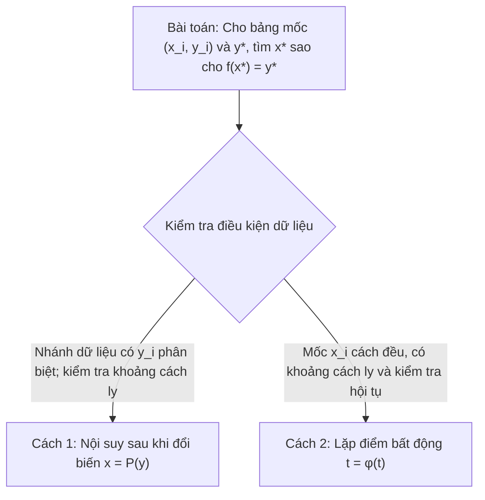

# TỔNG HỢP THUẬT TOÁN PHƯƠNG PHÁP SỐ CHUYÊN SÂU
### (Chi tiết hóa từng bước lặp, điều kiện áp dụng, mã giả và bảng trace minh họa)

---

## MỤC LỤC TỔNG QUAN

1. [Sơ đồ Horner & Horner Lặp (Giá trị, Đạo hàm các cấp & Khai triển Taylor)](#1-sơ-đồ-horner--horner-lặp)
2. [Mốc nội suy tối ưu Chebyshev](#2-mốc-nội-suy-tối-ưu-chebyshev)
3. [Đa thức nội suy Lagrange (Mốc bất kỳ)](#3-đa-thức-nội-suy-lagrange-mốc-bất-kỳ)
4. [Đa thức nội suy Newton tỷ sai phân & Nhân lồng Horner](#4-đa-thức-nội-suy-newton-tỷ-sai-phân-mốc-bất-kỳ)
5. [Đa thức nội suy Newton sai phân hữu hạn (Mốc cách đều: Tiến & Lùi)](#5-đa-thức-nội-suy-newton-sai-phân-hữu-hạn-mốc-cách-đều)
6. [Đa thức nội suy trung tâm: Gauss I, Gauss II, Stirling và Bessel](#6-đa-thức-nội-suy-trung-tâm-gauss-stirling-bessel)
7. [Phương pháp Nội suy ngược (Hàm ngược & Phương pháp lặp $t = \varphi(t)$)](#7-phương-pháp-nội-suy-ngược)
8. [Hàm ghép trơn Spline & Thuật toán Thomas (TDMA giải hệ 3 đường chéo)](#8-hàm-ghép-trơn-spline--thuật-toán-thomas-tdma)
9. [Phương pháp Bình phương tối thiểu (Mô hình Tuyến tính & Phi tuyến)](#9-phương-pháp-bình-phương-tối-thiểu-least-squares)

---

## 1. Sơ đồ Horner & Horner Lặp

### 1.1. Bài toán và Tham số
- **Đầu vào (Input):**
  - Mảng hệ số `a[0..N]` **theo bậc tăng**: `a[k]` là hệ số của $x^k$ trong $P(x) = a_N x^N + a_{N-1} x^{N-1} + \dots + a_1 x + a_0$. Không bỏ các hệ số 0 của bậc khuyết.
  - Điểm đánh giá: $x = c$.
  - Cấp đạo hàm cao nhất cần tính: $K$ ($0 \le K \le N$).
- **Đầu ra (Output):**
  - Giá trị đa thức $P(c)$.
  - Đa thức thương $Q(x)$ khi chia $P(x)$ cho $(x - c)$.
  - Các cấp đạo hàm: $P'(c), P''(c), \dots, P^{(K)}(c)$.
  - Khai triển Taylor của $P(x)$ tại lân cận điểm $c$: $P(x) = \sum_{m=0}^N \frac{P^{(m)}(c)}{m!} (x - c)^m$.

---

### 1.2. Thuật toán chi tiết từng bước lặp

#### A. Chia Horner 1 lần (Synthetic Division)
```text
Thuật toán Chia_Horner_1_Lan(a, N, c):
Tiền điều kiện: len(a) = N + 1; a[k] là hệ số của x^k; N >= 1.
1. Khởi tạo mảng b có kích thước (N + 1):
      b[0] = a[N]        // Giữ nguyên hệ số bậc cao nhất
2. VÒNG LẶP i từ 1 đến N:
      b[i] = a[N - i] + c * b[i - 1]
3. Trả về:
      P(c) = b[N]        // Số dư chính là giá trị P(c)
      Q(x) = [b[0], b[1], ..., b[N-1]]  // Các hệ số của đa thức thương
```

#### B. Horner lặp tính Đạo hàm các cấp và Khai triển Taylor
Để tính các cấp đạo hàm, ta thực hiện chia Horner lặp lại $K + 1$ lần trên mảng hệ số thương. Đầu vào `a` giữ **cùng quy ước bậc tăng** với thuật toán chia một lần; mảng làm việc `b` phải đảo sang bậc giảm trước vòng lặp:
- **Nguyên lý:** Mỗi lần chia cho $(x - c)$, số dư thu được tại vị trí cuối cùng thỏa mãn định lý Taylor:
  $$\text{Số dư lần } m = b_{N-m}^{(m)} = \frac{P^{(m)}(c)}{m!} \implies P^{(m)}(c) = m! \cdot b_{N-m}^{(m)}$$

```text
Thuật toán Horner_Lap_Dao_Ham(a, N, c, K):
Tiền điều kiện: len(a) = N + 1; a[k] là hệ số của x^k; 0 <= K <= N.
1. Khởi tạo b[i] = a[N - i] với i = 0..N  // b theo bậc giảm; không dùng copy(a)
2. Khởi tạo mảng kết quả đạo hàm D = [0]*(K + 1)
3. VÒNG LẶP NGOÀI m từ 0 đến K:   // m là cấp đạo hàm cần tính
      VÒNG LẶP TRONG i từ 1 đến (N - m):  // Quét cập nhật in-place mảng b
            b[i] = b[i] + c * b[i - 1]
      
      // Số dư nằm tại phần tử cuối cùng của lượt chia này:
      rem = b[N - m]
      D[m] = rem * Factorial(m)   // P^(m)(c) = rem * m!
4. Trả về mảng đạo hàm D và các hệ số khai triển Taylor rem_m = D[m] / m!
```

---

### 1.3. Bảng Trace minh họa từng bước lặp
**Ví dụ:** Cho $P(x) = 2x^3 - 4x^2 + 5x - 3$, tính $P(2), P'(2), P''(2), P'''(2)$ tại $c = 2$.
- Đầu vào theo bậc tăng: `a = [-3, 5, -4, 2]`. Sau bước đảo: $b = [2, -4, 5, -3]$, $N = 3, c = 2$.

| Lượt lặp $m$ | $i=0$ ($x^3$) | $i=1$ ($x^2$) | $i=2$ ($x^1$) | $i=3$ ($x^0$) | Số dư thu được | Giá trị đạo hàm $P^{(m)}(2) = m! \cdot \text{rem}$ |
| :---: | :---: | :---: | :---: | :---: | :---: | :---: |
| **$m = 0$ (Lượt 1)** | **2** | $-4 + 2(2) = \mathbf{0}$ | $5 + 2(0) = \mathbf{5}$ | $-3 + 2(5) = \mathbf{7}$ | $b_3 = \mathbf{7}$ | $P(2) = 0! \cdot 7 = \mathbf{7}$ |
| **$m = 1$ (Lượt 2)** | **2** | $0 + 2(2) = \mathbf{4}$ | $5 + 2(4) = \mathbf{13}$ | *(Đã chốt)* | $b_2 = \mathbf{13}$ | $P'(2) = 1! \cdot 13 = \mathbf{13}$ |
| **$m = 2$ (Lượt 3)** | **2** | $4 + 2(2) = \mathbf{8}$ | *(Đã chốt)* | *(Đã chốt)* | $b_1 = \mathbf{8}$ | $P''(2) = 2! \cdot 8 = \mathbf{16}$ |
| **$m = 3$ (Lượt 4)** | **2** | *(Đã chốt)* | *(Đã chốt)* | *(Đã chốt)* | $b_0 = \mathbf{2}$ | $P'''(2) = 3! \cdot 2 = \mathbf{12}$ |

- **Khai triển Taylor tại lân cận $c = 2$:**
  $$P(x) = 7 + 13(x - 2) + \frac{16}{2!}(x - 2)^2 + \frac{12}{3!}(x - 2)^3 = 7 + 13(x - 2) + 8(x - 2)^2 + 2(x - 2)^3$$

- **Độ phức tạp:**
  - Thời gian: $O((K+1)N)$ phép nhân cộng (với $K=N$ là $O(N^2)$; $K=0$ là $O(N)$).
  - Không gian: $O(N)$ lưu trữ in-place.

**Nhân ngược Horner (Câu 5):** Với $Q(x)=\sum_{k=0}^{N-1}q_kx^k$ và $P(x)=(x-c)Q(x)+r$, mảng hệ số bậc tăng thỏa $a_0=r-cq_0$, $a_k=q_{k-1}-cq_k$ ($1\le k\le N-1$), $a_N=q_{N-1}$. Đặt các hệ số ngoài dải bằng 0 để dùng được cả $N=1$.
```text
Thuật toán Nhan_Nguoc_Horner(q[0..N-1], c, r=0):
    a[0] = r - c*q[0]
    VỚI k từ 1 đến N-1: a[k] = q[k-1] - c*q[k]
    a[N] = q[N-1]
    Trả về a[0..N]  // theo bậc tăng
```
Để lập $\omega(x)=\prod_{j=0}^n(x-x_j)$, bắt đầu với mảng hệ số `[1]`, rồi nhân ngược với từng $(x-x_j)$ và $r=0$; giữ nguyên cặp $(x_j,y_j)$ nếu sau đó ghép với dữ liệu nội suy.

---

## 2. Mốc nội suy tối ưu Chebyshev

### 2.1. Bài toán và Ý nghĩa
- **Hiện tượng Runge:** Với *một số hàm* và dãy mốc cách đều, khi tăng bậc, đa thức nội suy có thể dao động mạnh gần hai đầu và sai số cực đại có thể không giảm, thậm chí tăng không bị chặn. Đây không phải kết luận cho mọi hàm: nếu $f$ là đa thức bậc không quá $n$, nội suy bậc $n$ có sai số đúng bằng 0.
- **Mốc Chebyshev:** Chọn các mốc $x_k$ là nghiệm của $T_{n+1}(t)=\cos((n+1)\arccos t)$ trên $[-1,1]$, sau đó ánh xạ tuyến tính về $[a,b]$. Các mốc dày gần hai đầu; chúng tối thiểu hóa $\|\omega_{n+1}\|_\infty$ với $\omega_{n+1}(x)=\prod_{k=0}^n(x-x_k)$ trong các cách chọn $n+1$ mốc trên $[a,b]$. Do đó chúng tối ưu **chặn sai số dựa trên cùng chặn đạo hàm**, không bảo đảm đa thức nội suy là đa thức xấp xỉ minimax của mọi hàm $f$.
- **Quy ước:** Trong thuật toán dưới đây `n` là **bậc** của đa thức, nên có `n+1` mốc; nếu đề cho `num_nodes` mốc (như Câu 3), đặt `n = num_nodes - 1`. Cần $a<b$, `n` nguyên không âm. Từ định nghĩa lượng giác có $T_{k+1}=2tT_k-T_{k-1}$, $T_0=1$, $T_1=t$; với $k\ge1$ hệ số đầu của $T_k$ là $2^{k-1}$.

---

### 2.2. Thuật toán chi tiết từng bước lặp

```text
Thuật toán Sinh_Moc_Chebyshev(a, b, n):
Đầu vào: Đoạn [a, b], bậc đa thức n (tương ứng n + 1 mốc nội suy k = 0, 1, ..., n)
Đầu ra: Mảng các mốc nội suy tối ưu x = [x_0, x_1, ..., x_n]

1. Tính trung điểm và bán kính khoảng:
      x_mid = (a + b) / 2
      half_len = (b - a) / 2

2. Khởi tạo mảng x có kích thước (n + 1)

3. VÒNG LẶP k từ 0 đến n:
      // Tính nghiệm trên đoạn chuẩn [-1, 1]:
      theta_k = ((2 * k + 1) * PI) / (2 * (n + 1))
      t_k = cos(theta_k)
      
      // Ánh xạ tuyến tính sang đoạn [a, b]:
      x[k] = x_mid + half_len * t_k

4. Sắp xếp mảng x theo thứ tự tăng dần (nếu cần xử lý bảng mốc chuẩn)
5. Trả về mảng x
```

- **Đánh giá sai số chặn trên:** Nếu $f\in C^{n+1}[a,b]$, $M_{n+1}=\max_{[a,b]}|f^{(n+1)}|<\infty$ và $P_n$ nội suy $f$ tại chính các mốc trên, thì
  $$\max_{x \in [a, b]} |f(x) - P_n(x)| \le \frac{M_{n+1}}{(n+1)! \cdot 2^n} \left(\frac{b - a}{2}\right)^{n+1} \quad \text{với } M_{n+1} = \max_{x \in [a, b]} |f^{(n+1)}(x)|$$
Đây là chặn trên, không phải giá trị sai số thực; không suy ra chặn này từ một bảng số có nhiễu mà không có giả thiết về hàm $f$.

---

## 3. Đa thức nội suy Lagrange (Mốc bất kỳ)

### 3.1. Bài toán
Cho tập $(n+1)$ mốc đôi một khác nhau: $(x_0, y_0), (x_1, y_1), \dots, (x_n, y_n)$.  
Xây dựng đa thức $L_n(x) = \sum_{i=0}^n y_i l_i(x)$ bậc không quá $n$ thỏa mãn $L_n(x_i) = y_i$.
Điều kiện $x_i\ne x_j$ ($i\ne j$) cũng cho định thức Vandermonde $\det V=\prod_{0\le i<j\le n}(x_j-x_i)\ne0$, nên đa thức bậc không quá $n$ đi qua các nút tồn tại và duy nhất.

Trong đó, đa thức cơ bản Lagrange thứ $i$ có dạng:
$$l_i(x) = \frac{\prod_{j \ne i} (x - x_j)}{\prod_{j \ne i} (x_i - x_j)} = \frac{w_i(x)}{D_i}$$

---

### 3.2. Thuật toán chi tiết từng bước lặp

```text
Thuật toán Tinh_Gia_Tri_Lagrange(X, Y, n, eval_x):
Đầu vào: Mảng hoành độ X[0..n], tung độ Y[0..n], điểm cần tính eval_x
Đầu ra: Giá trị nội suy L_n(eval_x)

0. Kiểm tra len(X) = len(Y) = n+1 và X[i] != X[j] với mọi i != j.
1. Khởi tạo tong_L = 0.0
2. VÒNG LẶP NGOÀI i từ 0 đến n:
      // Kiểm tra nếu eval_x trùng ngay mốc X[i]
      Nếu eval_x == X[i] thì trả về Y[i]  // đúng nút, không dùng ngưỡng tuyệt đối
      
      Khởi tạo tu_so = 1.0
      Khởi tạo mau_so = 1.0
      
      VÒNG LẶP TRONG j từ 0 đến n:
            NẾU j != i THÌ:
                  tu_so = tu_so * (eval_x - X[j])
                  mau_so = mau_so * (X[i] - X[j])
                  
      l_i = tu_so / mau_so
      tong_L = tong_L + Y[i] * l_i

3. Trả về tong_L
```

#### Xây dựng đa thức tường minh qua bảng tích (Horner mở rộng):
1. **Bước tích toàn phần:** Tính đa thức tích bậc $(n+1)$: $\omega(x) = \prod_{j=0}^n (x - x_j)$ qua vòng lặp nhân đa thức liên tiếp.
2. **Bước hạ bậc cho từng mốc:** Với mỗi $i$, thực hiện phép chia Horner đa thức $\omega(x)$ cho $(x - x_i)$ để thu được tử số $w_i(x) = \frac{\omega(x)}{x - x_i}$ bậc $n$.
3. **Tổng hợp:** Cộng dồn các vector hệ số: $L_n = \sum_{i=0}^n \frac{y_i}{D_i} \cdot w_i$.

- **Độ phức tạp:**
  - Tính 1 điểm $L_n(x^*)$: $O(n^2)$ phép toán.
  - Xây dựng dạng biểu thức chính tắc $L_n(x) = \sum c_k x^k$: $O(n^2)$ phép toán qua đa thức $\omega(x)$.

---

## 4. Đa thức nội suy Newton tỷ sai phân (Mốc bất kỳ)

### 4.1. Bài toán và Bảng tỷ sai phân (Divided Differences Table)
Cho $(n+1)$ mốc bất kỳ $(x_i, y_i)$. Tỷ sai phân cấp $k$ được định nghĩa đệ quy:
$$f[x_i] = y_i, \quad f[x_i, x_{i+1}, \dots, x_{i+k}] = \frac{f[x_{i+1}, \dots, x_{i+k}] - f[x_i, \dots, x_{i+k-1}]}{x_{i+k} - x_i}$$

Dạng đa thức Newton tiến:
$$P_n(x) = f[x_0] + f[x_0, x_1](x - x_0) + f[x_0, x_1, x_2](x - x_0)(x - x_1) + \dots + f[x_0, \dots, x_n]\prod_{j=0}^{n-1}(x - x_j)$$

---

### 4.2. Thuật toán chi tiết từng bước lặp

#### A. Vòng lặp lập bảng tỷ sai phân 2D
```text
Thuật toán Lap_Bang_Ty_Sai_Phan(X, Y, n):
1. Khởi tạo ma trận F kích thước (n + 1) x (n + 1) với toàn số 0
2. Gán cột 0: 
      VÒNG LẶP i từ 0 đến n:
            F[i, 0] = Y[i]

3. VÒNG LẶP NGOÀI j từ 1 đến n:        // j là cấp tỷ sai phân (cột)
      VÒNG LẶP TRONG i từ j đến n:      // i là hàng dữ liệu
            F[i, j] = (F[i, j - 1] - F[i - 1, j - 1]) / (X[i] - X[i - j])

4. Trả về ma trận F
   (Các hệ số Newton tiến nằm trên đường chéo chính: c[j] = F[j, j] với j = 0..n)
   (Các hệ số Newton lùi nằm trên hàng cuối: c_bwd[j] = F[n, j] với j = 0..n)
```
Với hệ số lùi, nhân tử theo thứ tự `X[n], X[n-1], ...`; không lấy `F[0,j]` vì bảng này lưu sai phân theo **đầu mút phải**. Nếu mốc trùng nhau thì mẫu số bằng 0 và phải dừng.

#### B. Tối ưu bộ nhớ: Vòng lặp cập nhật mảng 1D in-place
Nếu chỉ cần lấy các hệ số Newton tiến mà không cần lưu cả bảng 2D, ta dùng 1 mảng $C[0..n]$ kích thước $(n+1)$:
```text
1. Khởi tạo C = copy(Y)
2. VÒNG LẶP NGOÀI j từ 1 đến n:
      VÒNG LẶP TRONG i từ n GIẢM DẦN VỀ j:   // Quét lùi để không ghi đè dữ liệu cũ
            C[i] = (C[i] - C[i - 1]) / (X[i] - X[i - j])
// Kết quả mảng C chính là các hệ số: C[j] = f[x_0, ..., x_j]
```

#### C. Thuật toán nhân lồng Horner (Nested Evaluation) tính $P_n(eval\_x)$
Sau khi có các hệ số $c_j = F[j, j]$, tính giá trị tại $x^*$ với độ phức tạp tối ưu $O(n)$ không cần khai triển đa thức:
```text
Thuật toán Nhan_Long_Newton(c, X, n, eval_x):
1. Khởi tạo val = c[n]
2. VÒNG LẶP k từ (n - 1) GIẢM DẦN VỀ 0:
      val = val * (eval_x - X[k]) + c[k]
3. Trả về val   // val chính là P_n(eval_x)
```

**Newton lùi (cùng bảng `F`):** đặt `c_bwd[j]=F[n,j]`, `val=c_bwd[n]`, rồi với `k=n-1,...,0` cập nhật `val ← val*(eval_x-X[n-k])+c_bwd[k]`. Tiến và lùi dùng *đủ cùng bộ mốc* cho một đa thức duy nhất; chọn hướng theo yêu cầu đề hoặc theo cửa sổ mốc.

**Đạo hàm cấp `r` theo biến `x` của dạng Newton:** Với dãy mốc `Z[0..n]` và hệ số Newton cùng thứ tự `c[0..n]` (tiến: `Z=X`; lùi: `Z=[X[n],...,X[0]]`), tính đồng thời `P,P',...,P^(K)` tại `eval_x`:
```text
R[0] = c[n]; R[1..K] = 0
VỚI k từ n-1 GIẢM về 0:
    VỚI r từ K GIẢM về 1:
        R[r] = R[r]*(eval_x-Z[k]) + r*R[r-1]
    R[0] = R[0]*(eval_x-Z[k]) + c[k]
Trả về R[0..K]  // R[r] là đạo hàm theo x, không cần chia thêm r!
```
Thứ tự `r` giảm giữ `R[r-1]` của bước cũ. Nếu chỉ dùng `k<n+1` mốc, chọn một cửa sổ *liên tiếp* quanh `eval_x`, giữ các cặp `(x_i,y_i)` và lập lại bảng trên chính cửa sổ đó; không trộn hệ số từ bảng toàn phần.

---

### 4.3. Bảng Trace minh họa đầy đủ (ví dụ 7 mốc)

Cho 7 mốc dữ liệu:
$(1.57, 2.4625), (1.59, 2.5857), (1.62, 2.772), (1.64, 2.897), (1.67, 3.086), (1.71, 3.3404), (1.74, 3.5328)$.

#### A. Bảng tỷ sai phân chung & Trích xuất Vector hệ số nội suy
- **Vector hệ số nội suy tiến (đường chéo trên):**
  $$C_{\text{tiến}} = [2.4625, \quad 6.16, \quad 1.0, \quad -2.857143, \quad 53.571429, \quad -625.944822, \quad 5225.238243]$$
- **Vector hệ số nội suy lùi (đường chéo dưới):**
  $$C_{\text{lùi}} = [3.5328, \quad 6.413333, \quad 0.761905, \quad -0.952381, \quad 5.291005, \quad 262.345679, \quad 5225.238243]$$

#### B. Bảng tích (Product Table - Chỉ ghi duy nhất hệ số các lũy thừa)
Các hàng là hệ số của đa thức tích $B_i(x)$ theo lũy thừa giảm dần $x^6 \dots x^0$:

| Mốc $x_k$ | $x^6$ | $x^5$ | $x^4$ | $x^3$ | $x^2$ | $x^1$ | $x^0$ |
| :---: | :---: | :---: | :---: | :---: | :---: | :---: | :---: |
| **$-$** | 0 | 0 | 0 | 0 | 0 | 0 | 1 |
| **1.57** | 0 | 0 | 0 | 0 | 0 | 1 | -1.57 |
| **1.59** | 0 | 0 | 0 | 0 | 1 | -3.16 | 2.4963 |
| **1.62** | 0 | 0 | 0 | 1 | -4.78 | 7.6155 | -4.044006 |
| **1.64** | 0 | 0 | 1 | -6.42 | 15.4547 | -16.533426 | 6.632170 |
| **1.67** | 0 | 1 | -8.09 | 26.1761 | -42.342775 | 34.242991 | -11.075724 |
| **1.71** | 1 | -9.8 | 40.01 | -87.103906 | 106.649137 | -69.631239 | 18.939487 |

#### C. Đa thức nội suy và Vector hệ số dùng cho phương pháp Horner
Tổng hợp $P(x) = \sum C_i \cdot \text{Row}_i$:
$$\text{ĐTNS} \approx [5225.238243445526,\ -51833.279608139552,\ 214179.247161827694,\ -471870.240763898152,\ 584613.974998666133,\ -386178.512231089102,\ 106258.262514601441].$$
Các hệ số trên chỉ được **làm tròn khi hiển thị**; bảng Horner bên dưới tính từ hệ số chưa làm tròn sau truy hồi tỷ sai phân. Với các hệ số lũy thừa lớn và triệt tiêu mạnh, nên dùng nhân lồng Newton khi chỉ cần $P(x^*)$.

#### D. Bảng tính giá trị theo sơ đồ Horner tại $x^* = 1.64$
- **Hàng 1:** Hệ số của đa thức $\text{ĐTNS}$
- **Hàng 2:** Điểm $x^* = 1.64$ và các giá trị tích lũy $b_i = b_{i-1} \cdot 1.64 + a_{N-i}$:

| $x^*$ | $x^6$ | $x^5$ | $x^4$ | $x^3$ | $x^2$ | $x^1$ | $x^0$ |
| :---: | :---: | :---: | :---: | :---: | :---: | :---: | :---: |
| **Hệ số ĐTNS** | 5225.238243445526 | -51833.279608139552 | 214179.247161827694 | -471870.240763898152 | 584613.974998666133 | -386178.512231089102 | 106258.262514601441 |
| **1.64** | 5225.238243445526 | -43263.888888888889 | 143226.469384049916 | -236978.830974056289 | 195968.692201213819 | -64789.857021098439 | **2.897000000000** |

$$\implies P(1.64) = \mathbf{2.8970000000}$$

---

## 5. Đa thức nội suy Newton sai phân hữu hạn (Mốc cách đều)

### 5.1. Định nghĩa và Bảng sai phân hữu hạn
Cho $x_i = x_0 + i \cdot h$ ($h = \text{const}$).
- **Sai phân tiến:** $\Delta y_i = y_{i+1} - y_i$, $\Delta^j y_i = \Delta^{j-1} y_{i+1} - \Delta^{j-1} y_i$.
- **Sai phân lùi:** $\nabla y_i = y_i - y_{i-1}$, $\nabla^j y_i = \nabla^{j-1} y_i - \nabla^{j-1} y_{i-1}$ (Quan hệ: $\nabla^j y_n = \Delta^j y_{n-j}$).

---

### 5.2. Thuật toán chi tiết từng bước lặp

```text
Thuật toán Lap_Bang_Sai_Phan_Huu_Han(Y, n):
1. Khởi tạo ma trận D kích thước (n + 1) x (n + 1)
2. Gán D[:, 0] = Y
3. VÒNG LẶP NGOÀI j từ 1 đến n:        // Cột cấp sai phân
      VÒNG LẶP TRONG i từ 0 đến (n - j): // Hàng dữ liệu
            D[i, j] = D[i + 1, j - 1] - D[i, j - 1]
4. Trả về ma trận D
```

#### Quy đổi biến chuẩn hóa $t$ và tính giá trị:
1. **Newton tiến (thường tiện khi $x^*$ gần đầu cửa sổ mốc):**
   - Đặt $t = \frac{x^* - x_0}{h}$. Các sai phân sử dụng: $D[0, j] = \Delta^j y_0$.
   - Công thức: $P_n(t) = y_0 + \sum_{j=1}^n \frac{\Delta^j y_0}{j!} \prod_{k=0}^{j-1} (t - k)$.
2. **Newton lùi (thường tiện khi $x^*$ gần cuối cửa sổ mốc):**
   - Đặt $t_b = \frac{x^* - x_n}{h}$ (khi $x^*\le x_n$ thì $t_b\le0$). Các sai phân sử dụng: $D[n-j,j]=\nabla^j y_n$.
   - Công thức: $P_n(t_b) = y_n + \sum_{j=1}^n \frac{\nabla^j y_n}{j!} \prod_{k=0}^{j-1} (t_b + k)$.

```text
Thuật toán Tinh_Newton_Tien_Theo_t(D, y0, n, t):
1. Khởi tạo val = y0
2. Khởi tạo t_prod = 1.0
3. VÒNG LẶP j từ 1 đến n:
      t_prod = t_prod * (t - (j - 1))
      val = val + (D[0, j] / Factorial(j)) * t_prod
4. Trả về val
```
Với cùng toàn bộ mốc, tiến và lùi cho cùng đa thức. Cả hai cần $h\ne0$; nếu tính đạo hàm từ đa thức theo $t$, dùng $d^rP/dx^r=h^{-r}d^rP/dt^r$.
```text
Thuật toán Tinh_Newton_Lui_Theo_tb(D, yn, n, tb):
1. val = yn; t_prod = 1.0
2. VỚI j từ 1 đến n:
       t_prod = t_prod * (tb + (j - 1))
       val = val + D[n-j, j] * t_prod / Factorial(j)
3. Trả về val
```
**Trích cửa sổ $k$ mốc cách đều:** sắp các *cặp* $(x_i,y_i)$ theo $x_i$, kiểm tra bước $h$; chọn $k$ chỉ số liên tiếp để $x^*$ nằm gần giữa cửa sổ (hoặc sát biên nếu gần đầu/cuối toàn bảng), rồi lập lại bảng sai phân trên cửa sổ. Kiểm tra `1≤k≤n+1`; việc chọn gần tâm là quy tắc thực hành, không bảo đảm sai số nhỏ nhất cho mọi hàm.

---

## 6. Đa thức nội suy trung tâm (Gauss, Stirling, Bessel)

### 6.1. Nguyên lý và Trích xuất mốc đối xứng
Khi $x^*$ gần tâm của một cửa sổ mốc cách đều, các dạng trung tâm thường thuận tiện để chọn mốc và tính các số hạng đầu. Với **cùng bộ mốc và đủ bậc**, mọi dạng Newton/Gauss/Stirling/Bessel hợp lệ cho cùng một đa thức nội suy duy nhất; không có phương pháp nào luôn “chính xác nhất”. Khi cắt bậc hoặc đổi cửa sổ, sai số còn phụ thuộc hàm và cách chọn mốc.

- **Chuyển đổi chỉ số mảng:**
  - Với Gauss/Stirling trên $2N+1$ mốc, chọn $x_0$ là **mốc giữa của cửa sổ**; $h=x_1-x_0>0$, $t=(x^*-x_0)/h$. Có thể chọn cửa sổ để $|t|$ nhỏ, nhưng $|t|\le0.5$ không phải điều kiện tồn tại công thức.
  - Đối với $2N+1$ mốc (Gauss, Stirling): Lấy $\{x_{-N}, \dots, x_0, \dots, x_N\}$.
  - Trong bộ nhớ mảng Python/C (chỉ số $0 \dots 2N$), mốc $x_k$ tương ứng với phần tử có chỉ số mảng `idx = k + N`.

---

### 6.2. Sơ đồ bước lặp Ziczac của Gauss I và Gauss II

```text
       y_{-1} --------> Δy_{-1} -------> Δ²y_{-1} ------> Δ³y_{-2} ...
               \      /          \      /          \
                y_0 ------------> Δy_0 -----------> Δ²y_0 ...
```
- **Gauss I (Đường ziczac xuống trước):**
  $$y_0 \xrightarrow{\text{xuống}} \Delta y_0 \xrightarrow{\text{lên}} \Delta^2 y_{-1} \xrightarrow{\text{xuống}} \Delta^3 y_{-1} \xrightarrow{\text{lên}} \Delta^4 y_{-2} \dots$$
  $$P(t) = y_0 + t\Delta y_0 + \frac{t(t-1)}{2!} \Delta^2 y_{-1} + \frac{(t+1)t(t-1)}{3!} \Delta^3 y_{-1} + \frac{(t+1)t(t-1)(t-2)}{4!} \Delta^4 y_{-2} + \dots$$

- **Gauss II (Đường ziczac lên trước):**
  $$y_0 \xrightarrow{\text{lên}} \Delta y_{-1} \xrightarrow{\text{xuống}} \Delta^2 y_{-1} \xrightarrow{\text{lên}} \Delta^3 y_{-2} \xrightarrow{\text{xuống}} \Delta^4 y_{-2} \dots$$
  $$P(t) = y_0 + t\Delta y_{-1} + \frac{(t+1)t}{2!} \Delta^2 y_{-1} + \frac{(t+1)t(t-1)}{3!} \Delta^3 y_{-2} + \frac{(t+2)(t+1)t(t-1)}{4!} \Delta^4 y_{-2} + \dots$$

**Vòng lặp tổng quát cho $2N+1$ mốc:** lập bảng tiến `tbl[i,k]=Δ^k y_{i-N}` với `0≤i≤2N-k`. Đặt dãy chỉ số mốc được kết nạp `Z_I=[0,1,-1,2,-2,...,N,-N]` và `Z_II=[0,-1,1,-2,2,...,-N,N]`.
```text
Thuật toán Tinh_Gauss(tbl, N, t, mode):
    NẾU mode = I:  Z = Z_I; row(k) = N-floor(k/2)
    NẾU mode = II: Z = Z_II; row(k) = N-ceil(k/2)
    val = tbl[N,0]; prod = 1
    VỚI k từ 1 đến 2N:
        prod = prod*(t-Z[k-1])
        val = val + tbl[row(k),k]*prod/Factorial(k)
    Trả về val
```
`Z` và chỉ số hàng phải cùng hướng; các hàng trên luôn nằm trong miền xác định của bảng. Khi trích cửa sổ, lấy đúng $2N+1$ cặp mốc liên tiếp cách đều và chọn mốc giữa làm $x_0$. Để lấy đạo hàm, tích lũy đồng thời hệ số đa thức theo `t` khi nhân thêm `(t-Z[k-1])`, rồi vi phân; $P_x^{(r)}=h^{-r}P_t^{(r)}$. Không lấy đạo hàm theo $t$ làm đạo hàm theo $x$.

---

### 6.3. Thuật toán nội suy Stirling (Trung bình cộng Gauss I & II)
Thường thuận tiện khi $x^*$ rất gần mốc giữa (ví dụ $|t|\lesssim0.25$); đây là quy tắc thực hành, không phải điều kiện tồn tại. Tách thành 2 nhóm chẵn và lẻ:
$$P(t) = y_0 + t \left(\frac{\Delta y_{-1} + \Delta y_0}{2}\right) + \frac{t^2}{2!} \Delta^2 y_{-1} + \frac{t(t^2 - 1^2)}{3!} \left(\frac{\Delta^3 y_{-2} + \Delta^3 y_{-1}}{2}\right) + \frac{t^2(t^2 - 1^2)}{4!} \Delta^4 y_{-2} + \dots$$

```text
Thuật toán Tinh_Stirling(tbl, N, t):
Tiền điều kiện: có đúng 2N+1 mốc cách đều, N >= 1;
              tbl[i,k] = Δ^k y_{i-N}, 0 <= i <= 2N-k.
1. Khởi tạo val = tbl[N, 0]   // y_0
2. Khởi tạo t_sq = t * t
3. Khởi tạo q = 1.0           // tích (t²-j²), j=1..i-1 ở vòng i
4. VÒNG LẶP i từ 1 đến N:
      NẾU i >= 2: q = q * (t_sq - (i - 1)**2)
      // Số hạng lẻ:
      coef_odd = (tbl[N - i, 2*i - 1] + tbl[N - i + 1, 2*i - 1]) / (2.0 * Factorial(2*i - 1))
      term_odd = coef_odd * t * q
      
      // Số hạng chẵn:
      coef_even = tbl[N - i, 2*i] / Factorial(2*i)
      term_even = coef_even * t_sq * q
      
      val = val + term_odd + term_even
5. Trả về val
```
Ở `i=1`, các nhân tử là $t$ và $t^2$; ở `i=2`, chúng là $t(t^2-1)$ và $t^2(t^2-1)$. Với $y=x^3$ trên các mốc $-2,-1,0,1,2$ và $t=1/2$, thuật toán cho $P=1/8$. Đạo hàm theo $x$ cần vi phân đa thức theo $t$ rồi chia $h$.

---

### 6.4. Thuật toán nội suy Bessel (Số mốc chẵn $2N$)
Thường thuận tiện khi $x^*$ gần trung điểm hai mốc tâm. Đặt $x_0$ là **mốc trái** của cặp tâm $(x_0,x_1)$, $t=(x-x_0)/h$, $u=t-1/2$. Miền $t\in[0.25,0.75]$ chỉ là gợi ý chọn công thức, không phải điều kiện tồn tại:
$$P(u) = \left(\frac{y_0 + y_1}{2}\right) + u \Delta y_0 + \frac{u^2 - \frac{1}{4}}{2!} \left(\frac{\Delta^2 y_{-1} + \Delta^2 y_0}{2}\right) + \frac{u(u^2 - \frac{1}{4})}{3!} \Delta^3 y_{-1} + \dots$$
Với $2N$ mốc $x_{-N+1},...,x_0,x_1,...,x_N$ ($N\ge1$), đặt $q_i(u)=\prod_{j=1}^{i}(u^2-(j-\tfrac12)^2)$. Tổng quát, số hạng chẵn bậc $2i$ là $q_i(u)(\Delta^{2i}y_{-i}+\Delta^{2i}y_{-i+1})/[2(2i)!]$; số hạng lẻ bậc $2i+1$ là $u q_i(u)\Delta^{2i+1}y_{-i}/(2i+1)!$, với $1\le i\le N-1$.
```text
Thuật toán Tinh_Bessel(tbl, N, u):
Tiền điều kiện: 2N mốc cách đều; tbl[i,k]=Δ^k y_{i-(N-1)},
               0 <= i <= 2N-1-k.
1. val = (tbl[N-1,0] + tbl[N,0])/2 + u*tbl[N-1,1]
2. q = 1
3. VỚI i từ 1 đến N-1:
       q = q * (u*u - (i - 0.5)**2)
       even = (tbl[N-1-i,2*i] + tbl[N-i,2*i])/(2*Factorial(2*i))
       odd  = tbl[N-1-i,2*i+1]/Factorial(2*i+1)
       val = val + q*even + u*q*odd
4. Trả về val
```
Với $N=1$ vòng lặp rỗng và cho đa thức bậc nhất. Khi trích cửa sổ, lấy đúng $2N$ cặp mốc liên tiếp cách đều và đặt $x_0$ tại nút trái của cặp tâm. Khi cần đạo hàm, vi phân theo $u$ rồi dùng $\frac{d}{dx}=\frac1h\frac{d}{du}$; các đạo hàm cấp $r$ chia $h^r$. Các giá trị trung gian cần giữ đủ precision, chỉ làm tròn khi in.

---

## 7. Phương pháp Nội suy ngược (Inverse Interpolation)

### 7.1. Phân loại hai hướng giải bài toán tìm $x^*$ sao cho $f(x^*) = \bar{y}$

Cho bảng giá trị thực nghiệm $(x_i, y_i)_{i=0}^n$ và giá trị mục tiêu $\bar{y}$. Từ bảng hữu hạn, ta thường tìm nghiệm của **đa thức nội suy** $P(x)=\bar y$ hoặc xấp xỉ nghiệm của hàm thật khi có thêm thông tin về $f$; hai khái niệm không được đồng nhất.



- **Cách 1 (Nội suy hàm ngược):** Hoán đổi vai trò biến $y$ làm biến độc lập và $x$ làm giá trị hàm: $(Y_i, X_i) = (y_i, x_i)$. Xây dựng đa thức nội suy $x=P_n(y)$ (qua Newton tỷ sai phân hoặc Lagrange) và tính **xấp xỉ** $x^*=P_n(\bar y)$. Kiểm tra $x^*$ thuộc khoảng đang xét và residual nếu biết hàm hoặc đa thức thuận.
- **Cách 2 (Phương pháp lặp nội suy ngược - Chuẩn thi cử giáo trình):** Sử dụng đa thức Newton theo $t$ với mốc $x$ cách đều bước $h$, rút ẩn $t$ từ số hạng bậc nhất để đưa về phương trình lặp điểm bất động $t = \varphi(t)$.

---

### 7.2. Phương pháp Nội suy Hàm Ngược (Inverse Function Interpolation)

#### 7.2.1. Cơ sở toán học & Điều kiện đơn điệu
- **Điều kiện tồn tại hàm ngược thật:** Nếu $f$ liên tục và đơn điệu nghiêm ngặt trên một khoảng $I$, thì trên $f(I)$ có hàm ngược duy nhất. Dãy mẫu $y_0<\dots<y_n$ hoặc $y_0>\dots>y_n$ chỉ chứng minh các **giá trị tại nút** phân biệt; không chứng minh $f$ đơn điệu giữa các nút. Khi chỉ có bảng, gọi đó là *nhánh mẫu đơn điệu* và chỉ kết luận về đa thức nội suy trên nhánh sau khi kiểm tra.
- **Bản chất mốc dữ liệu sau khi hoán đổi:** 
  - Ban đầu, mốc $x_i$ có thể cách đều bước $h$. Nhưng khi hoán đổi vai trò biến số: $y$ trở thành **biến độc lập** và $x$ trở thành **giá trị hàm**, thì các mốc $y_i$ **nói chung không cách đều nhau**.
  - Vì $y_i$ nói chung không cách đều, dùng công thức nội suy cho **mốc bất kỳ**; công thức sai phân hữu hạn theo $y$ chỉ hợp lệ nếu đã kiểm tra riêng rằng các $y_i$ cách đều:
    1. Đa thức nội suy **Newton tỷ sai phân** theo biến $y$:
       $$x = P_n(y) = x_0 + f[y_0, y_1](y - y_0) + f[y_0, y_1, y_2](y - y_0)(y - y_1) + \dots$$
    2. Hoặc đa thức nội suy **Lagrange** theo biến $y$:
       $$x = L_n(y) = \sum_{i=0}^n x_i \prod_{j \ne i} \frac{y - y_j}{y_i - y_j}$$

---

#### 7.2.2. Thuật toán chi tiết từng bước lặp

##### Bước 1: Vòng lặp quét tìm và phân tách các khoảng đơn điệu
Dữ liệu đo đạc có thể không đơn điệu toàn cục. Sắp các **cặp** theo $x$ tăng, kiểm tra $x_i$ phân biệt, rồi quét để chia thành các đoạn có $y_i$ tăng ngặt hoặc giảm ngặt theo **mẫu**. Điểm đổi chiều được dùng chung cho hai đoạn; cặp bằng nhau không thuộc đoạn đơn điệu ngặt:
```text
Thuật toán Quet_Khoang_Don_Dieu(points):
1. Khởi tạo danh sách Intervals = []
2. N = len(points)
3. Nếu N < 2: Báo lỗi "Không đủ mốc để kiểm tra"
4. curr_dir = 0; start_idx = 0
5. VỚI i từ 0 đến N-2:
      d = sign(points[i+1].y - points[i].y)
      NẾU d == 0:
          NẾU curr_dir != 0: thêm [start_idx, i, curr_dir] vào Intervals
          curr_dir = 0; start_idx = i+1
      NGƯỢC LẠI NẾU curr_dir == 0:
          start_idx = i; curr_dir = d
      NGƯỢC LẠI NẾU d != curr_dir:
          thêm [start_idx, i, curr_dir] vào Intervals
          start_idx = i; curr_dir = d
6. NẾU curr_dir != 0: thêm [start_idx, N-1, curr_dir]
7. Trả về Intervals  // mỗi đoạn có ít nhất 2 nút, mọi hiệu y kề nhau cùng dấu khác 0
```
Ví dụ $y=[1,1,0]$ chỉ tạo đoạn giảm `[1,2]`; không gán đoạn `[0,1]` là tăng. Quét mẫu không chứng minh tính đơn điệu của hàm thật giữa các nút.

##### Bước 2: Chọn khoảng đơn điệu chứa $\bar{y}$ và trích xuất cửa sổ mốc
- Quét **toàn bộ các nút** trước để ghi mọi $i$ có $y_i=\bar y$; nếu nhiều nút cho cùng mục tiêu thì không có nghiệm duy nhất theo dữ liệu. Sau đó quét **mọi** đoạn trong `Intervals`; trong mỗi đoạn, tìm mọi cặp kề nhau $[x_i,x_{i+1}]$ có $(y_i-\bar y)(y_{i+1}-\bar y)<0$. Nếu không có nghiệm nút và không có cặp đổi dấu, báo `NO_BRACKET` thay vì tự chọn khoảng gần nhất. Điều kiện đầu/cuối đoạn sau chỉ là bước lọc nhanh:
  $$\min(y_{start}, y_{end}) \le \bar{y} \le \max(y_{start}, y_{end})$$
- Trên từng đoạn được chọn, cắt cửa sổ các **mốc liên tiếp** chứa cặp cách ly và có $y_i$ phân biệt; thường dùng 4 hoặc 5 mốc khi đoạn đủ dài. Nếu có nhiều khoảng cách ly, xử lý từng khoảng riêng, không gộp thành một nghiệm duy nhất.

##### Bước 3: Hoán đổi vai trò biến số và tiền xử lý
- Đặt mảng biến độc lập mới: $Y = [y_0, y_1, \dots, y_n]$.
- Đặt mảng giá trị hàm mới: $X = [x_0, x_1, \dots, x_n]$.
- **Sắp xếp mốc (tùy chọn):** Có thể sắp các **cặp** $(Y_i,X_i)$ theo $Y_i$ tăng để tiện theo dõi. Mẫu số âm vẫn hợp lệ và việc sắp tăng không tự bảo đảm ổn định số học. Giữ nguyên thứ tự cặp khi không sắp, đồng thời kiểm tra mọi $Y_i$ trong cửa sổ đôi một khác nhau.

##### Bước 4: Vòng lặp lập bảng Tỷ sai phân theo biến $Y$
```text
Thuật toán Bang_Ty_Sai_Phan_Y(Y, X, n):
1. Khởi tạo ma trận F kích thước (n + 1) x (n + 1) chứa giá trị NaN
2. Gán cột 0: F[i, 0] = X[i] với i = 0..n

3. VÒNG LẶP NGOÀI j từ 1 đến n:        // Cột cấp tỷ sai phân
      VÒNG LẶP TRONG i từ 0 đến n - j: // Hàng dữ liệu
            denom = Y[i + j] - Y[i]
             NẾU denom == 0 THÌ:
                   Báo lỗi: Hai mốc Y trùng nhau, tỷ sai phân không xác định!
            F[i, j] = (F[i + 1, j - 1] - F[i, j - 1]) / denom

4. Trích xuất vector hệ số Newton tiến theo y:
      d[j] = F[0, j] với j = 0..n
5. Trả về bảng F và vector hệ số d
```
Nếu hai $Y_i$ rất gần nhau so với thang dữ liệu, tỷ sai phân có thể kém điều kiện dù mẫu số khác 0; cảnh báo và cân nhắc giảm bậc/cửa sổ, không tự coi chúng là cùng một nút bằng ngưỡng tuyệt đối.

##### Bước 5: Vòng lặp nhân lồng Horner tính nghiệm $x^* = P_n(\bar{y})$
Sau khi có các hệ số $d_j = F[0, j]$, áp dụng nhân lồng Horner để tính nghiệm trong $O(n)$:
```text
Thuật toán Nhan_Long_Horner_Y(d, Y, n, eval_y):
1. Khởi tạo x_star = d[n]
2. VÒNG LẶP k từ (n - 1) GIẢM DẦN VỀ 0:
      x_star = x_star * (eval_y - Y[k]) + d[k]
3. Trả về x_star
```

##### Bước 6: Tính đạo hàm của hàm ngược tại $\bar{y}$
Vi phân đa thức $P_n(y)$ để lấy $P_n'(\bar y)$, tức **xấp xỉ** đạo hàm hàm ngược. Với hàm ngược **thật** và $f'(f^{-1}(\bar y))\ne0$, định lý giải tích là
$$ (f^{-1})'(\bar y)=\frac{1}{f'(f^{-1}(\bar y))}. $$
Không thay $P_n'(\bar y)$ và $P_n(\bar y)$ vào đẳng thức này như một đồng nhất thức chính xác.

##### Bước 7: Thử lại và đánh giá sai số phần dư
- Lấy $x^*$ vừa tìm được, kiểm tra trước hết $x^*$ nằm trong khoảng cách ly đang xét. Nếu biết hàm thật $f$, tính $r_f=|f(x^*)-\bar y|$; nếu chỉ có bảng, có thể tính $r_P=|P_{\text{thuận}}(x^*)-\bar y|$ với đa thức thuận và ghi rõ đây là **residual mô hình**.
- Residual không phải sai số hoành độ thật. Chỉ khi có nghiệm thật trong khoảng và $|f'|\ge m>0$ trên khoảng ấy mới suy ra $|x^*-x_{\mathrm{true}}|\le r_f/m$.

---

#### 7.2.3. Bảng Trace minh họa chi tiết Phương pháp Hàm ngược
**Ví dụ:** Cho bảng số liệu thực nghiệm sau, tìm nghiệm $x^*$ ứng với $\bar{y} = 2.60$:

| Mốc $i$ | $x_i$ (Ban đầu) | $y_i$ (Ban đầu) | Đánh giá biến thiên |
| :---: | :---: | :---: | :---: |
| 0 | 1.40 | 2.44018 | Mốc của nhánh tăng theo dữ liệu |
| 1 | 1.50 | 2.55290 | $y_1>y_0$ |
| 2 | 1.60 | 2.65511 | $y_2>y_1$ |
| 3 | 1.70 | 2.74677 | $y_3>y_2$ |

- **Phân tích:** Các $y_i$ tăng nghiêm ngặt **tại bốn nút** và $\bar{y}=2.60\in[y_1,y_2]$; cặp $[1.50,1.60]$ cách ly nghiệm của hàm liên tục tương thích với dữ liệu, nhưng chỉ riêng bảng không chứng minh hàm thật đơn điệu trên toàn $[1.40,1.70]$.
- **Hoán đổi vai trò:** Coi $Y_i = y_i$ là biến, $X_i = x_i$ là hàm.
- **Bảng tỷ sai phân theo biến $Y$:**

| $i$ | $Y_i$ (Biến) | $X_i = F[i, 0]$ (Hàm) | Tỷ sai phân cấp 1 $F[i, 1]$ | Tỷ sai phân cấp 2 $F[i, 2]$ | Tỷ sai phân cấp 3 $F[i, 3]$ |
| :---: | :---: | :---: | :---: | :---: | :---: |
| 0 | **2.44018** | **1.40000** ($d_0$) | | | |
| 1 | **2.55290** | 1.50000 | **0.887154009936** ($d_1$) | | |
| 2 | **2.65511** | 1.60000 | 0.978377849525 | **0.424435116500** ($d_2$) | |
| 3 | **2.74677** | 1.70000 | 1.090988435523 | 0.580856171646 | **0.510196207138** ($d_3$) |

- **Đa thức nội suy ngược theo biến $Y$:**
  $$x = P_3(Y) \approx 1.40 + 0.887154009936(Y - 2.44018) + 0.424435116500(Y - 2.44018)(Y - 2.55290) + 0.510196207138(Y - 2.44018)(Y - 2.55290)(Y - 2.65511).$$
  Các hệ số chỉ làm tròn khi hiển thị; các phép tính dưới dùng tỷ sai phân chưa làm tròn.
- **Tính nghiệm tại $\bar{y} = 2.60$ qua thuật toán nhân lồng Horner:**
  - $k=3:\ val=d_3\approx0.510196207138$.
  - $k=2:\ val=d_3(2.60-2.65511)+d_2\approx0.396318203525$.
  - $k=1:\ val=val(2.60-2.55290)+d_1\approx0.905820597322$.
  - $k=0:\ val=val(2.60-2.44018)+d_0\approx\mathbf{1.544768247864}$.
- **Kết quả nội suy ngược:** $\mathbf{x^*\approx1.54477}$, thuộc khoảng mẫu $[1.50,1.60]$. Không có hàm $f$ thật trong ví dụ để kết luận sai số nghiệm thật.

---

### 7.3. Phương pháp Lặp Nội suy Ngược (Inverse Interpolation Loop - Điểm bất động $t = \varphi(t)$)

#### 7.3.1. Thuật toán chi tiết từng bước lặp

```text
Thuật toán Lap_Noi_Suy_Nguoc(X, Y, n, eval_y, tol_t, tol_res, tol_x, max_iter):
Đầu vào: các cặp (X[i],Y[i]) đã xếp theo X tăng, X cách đều h>0;
         ngưỡng dừng dương, max_iter nguyên dương.
Đầu ra: danh sách (khoảng cách ly, ứng viên x, residual_mô_hình,
                  History, status, chặn sai số nếu chứng minh được).

BƯỚC 1: QUÉT TẤT CẢ KHOẢNG CÁCH LY
      Nếu eval_y == Y[i]: ghi nghiệm nút X[i] một lần.
      Brackets = mọi i=0..n-1 có (Y[i]-eval_y)*(Y[i+1]-eval_y) < 0.
      Nếu không có nghiệm nút và Brackets rỗng: trả NO_BRACKET.
      Không tự thay bằng khoảng "gần nhất".

BƯỚC 2: VỚI TỪNG BRACKET [X[i],X[i+1]]
      Mở rộng bracket thành nhánh đơn điệu lớn nhất chứa nó:
        chừng nào chiều tăng/giảm của đoạn kề vẫn giữ nguyên thì mở rộng.
      Chọn m+1 >= 2 mốc LIÊN TIẾP quanh bracket trong nhánh đó:
        n_points = 'all' -> lấy cả nhánh;
        ngược lại count = min(n_points, độ_dài_nhánh), mặc định n_points = 4;
        cửa sổ đặt quanh bracket: offset = clamp(bracket_local - (count-2)//2,
                                               0, độ_dài_nhánh - count).
      Giữ nguyên từng cặp (x,y); 1 <= m <= số mốc nhánh - 1.
      Đổi chỉ số cục bộ thành x_0..x_m, y_0..y_m; lập Δ^r y_0, r=1..m.
      c1 = Δy_0. Nếu c1 == 0: cửa sổ này không dùng được; chọn lại hoặc báo lỗi.
      Nếu |c1| rất nhỏ so với thang y: cảnh báo bài toán kém điều kiện.
      Lưu ý: phải lập lại bảng sai phân trên đúng cửa sổ này, không dùng
      các hệ số bậc cao lấy từ bảng toàn cục.

BƯỚC 3: THIẾT LẬP PHÉP LẶP
  3a. Newton tiến (thường tiện khi nghiệm gần đầu cửa sổ):
      t0 = (eval_y-y_0)/c1
      phi(t) = t0 - Σ_{r=2}^m [Δ^r y_0/(r!*c1)] * ∏_{j=0}^{r-1}(t-j).
      P_m(t) = y_0 + c1*t + Σ_{r=2}^m Δ^r y_0/r! * ∏_{j=0}^{r-1}(t-j).
  3b. Newton lùi (thường tiện khi nghiệm gần cuối cửa sổ):
      c1 = Δy_{m-1}, t0 = (eval_y-y_m)/c1
      phi(t) = t0 - Σ_{r=2}^m [Δ^r y_{m-1-r}/(r!*c1)] * ∏_{j=0}^{r-1}(t+j).
      P_m(t) = y_m + c1*t + Σ_{r=2}^m Δ^r y_{m-1-r}/r! * ∏_{j=0}^{r-1}(t+j).
  3c. Chế độ auto: chạy cả hai hướng, chỉ nhận ứng viên hội tụ, nằm trong
      bracket và có residual <= max(10*tol_res, 1e-10)*scale(y); nếu nhiều
      ứng viên hợp lệ thì chọn residual nhỏ nhất (hoà: ít bước hơn).
      Nếu chứng minh được phi(I) ⊂ I và sup_I |phi'(t)| <= q < 1
      trên khoảng đóng I chứa t0, lưu q để chặn sai số hậu nghiệm.

BƯỚC 4: LẶP, KHÔNG LÀM TRÒN GIÁ TRỊ TRUNG GIAN
      t_curr = t0; History = [(0,t0,x_0+h*t0,NA,NA)]
      status = MAX_ITER
      VỚI k từ 1 đến max_iter:
          t_prev = t_curr; corr = 0
          prod = t_prev*(t_prev-1)
          VỚI r từ 2 đến m:
              NẾU r > 2: prod = prod*(t_prev-(r-1))
              corr = corr + (Δ^r y_0/(Factorial(r)*c1))*prod
          t_curr = t0 - corr
          NẾU t_curr không hữu hạn: ghi History, status = DIVERGED, THOÁT
          diff_t = |t_curr-t_prev|; x_curr = x_0+h*t_curr
          diff_x = |h|*diff_t
          residual = |P_m(t_curr)-eval_y|  // residual của đa thức thuận
          Ghi (k,t_curr,x_curr,diff_t,diff_x,residual) vào History
          in_bracket = X[i] <= x_curr <= X[i+1]
          NẾU diff_t < tol_t VÀ residual < tol_res VÀ in_bracket:
              NẾU có q:
                  bound_x = q/(1-q)*diff_x
                  NẾU bound_x < tol_x VÀ
                      [x_curr-bound_x, x_curr+bound_x] nằm trong [X[i],X[i+1]]:
                      status = CONVERGED_CERTIFIED  // nghiệm của P_m trong bracket
                      THOÁT
              NẾU không có q:
                  status = CANDIDATE_NUMERIC; THOÁT
      Nếu status == MAX_ITER và x_curr ngoài bracket:
          status = OUT_OF_BRACKET
      Trả ứng viên, History, residual, status và bound_x (nếu có).
```
Điều kiện co trên một khoảng **bất biến** là điều kiện đủ để chứng minh lặp hội tụ đến nghiệm của *đa thức nội suy*; các bước trung gian không nhất thiết nằm trong khoảng cách ly hẹp. Khi hết `max_iter` hoặc chỉ có `CANDIDATE_NUMERIC`, không gọi ứng viên là nghiệm đã được chứng minh. Muốn suy ra sai số so với nghiệm của hàm thật còn cần chặn sai số nội suy và giả thiết về $f$ như ở mục 7.2. Độ phức tạp: lập bảng $O(m^2)$, mỗi bước lặp và kiểm tra residual $O(m)$, tổng $O(m^2+Km)$.

#### 7.3.2. Bảng Trace minh họa các bước lặp từ đề thi thực tế
Với $\bar{y}=-1.43$, dùng 4 mốc cách đều, $x_0=2.380$, $y_0=-1.5819$, $h=0.115$, $\Delta y_0=0.0692$, $\Delta^2y_0=0.0458$, $\Delta^3y_0=-0.1445$. Cặp cách ly từ dữ liệu là $[x_1,x_2]=[2.495,2.610]$. Giữ các hệ số dưới dạng tỷ số chính xác từ số thập phân đã cho:
$$t_0=\frac{0.1519}{0.0692},\qquad
\varphi(t)=t_0-\frac{0.0458}{2(0.0692)}t(t-1)
+\frac{0.1445}{6(0.0692)}t(t-1)(t-2).$$
Để kiểm chứng hội tụ của *đa thức*, lấy $I=[1.5,2.2]$: $t_0\in I$, $\varphi(I)\subset[1.50495,1.81639]\subset I$ và $\max_I|\varphi'|<0.75$. Dùng $q=0.75$, `tol_t=1e-6`, `tol_res=1e-6`, `tol_x=1e-6`; các số trong bảng chỉ làm tròn khi in.

| Bước lặp $k$ | Giá trị $t^{(k)}$ | Ứng viên $x^{(k)}=x_0+t^{(k)}h$ | Độ thay đổi $\lvert t^{(k)}-t^{(k-1)}\rvert$ | Độ thay đổi $\lvert x^{(k)}-x^{(k-1)}\rvert$ | Kết luận |
| :---: | :---: | :---: | :---: | :---: | :---: |
| **0** | 2.195086705202 | 2.632434971098 | — | — | Khởi tạo; chưa phải nghiệm |
| **1** | 1.505075661326 | 2.553083701053 | 0.690011043876 | 0.079351270046 | Tiếp tục |
| **2** | 1.812587700237 | 2.588447585527 | 0.307512038911 | 0.035363884475 | Tiếp tục |
| **3** | 1.611604158277 | 2.565334478202 | 0.200983541960 | 0.023113107325 | Tiếp tục |
| **4** | 1.735672416303 | 2.579602327875 | 0.124068258026 | 0.014267849673 | Tiếp tục |
| **5** | 1.655069166022 | 2.570332954093 | 0.080603250281 | 0.009269373782 | Tiếp tục |
| **…** | … | … | … | … | Lặp cùng công thức, không dùng số đã làm tròn |
| **14** | 1.686543722976 | 2.573952528142 | 0.001472131198 | 0.000169295088 | **Chưa** đạt ngưỡng |
| **29** | 1.685967392723 | 2.573886250163 | 0.000001895092 | 0.000000217936 | Chưa đạt `tol_t` |
| **30** | 1.685968608739 | 2.573886390005 | 0.000001216015 | 0.000000139842 | Chưa đạt `tol_t` |
| **31** | **1.685967828463** | **2.573886300273** | **0.000000780276** | **0.000000089732** | Đạt `tol_t`; residual đa thức $\approx3.46\cdot10^{-8}$ |

Ở bước 31, chặn hậu nghiệm cho nghiệm của đa thức là $|x^{(31)}-x^*_{P}|\le\frac{0.75}{1-0.75}\,|x^{(31)}-x^{(30)}|<2.70\cdot10^{-7}$; ứng viên thuộc $[2.495,2.610]$. Giới hạn lặp khoảng $x^*_{P}=2.57388634$. Không suy ra sai số đối với nghiệm của hàm thật chỉ từ bảng này.

---

### 7.4. Bảng so sánh chuyên sâu: Nội suy Hàm Ngược vs Lặp Nội suy Ngược

| Tiêu chí | Nội suy Hàm Ngược ($x = P(y)$) | Lặp Nội suy Ngược ($t = \varphi(t)$) |
| :--- | :--- | :--- |
| **Bản chất thuật toán** | Tính trực tiếp đa thức xấp xỉ hàm ngược $P_n(\bar y)$ | Tìm điểm bất động tương ứng với nghiệm của đa thức nội suy thuận |
| **Điều kiện chính** | $y_i$ trong cửa sổ đôi một khác nhau; muốn hàm ngược thật duy nhất phải biết $f$ đơn điệu ngặt trên khoảng | Mốc $x_i$ cách đều, có khoảng cách ly và $\Delta y_0\ne0$ trong cửa sổ; chứng minh hội tụ cần thêm điều kiện co trên miền bất biến hoặc kiểm chứng phù hợp |
| **Dạng mốc sau đổi biến** | Mốc $y_i$ **nói chung không cách đều** | Giữ mốc $x_i$ cách đều; biến $t=(x-x_0)/h$ |
| **Công thức nội suy** | Newton tỷ sai phân hoặc Lagrange theo $y$ | Newton sai phân hữu hạn theo $t$ |
| **Số bước tính toán** | Tính 1 lần bảng tỷ sai phân + nhân lồng Horner | Lặp đến ngưỡng được định nghĩa hoặc `max_iter`, kèm trạng thái |
| **Sai số / Độ ổn định** | Các mốc $y_i$ sát nhau có thể gây kém điều kiện; residual mô hình không là true error | Có bảo đảm hội tụ đến nghiệm đa thức nếu $\varphi(I)\subset I$ và $\sup_I\lvert\varphi'\rvert\le q<1$; chỉ xét một điểm có $\lvert\varphi'\rvert<1$ là chưa đủ |
| **Ứng dụng phòng thi** | Nhanh, trực quan khi đề cho sẵn các mốc đơn điệu | Chuẩn mẫu giáo trình khi đề yêu cầu bảng các bước lặp |

---

## 8. Hàm ghép trơn Spline & Thuật toán Thomas (TDMA)

### 8.1. Khái niệm chung
Cho $n+1$ mốc $x_0 < x_1 < \dots < x_n$. Hàm ghép trơn $S(x)$ gồm $n$ đa thức con $S_i(x)$ trên từng đoạn $[x_i, x_{i+1}]$ ($i = 0, \dots, n-1$).
- Đặt bước nhảy: $h_i = x_{i+1} - x_i > 0$.
- Spline tuyến tính thỏa liên tục $C^0$, bậc hai thỏa $C^1$, bậc ba thỏa $C^2$ tại các nút trong. Khi tính ở $x^*$, tìm đoạn chứa $x^*$ trước; ngoài $[x_0,x_n]$ là ngoại suy và phải ghi nhãn riêng.

---

### 8.2. Spline tuyến tính (Linear Spline - Bậc 1)
Trên mỗi đoạn $[x_i, x_{i+1}]$, $S_i(x) = a_1 x + a_0$:
- Vòng lặp $i = 0 \dots n-1$:
  $$a_{1, i} = \frac{y_{i+1} - y_i}{h_i}, \quad a_{0, i} = y_i - a_{1, i} \cdot x_i$$

---

### 8.3. Spline cấp 2 (Quadratic Spline - Bậc 2)
Đặt $z_i = S'(x_i)$ là hệ số góc tại các nút ($i = 0 \dots n$).
1. **Khởi tạo:** Cho trước điều kiện biên $z_0 = S'(x_0)$ (ví dụ $z_0 = 0$).
2. **Vòng lặp tiến tìm toàn bộ vector $z$:**
   - Cho $i$ chạy từ $0$ đến $n-1$:
     $$z_{i+1} = \frac{2(y_{i+1} - y_i)}{h_i} - z_i$$
3. **Xác định hệ số từng đoạn $S_i(x) = a_{2,i} x^2 + a_{1,i} x + a_{0,i}$:**
   $$a_{2,i} = \frac{z_{i+1} - z_i}{2h_i}, \quad a_{1,i} = z_i - 2 a_{2,i} x_i, \quad a_{0,i} = y_i - a_{2,i} x_i^2 - a_{1,i} x_i$$

---

### 8.4. Spline cấp 3 (Natural Cubic Spline) & Thuật toán Thomas (TDMA)

#### A. Thiết lập hệ phương trình 3 đường chéo
Đặt $M_i = S''(x_i)$ là Moment uốn tại nút $x_i$ ($i = 0 \dots n$).  
Với Spline tự nhiên (Natural Spline): $M_0 = 0$ và $M_n = 0$.  
Tại các nút trong $i = 1, 2, \dots, n-1$, điều kiện liên tục của đạo hàm cấp 1 ($S'_{i-1}(x_i) = S'_i(x_i)$) dẫn đến hệ phương trình:
$$h_{i-1} M_{i-1} + 2(h_{i-1} + h_i) M_i + h_i M_{i+1} = 6 \left(\frac{y_{i+1} - y_i}{h_i} - \frac{y_i - y_{i-1}}{h_{i-1}}\right)$$

Đây là hệ phương trình tuyến tính 3 đường chéo (Tridiagonal System) dạng:
$$a_i M_{i-1} + b_i M_i + c_i M_{i+1} = d_i \quad (i = 1, \dots, n-1)$$
Trong đó:
- $a_i = h_{i-1}$ (đường chéo dưới)
- $b_i = 2(h_{i-1} + h_i)$ (đường chéo chính, luôn trội đường chéo vì $2(h_{i-1} + h_i) > h_{i-1} + h_i$)
- $c_i = h_i$ (đường chéo trên)
- $d_i = 6 \left( \frac{y_{i+1} - y_i}{h_i} - \frac{y_i - y_{i-1}}{h_{i-1}} \right)$

---

#### B. Thuật toán Thomas (TDMA - Tridiagonal Matrix Algorithm) $O(N)$
Thuật toán Thomas giải hệ ba đường chéo trong $O(m)$ thời gian, $O(m)$ bộ nhớ khi các pivot khác 0. Với hệ moment spline và $h_i>0$, đường chéo chính trội nên các pivot được bảo đảm; khử Gauss cũng đạt $O(m)$ nếu khai thác cấu trúc ba đường chéo.

```text
Thuật toán Giai_He_Thomas_TDMA(a, b, c, d, m):
Đầu vào: hệ m ẩn U[1..m], a[1]=0, c[m]=0; m>=0.
          a,b,c,d đánh chỉ số 1..m; các phần tử ngoài dải không truy cập.
Đầu ra: U[1..m].
0. NẾU m == 0: trả về mảng rỗng []  // caller ghép các moment biên
1. c_prime[1..m], d_prime[1..m] = mảng mới
   NẾU b[1] == 0: báo lỗi pivot
   c_prime[1] = (c[1]/b[1] nếu m>1, ngược lại 0)
   d_prime[1] = d[1]/b[1]
2. VỚI i từ 2 đến m:
       pivot = b[i] - a[i]*c_prime[i-1]
       NẾU pivot == 0: báo lỗi pivot
       c_prime[i] = (c[i]/pivot nếu i<m, ngược lại 0)
       d_prime[i] = (d[i]-a[i]*d_prime[i-1])/pivot
3. U[m] = d_prime[m]
4. VỚI i từ m-1 GIẢM về 1:
       U[i] = d_prime[i] - c_prime[i]*U[i+1]
5. Trả về U[1..m]
```
Với spline **tự nhiên**, đặt $m=n-1$, $M_0=M_n=0$, $a_1=c_m=0$ trong *hệ rút gọn*, giải $M_1,...,M_m$ rồi ghép $[M_0,...,M_n]$. Nếu $n=1$, $m=0$ và $M=[0,0]$: spline là đoạn thẳng, không chạy quét xuôi.

Với **moment biên được cho** $M_0=L$, $M_n=R$, hệ nội điểm ở phần A vẫn đúng nhưng chuyển $h_0L$ khỏi vế phải hàng đầu và $h_{n-1}R$ khỏi vế phải hàng cuối (nếu $m=1$, cả hai cùng một hàng). Trường hợp $n=1$ ghép luôn $M=[L,R]$. Với **biên kẹp** $S'(x_0)=s_L$, $S'(x_n)=s_R$, giữ cả $M_0,M_n$ là ẩn và thêm hai hàng biên:
$$2h_0M_0+h_0M_1=6\left(\frac{y_1-y_0}{h_0}-s_L\right),\qquad
h_{n-1}M_{n-1}+2h_{n-1}M_n=6\left(s_R-\frac{y_n-y_{n-1}}{h_{n-1}}\right).$$
Ghép với các hàng nội điểm thành hệ ba đường chéo $n+1$ ẩn và áp dụng Thomas sau khi đánh lại chỉ số. Các điều kiện biên khác nhau tạo spline khác nhau; không mặc định natural cho đề đã cho $S'$ hoặc $S''$ ở biên.

---

#### C. Vòng lặp xây dựng đa thức từng đoạn và tính giá trị nội suy
Trên từng đoạn $[x_i, x_{i+1}]$, đa thức Spline biểu diễn thuận tiện theo biến cục bộ $(x - x_i)$:
$$S_i(x) = A_i + B_i(x - x_i) + C_i(x - x_i)^2 + D_i(x - x_i)^3$$
Các hệ số được tính trực tiếp từ moment $M_i, M_{i+1}$:
- $A_i = y_i$
- $B_i = \frac{y_{i+1} - y_i}{h_i} - \frac{h_i}{6}(2M_i + M_{i+1})$
- $C_i = \frac{M_i}{2}$
- $D_i = \frac{M_{i+1} - M_i}{6h_i}$

Khi cần tính tại $x^* \in [x_i, x_{i+1}]$, đặt $\Delta x = x^* - x_i$:
- $S(x^*) = A_i + B_i \Delta x + C_i (\Delta x)^2 + D_i (\Delta x)^3$
- $S'(x^*) = B_i + 2 C_i \Delta x + 3 D_i (\Delta x)^2$
- $S''(x^*) = 2 C_i + 6 D_i \Delta x$

**Kiểm tra tại nút:** xác nhận $S_i(x_i)=y_i$, $S_i(x_{i+1})=y_{i+1}$ và hai phía tại mỗi nút trong bằng nhau cho $S,S',S''$; với hệ moment đã giải, residual của mọi hàng hệ phải gần 0 trong precision tính toán. Spline cấp 4 của Câu 20 cần hệ điều kiện biên và công thức riêng; bài giảng `18_Spline 20251.pdf` chỉ trình bày các bậc 1–3. Mục này **chỉ** bao phủ bậc 1–3, không suy rộng công thức cubic sang bậc 4.

---

## 9. Phương pháp Bình phương tối thiểu (Least Squares)

### 9.1. Mô hình Tuyến tính theo tham số: $g(x) = \sum_{j=1}^m c_j \varphi_j(x)$
Cho tập thực nghiệm $(x_i, y_i)_{i=1}^N$. Tìm $c=[c_1,\dots,c_m]^T$ cực tiểu hóa $S=\sum_{i=1}^N(y_i-g(x_i))^2$. Để có nghiệm hệ số **duy nhất** qua hệ chuẩn cần $N\ge m$ và ma trận thiết kế $\Phi$ có hạng cột đầy đủ $\operatorname{rank}(\Phi)=m$; riêng $N>m$ không đủ. Nếu thiếu hạng, cực tiểu có thể vẫn tồn tại nhưng vector hệ số không duy nhất.

#### Thuật toán chi tiết từng bước:
1. **Bước 1 (Xây dựng ma trận thiết kế $\Phi$):**
   - Ma trận $\Phi \in \mathbb{R}^{N \times m}$ với $\Phi_{i, j} = \varphi_j(x_i)$.
2. **Bước 2 (Lập hệ phương trình chuẩn Gauss $M c = B$ qua vòng lặp tích vô hướng):**
   - Ma trận đối xứng $M = \Phi^T \Phi \in \mathbb{R}^{m \times m}$:
     $$M_{j, k} = \sum_{i=1}^N \varphi_j(x_i) \varphi_k(x_i) \quad (1 \le j, k \le m)$$
   - Vector vế phải $B = \Phi^T Y \in \mathbb{R}^{m \times 1}$:
     $$B_j = \sum_{i=1}^N \varphi_j(x_i) y_i \quad (1 \le j \le m)$$
3. **Bước 3 (Kiểm tra hạng và giải hệ):**
   - $M=\Phi^T\Phi$ luôn nửa xác định dương và xác định dương **khi và chỉ khi** $\operatorname{rank}(\Phi)=m$. Chỉ khi đó mới dùng Cholesky $M=LL^T$ hoặc khử Gauss cho nghiệm duy nhất.
   - Khi thiếu hạng, báo nghiệm hệ số không duy nhất hoặc quy định một nghiệm chuẩn nhỏ nhất qua SVD/pseudoinverse. Trong tính số với ma trận kém điều kiện, QR/SVD thường ổn định hơn việc lập phương trình chuẩn.

---

### 9.2. Mô hình Phi tuyến đưa về dạng tuyến tính (Có kiểm tra dấu dữ liệu)
Xét mô hình hàm số mũ tổng quát thường gặp trong bài thi:
$$y = a \cdot e^{b \varphi_1(x) + c \varphi_2(x)} + C_0$$
Ở đây $C_0$ **đã biết**, $a\ne0$ và $Y_i-C_0$ phải cùng dấu khác 0 để lấy logarit. Phép fit sau log tối thiểu hóa tổng bình phương **trong không gian log**, không mặc nhiên tối thiểu hóa SSE của $y$ gốc.

```text
Thuật toán Tuyen_Tinh_Hoa_Phi_Tuyen(X, Y, N, C0):
0. Kiểm tra C0 đã biết, N>=3 và ma trận [1,phi_1(X),phi_2(X)]
   có hạng cột 3; nếu không, báo tham số không duy nhất.
1. Chuyển vế hằng số đã biết: y_tilde[i] = Y[i] - C0 với mọi i = 1..N

2. KIỂM TRA DẤU DỮ LIỆU:
      NẾU mọi y_tilde[i] > 0 THÌ:
            sign_mode = +1
            Y_lin[i] = ln(y_tilde[i])
      NẾU mọi y_tilde[i] < 0 THÌ:
            sign_mode = -1
            Y_lin[i] = ln(-y_tilde[i])
      NẾU có giá trị bằng 0 hoặc cả âm và dương:
            Báo lỗi: phép lấy logarit của |y_tilde| không hợp lệ
            cho bộ dữ liệu này theo một dấu a cố định.

3. THIẾT LẬP MÔ HÌNH HỒI QUY TUYẾN TÍNH:
      Y_lin = A_0 + b * phi_1(x) + c * phi_2(x)
      (với A_0 = ln(a) nếu sign_mode = +1, hoặc A_0 = ln(-a) nếu sign_mode = -1)

4. LẬP VÀ GIẢI HỆ PHƯƠNG TRÌNH CHUẨN 3x3 tìm [A_0, b, c]^T
   theo mục tiêu SSE_log = sum((Y_lin[i]-A_0-b*phi_1(X[i])-c*phi_2(X[i]))^2).

5. KHÔI PHỤC THAM SỐ GỐC:
      NẾU sign_mode == +1 THÌ a = exp(A_0)
      NẾU sign_mode == -1 THÌ a = -exp(A_0)

6. ĐÁNH GIÁ CÁC CHỈ SỐ SAI SỐ TRÊN DỮ LIỆU GỐC:
      VÒNG LẶP i từ 1 đến N:
            y_hat[i] = a * exp(b * phi_1(X[i]) + c * phi_2(X[i])) + C0
            e[i] = Y[i] - y_hat[i]
            
      SSE = sum(e[i]^2)
      MAE = (1 / N) * sum(|e[i]|)
      RMSE = sqrt(SSE / N)
      Max_Error = max(|e[i]|)
      SST = sum((Y[i] - mean(Y))^2)
      R_squared = 1 - SSE/SST nếu SST > 0; nếu SST == 0: KHÔNG XÁC ĐỊNH
      
7. Trả về các tham số a, b, c và bảng chỉ số sai số (SSE, RMSE, R^2).
```
`SSE` là tổng bình phương residual trong không gian $y$ gốc; `RMSE=\sqrt{SSE/N}` có cùng đơn vị với $y$; `R^2` so với mô hình hằng $\bar y$ và có thể âm. Chúng đánh giá kết quả **sau khi** fit log, không phải mục tiêu mà bước 4 đã tối ưu; không đo sai số so với hàm thật không biết.

**Nhận dạng nhanh các dạng trong Câu 22–23:** $y=ax+b$ dùng cơ sở $(x,1)$ trực tiếp; $y=a x^b$ với $x>0$ và $y>0$ dùng $\ln y=\ln a+b\ln x$; $y=a e^{b\phi_1(x)+c\phi_2(x)}$ dùng $\ln y=\ln a+b\phi_1(x)+c\phi_2(x)$ khi $a,y>0$. Với mô hình tuyến tính theo tham số khác, chọn đúng từng hàm cơ sở $\phi_j$ theo **toàn bộ biểu thức** trong đề trước khi lập $\Phi$. Với $a<0$ ở dạng mũ, dùng $\ln|y-C_0|$ và khôi phục dấu như mã giả. Luôn kiểm tra miền xác định và hạng ma trận sau biến đổi. Nếu đề đòi cực tiểu SSE trên $y$ gốc, cần tối ưu phi tuyến theo mục tiêu đó.

---

## 10. BẢNG TỔNG HỢP SO SÁNH CÁC THUẬT TOÁN

| Thuật toán | Loại mốc dữ liệu | Mục đích chính | Độ phức tạp thời gian | Cấu trúc vòng lặp trọng tâm |
| :--- | :--- | :--- | :---: | :--- |
| **Sơ đồ Horner** | Mọi đa thức, hệ số bậc tăng ở đầu vào | Tính $P(c)$ và đạo hàm các cấp $P^{(k)}(c)$ | $O((K+1)N)$ | Đảo mảng hệ số một lần, rồi chia tổng hợp lặp |
| **Mốc Chebyshev** | Khoảng $[a,b]$, $a<b$ | Giảm chuẩn tích nút và tối ưu chặn sai số tương ứng | $O(N)$ | Tính $N$ nghiệm lượng giác, với $N$ là số mốc |
| **Lagrange** | Mốc bất kỳ | Tìm đa thức nội suy tổng quát | $O(N^2)$ | 2 vòng lặp tính tích cơ sở $l_i(x)$ |
| **Newton Tỷ sai phân** | Mốc bất kỳ | Xây dựng bảng chia sai phân, dễ thêm mốc | $O(N^2)$ | Lập bảng 2D / 1D in-place + Nhân lồng Horner $O(N)$ |
| **Newton Sai phân hữu hạn** | Mốc cách đều ($h = \text{const}$) | Tính nhanh ở đầu bảng (tiến) / cuối bảng (lùi) | $O(N^2)$ | Vòng lặp sai phân $\Delta$ + Tích lũy biến $t$ |
| **Gauss / Stirling / Bessel** | Mốc cách đều, cấu hình tâm phù hợp | Biểu diễn đa thức thuận tiện quanh tâm; với cùng bộ mốc đủ bậc cho cùng nội suy | $O(N^2)$ | Bảng sai phân và tích nhân tử; Stirling/Bessel ghép chẵn lẻ |
| **Nội suy hàm ngược** | Mốc $y_i$ phân biệt trong nhánh mẫu, có khoảng cách ly | Tính ứng viên $x^*=P_n(\bar y)$ không cần lặp | $O(N^2)$ | Tỷ sai phân theo $y$ + nhân lồng Horner $O(N)$; kiểm tra khoảng và residual |
| **Lặp nội suy ngược** | Mốc $x_i$ cách đều, có khoảng cách ly, $\Delta y_0\ne0$ | Tìm nghiệm của **đa thức nội suy** với trạng thái hội tụ rõ ràng | $O(N^2+KN)$ | Tích nhân tử tăng dần $O(N)$ mỗi bước, kiểm tra điều kiện co và residual |
| **Ghép trơn Cubic Spline** | Mốc $x_i$ tăng, biên được chỉ định | Đường ghép $C^2$; natural, moment biên hoặc clamped cho kết quả khác nhau | $O(N)$ | Hệ ba đường chéo + Thomas: quét xuôi và thế ngược |
| **Bình phương tối thiểu** | Dữ liệu và cơ sở với hạng cột đầy đủ nếu cần hệ số duy nhất | Tối thiểu SSE trong không gian được chọn (gốc hoặc sau log) | $O(Nm^2+m^3)$ với hệ chuẩn dense | Lập ma trận Gram, giải hệ; phân biệt chỉ số đánh giá sau fit |
